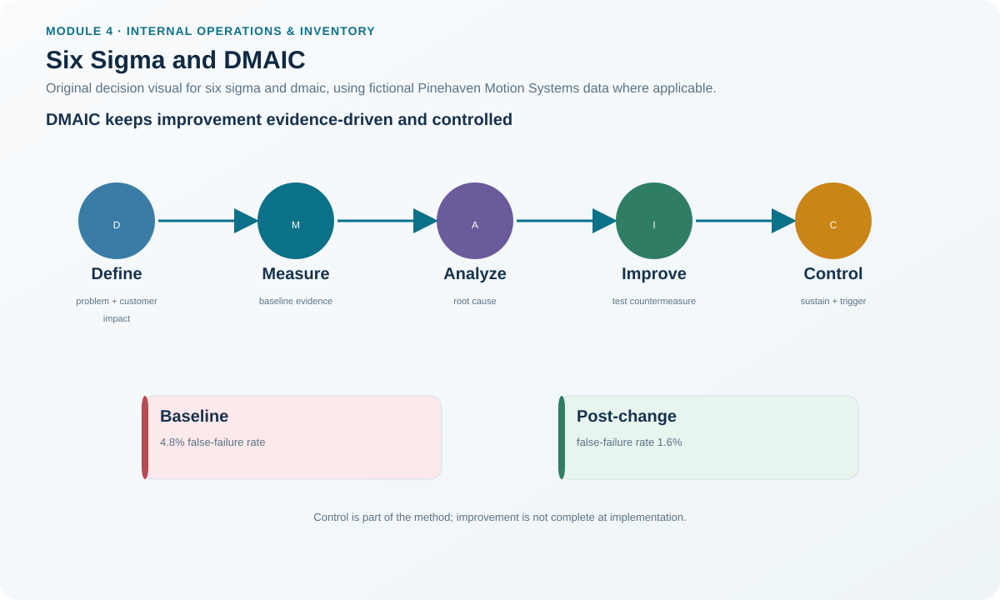
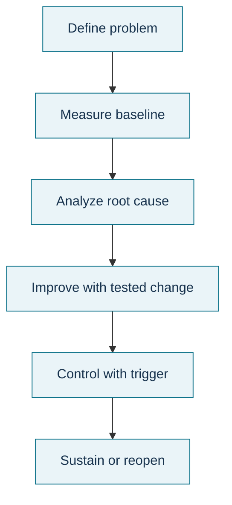

# 14. Six Sigma and DMAIC

## Learning objectives

After this topic, you should be able to:

- explain the customer, process, and employee dimensions of Six Sigma;
- define defects and opportunities carefully enough to make measurement meaningful;
- apply the DMAIC sequence to an existing process; and
- distinguish DMAIC improvement from uncontrolled solution jumping.

## Concept in plain English

Six Sigma is a disciplined approach to process improvement that aims to reduce defects and variation. The famous reference point is about **3.4 defects per million opportunities** under the conventional six-sigma model, but the more important lesson is disciplined definition and measurement. A “defect” must be tied to a customer requirement, and an “opportunity” must be defined consistently. If the team changes those definitions to make the number look better, the statistical language becomes meaningless.

Three elements matter: the **customer**, who defines acceptable performance; the **process**, whose steps and variation create the outcome; and the **employee**, whose participation and skills make improvement possible.

For an existing process, DMAIC provides the improvement sequence: **Define** the problem and customer requirement, **Measure** reliable baseline data, **Analyze** root causes, **Improve** the process with tested changes, and **Control** the improved state until it becomes normal performance. New-process design can use a related DMADV sequence, but this lesson keeps the focus on DMAIC.

## Why it matters

Teams often skip from a problem statement to an attractive solution. DMAIC forces the measurement system, baseline, and cause evidence to be strong enough that the improvement can be attributed to a controlled change. It also prevents the project from ending at implementation; the control phase checks whether the result is sustained.

## Decision model and workflow

### Evidence retained through the workflow

Retain the customer-critical requirement, defect/opportunity definitions, project charter, baseline, measurement-system evidence, data, root-cause analysis, tested improvements, risk assessment, control plan, before/after result, ownership, and reaction plan.

## Practical process flow

## Realistic example — Pinehaven Motion Systems

Pinehaven's fictional DMAIC case starts with a **4.8% false-failure rate** at Burn-in Test. Analysis points to fixture-contact resistance drifting after repeated thermal cycles. The improvement introduces scheduled contact replacement and a resistance check. Accepted throughput improves from **140 to 149 units/day**, and the false-failure rate falls to **1.6%**.

The improvement is not accepted merely because the post-change number is better. The control plan uses a weekly resistance chart and an action rule for consecutive points outside the defined limit. A second Pinehaven case reduces label mismatches from **11 to 3 per 1,000 units** using a scan-to-print rule tied to the production order.

Use [`improvement-projects.csv`](../../assets/data/module-4/improvement-projects.csv).

All names and values in this example are fictional and independently selected for learning purposes.

## Applied decision artifact

Create a **DMAIC project record**. Define: customer/CTQ requirement, problem and business case, scope, defect and opportunity definitions, baseline, measurement method, root-cause evidence, tested improvement, before/after comparison, control metric, trigger, owner, and handoff to standard work. The project cannot pass Measure if the data definition is unstable, or Control if no reaction plan exists.

## Decision logic

- Define the customer-relevant defect before collecting performance statistics.
- Verify the measurement process and baseline.
- Analyze causes using data and appropriate quality tools.
- Test improvement against the root cause rather than changing many variables at once without learning.
- Control the new process with an owner, metric, limit/trigger, and reaction plan.
- Reopen analysis when the process drifts or customer requirements change.

## Trade-offs

Rigorous data collection increases confidence but adds time and cost. Aggressive defect goals can drive improvement but can also encourage gaming if defect/opportunity boundaries are vague. Statistical sophistication is useful only when the data and process definitions are sound.

## Commonly confused with

**DMAIC** improves an existing process. **DMADV** is commonly used to design a new process or offering when improvement of the existing design is not the main task. Six Sigma is broader than a control chart; SPC can be one tool inside Measure/Analyze/Control.

## Common mistakes

- Defining an “opportunity” so broadly or narrowly that the DPMO result becomes misleading.
- Skipping measurement-system validation.
- Selecting the solution during Define and using later phases only to justify it.
- Ending the project after Improve without a control plan.
- Assuming a lower average is sufficient when variability remains unstable.

## Original knowledge check

**Question.** A DMAIC team has installed a new fixture and the defect rate improved for one week. What must happen before the project is considered sustained?

A. Close immediately because Improve is complete.

B. Establish and operate the Control plan with monitoring and reaction rules.

C. Remove all measurement to avoid tampering.

D. Convert the project to ABC inventory analysis.

Answer and rationale

### Correct answer

**B. Establish and operate the Control plan with monitoring and reaction rules.**

### Why it is correct

DMAIC ends with Control, which verifies that the improved process remains stable and that owners know how to react when performance drifts.

### Why the other answers are wrong

- **A.** One week of improvement is not sustainment evidence.
- **C.** Removing measurement eliminates the control mechanism.
- **D.** ABC analysis is unrelated to the process-control requirement.

## Practitioner perspective

The strongest DMAIC records are reproducible: another analyst can recompute the baseline, trace the cause evidence, understand the change, and see exactly which control triggers reopen the problem.

## Related concepts

- [Just-in-Time Production and Pull Execution](./13-just-in-time-production-and-pull-execution.md)
- [Theory of Constraints and Drum-Buffer-Rope](./15-theory-of-constraints-and-drum-buffer-rope.md)
- [Internal Operations and Inventory Formula Sheet](../../calculations/internal-operations/formula-sheet.md)

---

[Previous](./13-just-in-time-production-and-pull-execution.md) · [Next](./15-theory-of-constraints-and-drum-buffer-rope.md)
