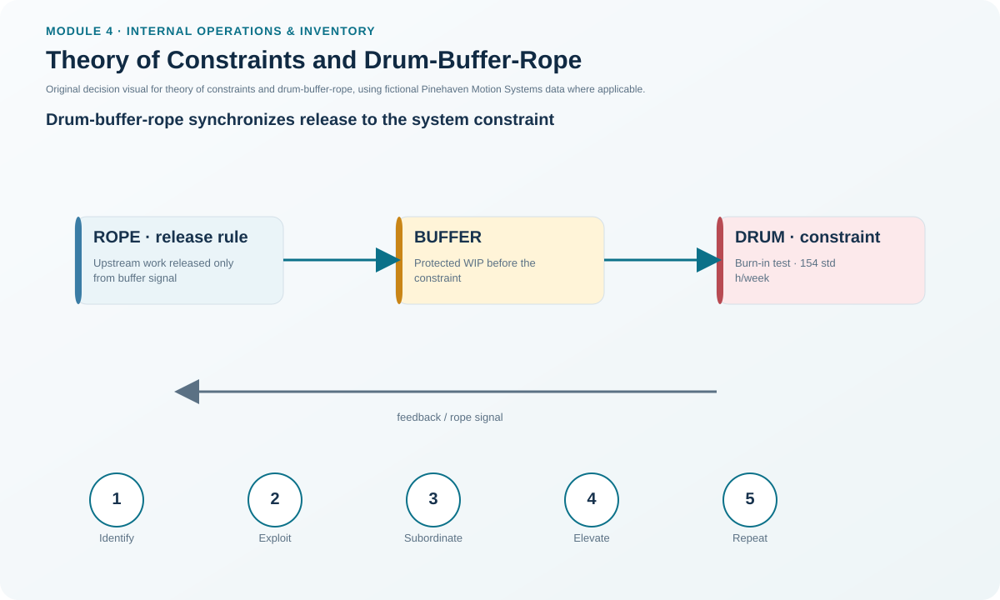
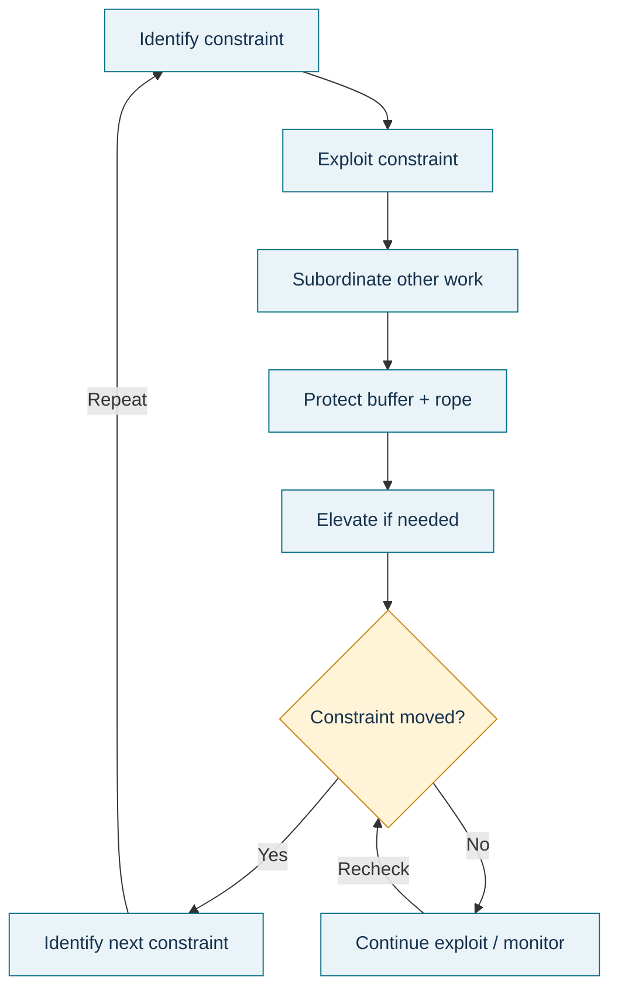

# 15. Theory of Constraints and Drum-Buffer-Rope

## Learning objectives

After this topic, you should be able to:

- explain why a system constraint determines maximum throughput;
- apply the five focusing steps of the theory of constraints (TOC);
- describe drum-buffer-rope as a synchronized release-control concept; and
- explain why the constraint can move after improvement.

## Concept in plain English

The theory of constraints starts from a system view: at least one factor limits the system's ability to achieve more of its goal. Improving a nonconstraint faster than the constraint may increase local output or WIP without increasing final throughput. TOC therefore focuses improvement on the limiting point.

The five focusing steps are cyclical: **identify the constraint, exploit it using existing capability, subordinate other activity to its needs, elevate it if more capacity is still required, and repeat because the constraint may move**. A constraint can be equipment, labor, material, policy, knowledge, or another limiting factor.

**Drum-buffer-rope (DBR)** converts the idea into flow control. The constraint sets the pace (drum). A carefully controlled time/material buffer protects it from starvation. Release upstream is synchronized by the rope so work enters the system at a rate that supports the constraint rather than flooding the system with excess WIP.

## Why it matters

Traditional local efficiency metrics can cause every resource to produce as fast as possible. If one step is slower, the result is a growing queue, not more customer output. TOC makes the system objective explicit and helps management invest improvement effort where it can change throughput.

## Decision model and workflow

### Evidence retained through the workflow

Retain the system goal, constraint evidence, queue/load and throughput, exploit actions, subordinate/release rules, buffer definition and status, elevation business case, before/after throughput, WIP/service result, and evidence of the next constraint.

## Practical process flow

## Realistic example — Pinehaven Motion Systems

Pinehaven's fictional TOC case identifies Burn-in Test at **144 standard hours/week demonstrated capacity**. Upstream assembly is releasing **410 standard hours/week** against the protected test constraint, creating excess WIP without more customer throughput.

Pinehaven applies a controlled buffer and ties upstream release to the test-cell pace. After improvement, Burn-in capability rises to **154 standard hours/week** while upstream released work is reduced from **410 to 365 standard hours/week**. The dataset records that WIP falls while accepted throughput increases.

The next action is not to declare TOC finished. Pinehaven checks where the new constraint has moved and repeats the focusing cycle. See [`improvement-projects.csv`](../../assets/data/module-4/improvement-projects.csv).

All names and values in this example are fictional and independently selected for learning purposes.

## Applied decision artifact

Use a **TOC constraint log and DBR control sheet** with system goal, current constraint, evidence, drum rate, buffer size/status, rope release trigger, exploit actions, subordinate rules, elevation decision, throughput before/after, WIP before/after, and next-constraint review. Buffer color or status must have a defined action, not just a dashboard display.

## Decision logic

- Identify the resource or policy actually limiting system throughput.
- Exploit the constraint before spending capital.
- Subordinate upstream/downstream behavior so the constraint is protected and not buried in excess work.
- Elevate only when existing methods cannot meet the required system output.
- After improvement, find the new constraint and repeat.
- Keep the drum pace aligned with customer demand; increasing constraint speed beyond needed demand can create overproduction.

## Trade-offs

A protective buffer prevents constraint starvation but creates some intentional WIP. Too small a buffer increases starvation risk; too large a buffer hides problems and lengthens flow. Elevation can raise throughput but requires capital or structural change, so exploit/subordinate actions should be tested first.

## Commonly confused with

A **bottleneck/constraint** is the factor limiting system performance relative to the goal. A resource can be highly utilized without being the true system constraint. TOC also differs from general capacity planning: it focuses on the system's limiting factor and synchronization, not only on aggregate capacity sufficiency.

## Common mistakes

- Improving every resource equally.
- Keeping nonconstraints busy even when they create WIP.
- Adding a buffer with no defined target/status/release rule.
- Elevating capacity before exploiting the existing constraint.
- Failing to repeat the cycle after the original constraint is improved.

## Original knowledge check

**Question.** Pinehaven increases Burn-in Test capacity enough that Final Assembly becomes the new limiter. What should TOC do next?

A. Keep focusing only on Burn-in forever.

B. Repeat the cycle and identify/exploit the new constraint.

C. Increase all upstream release immediately.

D. Eliminate every buffer regardless of variability.

Answer and rationale

### Correct answer

**B. Repeat the cycle and identify/exploit the new constraint.**

### Why it is correct

TOC is a repeating improvement cycle. Once the original constraint is elevated, another factor can become the system limit and must be addressed next.

### Why the other answers are wrong

- **A.** The constraint has moved, so continuing to optimize the old constraint alone is suboptimization.
- **C.** More release can create WIP if the new constraint cannot absorb it.
- **D.** Buffers should be managed to protect flow, not removed blindly.

## Practitioner perspective

Use TOC with capacity, lean, and quality data together. A “constraint” identified from a queue should be tested for root cause: the real limiter might be equipment capacity, setup loss, quality rework, material shortage, schedule policy, or an approval rule.

## Related concepts

- [Six Sigma and DMAIC](./14-six-sigma-and-dmaic.md)
- [Internal Operations and Inventory Formula Sheet](../../calculations/internal-operations/formula-sheet.md)

---

[Previous](./14-six-sigma-and-dmaic.md) · [Section review](./16-section-d-review.md)
