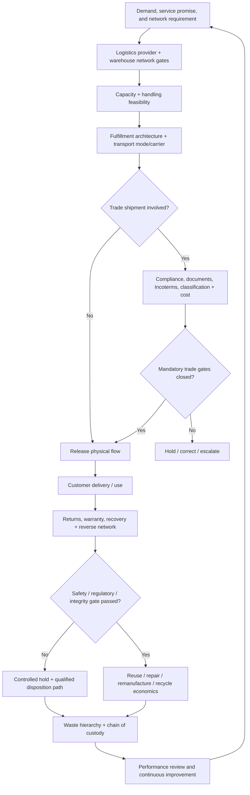

# HarborPeak Network, Trade, and Reverse-Flow Stabilization Decision

## Decision context

HarborPeak Equipment Systems has grown beyond the point where warehousing, fulfillment, transportation, international trade, and returns can be optimized independently. Leadership is preparing a two-year logistics stabilization program while also approving the next warehouse-capacity horizon through 2031.

The company wants a decision that preserves customer service and compliance without turning every requirement into excess cost. The team must therefore apply **mandatory gates first** and rank only the alternatives that remain feasible.

All organizations, sites, products, lanes, trade cases, values, returns, and waste streams in this case are fictional and independently created for learning purposes.

## End-to-end decision flow

## Source data

Use the locked HarborPeak datasets. Do not invent replacement values unless the task explicitly asks for a sensitivity case.

### Section A — logistics, warehousing, handling, and capacity

- [Logistics strategy](../../assets/data/module-5/logistics-strategy.csv)
- [Warehouse network](../../assets/data/module-5/warehouse-network.csv)
- [Warehouse capacity](../../assets/data/module-5/warehouse-capacity.csv)
- [Materials handling](../../assets/data/module-5/material-handling.csv)
- [Transportation capacity](../../assets/data/module-5/transportation-capacity.csv)

### Section B — execution, fulfillment, distribution, modes, and carriers

- [Warehouse operations](../../assets/data/module-5/warehouse-operations.csv)
- [Fulfillment strategies](../../assets/data/module-5/fulfillment-strategies.csv)
- [Distribution networks](../../assets/data/module-5/distribution-networks.csv)
- [Transport-mode selection](../../assets/data/module-5/transport-mode-selection.csv)
- [Carrier options](../../assets/data/module-5/carrier-options.csv)

### Section C — trade readiness and cross-border economics

- [Trade-compliance register](../../assets/data/module-5/trade-compliance-register.csv)
- [Incoterms decision cases](../../assets/data/module-5/incoterms-decision-cases.csv)
- [Border-cost and classification cases](../../assets/data/module-5/border-cost-classification-cases.csv)

### Section D — returns, recovery, and waste

- [Reverse-flow cases](../../assets/data/module-5/reverse-flow-cases.csv)
- [Reverse-cost cases](../../assets/data/module-5/reverse-cost-cases.csv)
- [Waste-disposition cases](../../assets/data/module-5/waste-disposition-cases.csv)

Use the [Logistics, Trade, and Reverse-Flow Formula & Control Sheet](../../calculations/logistics-trade-reverse/formula-sheet.md) for controlled calculation definitions.

## Controlled assumptions

Use these capstone assumptions only for this fictional decision:

- A logistics-provider alternative must have a **PASS capability gate**. Cost cannot rescue a failed capability gate.
- The warehouse-network design must cover **100% of modeled demand**, have PASS labor/regulatory flags at every included node, and achieve a service-weighted response time of **2.0 days or less**.
- For the core B2B + e-commerce fulfillment flow, HarborPeak requires **service score 5** and average lead time of **2.0 days or less**.
- The new outbound carton-handling cell needs at least **500 units/hour** and must have both safety and capability gates at PASS. Select the least-capital option that meets the requirement unless a sensitivity case changes the requirement.
- A carrier must first pass its structural gate. The focal contracted lane also requires multi-region reach and equipment-fit score 5.
- A transport alternative with a service gate other than PASS is not ranked against PASS alternatives for the base decision.
- Negative transportation-capacity gaps must be corrected before a lane is called ready.
- Trade compliance and document completeness are hard gates. The modeled tariff/classification codes and rates are synthetic training inputs, not real tariff advice.
- Incoterms® selection in the case uses the stated training facts; the live legal, tax, title, payment, sanctions, and licensing consequences would require separate current verification.
- A regulatory, hazardous-material, e-waste, product-integrity, or chain-of-custody flag is resolved **before** economic disposition ranking.
- The reverse-logistics economic result uses the formula sheet and includes the dataset's estimated service/warranty benefit only as a modeled scenario input.

## Assignment

Prepare one executive decision pack addressing the following seven tasks.

### 1. Select the forward-logistics operating structure

Use `logistics-strategy.csv` to rank the feasible internal/3PL/4PL alternatives. Then aggregate `warehouse-network.csv` by network option and calculate annual transport + inventory + overhead cost, service-weighted response time, and service-weighted service score. Apply the capstone gates before comparing costs.

State:

- the recommended logistics-provider model;
- the recommended warehouse-network pattern;
- the strongest rejected alternatives; and
- the annual cost/service trade-off you are deliberately accepting.

### 2. Validate space, handling, and lane capacity

Reproduce the warehouse-space requirement for 2030. Explain why the 2031 requirement can fall even though forecast inventory cube rises. Select a base material-handling option for the new outbound carton cell using the 500-unit/hour threshold.

Then identify every transportation lane whose reserved capacity is below required capacity and define the immediate corrective action.

### 3. Design fulfillment, distribution, mode, and carrier choices

Select the core B2B + e-commerce fulfillment strategy using the service gate. Use `warehouse-operations.csv` to identify where cross-dock/postponement activities create a different execution path from normal receive-put-away-pick-pack flow.

For each shipment in `transport-mode-selection.csv`, select the lowest-cost PASS option. Select the focal carrier for the contracted multi-region lane after applying the structural/geographic/equipment gates.

### 4. Release—or hold—the cross-border flow

Use the trade-compliance register to identify the shipment that must not be loaded in its current state and explain the closure evidence required.

For IC-01, state the training Incoterms® rule and named place and explain the key responsibility logic. For BC-01, independently reproduce the modeled duty and landed cost. Clearly separate the fictional arithmetic from current-law verification.

### 5. Design the reverse-flow response

Calculate the return rate for each product in `reverse-flow-cases.csv`. Use `reverse-cost-cases.csv` to calculate the economic result and result per returned unit for each product line.

Identify:

- which reverse-cost line is positive under the modeled assumptions;
- which negative lines need redesign rather than simple acceptance; and
- which product-level return cases have a regulatory/e-waste flag that prevents a purely economic disposition decision.

### 6. Apply the waste hierarchy and custody gates

For every row in `waste-disposition-cases.csv`, identify the highest practical hierarchy level stated in the data. Explain why WD-04 and WD-07 require a legal/safety review before the economic attractiveness of a recovery route matters.

Define the minimum chain-of-custody evidence HarborPeak should retain for a controlled waste/recovery movement.

### 7. Present the stabilization plan and run a decision-changing sensitivity

Create a 30/60/90-day plan with named owners, measures, thresholds, and escalation triggers.

Run this sensitivity: **the planned fifth vertical storage level for 2031 is not available, so usable storage levels remain at four while all other 2031 data stay unchanged.** Recalculate the 2031 total required area and state whether that changes the facility decision.

## Required executive decision record

| Field | Required content |
|---|---|
| Decision | Choice, scope, and accountable owner |
| Mandatory gates | Service, capability, safety, legal, integrity, or custody conditions that must pass |
| Evidence | Dataset, calculation, horizon, and assumptions |
| Alternative | Strongest rejected option and why it loses after gates |
| Economic effect | Cost, recovery, or investment consequence where quantifiable |
| Customer/operating effect | Response time, capacity, handling, continuity, or reverse-flow consequence |
| Trigger | Condition that forces re-evaluation or replanning |
| Control | Metric, threshold, evidence owner, and review cadence |

## Submission quality gates

A complete submission must:

- reproduce every quoted calculated result from the linked datasets;
- apply hard gates before weighted or cost ranking;
- avoid combining costs from datasets that represent different scopes as though they were additive;
- keep training trade arithmetic separate from current legal/tariff guidance;
- distinguish delivery/cost obligations under an Incoterms® rule from title/payment/legal compliance;
- avoid treating a positive reverse-recovery value as permission to bypass a regulatory or safety hold;
- show the 2031 storage-level sensitivity calculation; and
- end with owned implementation controls rather than a list of activities.

## Capstone knowledge checks

### Question 1

**Question.** BudgetFreight shows the lowest total logistics cost in the provider dataset, but its capability gate is FAIL. What is the correct base-case action?

A. Select BudgetFreight because cost is the primary logistics objective

B. Remove BudgetFreight from economic ranking until the failed capability gate is resolved

C. Average its capability score with its cost advantage

D. Select it only for international shipments

Answer and rationale

### Correct answer

**B. Remove BudgetFreight from economic ranking until the failed capability gate is resolved.**

### Why it is correct

The capstone explicitly treats capability as a mandatory gate. A failed gate cannot be offset by a lower modeled cost.

### Why the other answers are wrong

A reverses the gate logic, C converts a mandatory condition into a weighted preference, and D invents a scope exception that is not supported by the data.

### Question 2

**Question.** Supplier Bay-Cedar requires 705 units/week but has 690 units/week reserved. What is the planning implication?

A. It has 15 units/week spare capacity

B. It has a 15-unit/week shortfall that must be closed before the lane is called ready

C. It is ready because 690 is close to 705

D. The shortage can be ignored if another lane has spare capacity

Answer and rationale

### Correct answer

**B. It has a 15-unit/week shortfall that must be closed before the lane is called ready.**

### Why it is correct

The capacity gap is reserved minus required capacity: `690 − 705 = −15 units/week`.

### Why the other answers are wrong

A reverses the sign, C ignores a mandatory capacity condition, and D assumes capacity is transferable between lanes without evidence.

### Question 3

**Question.** TC-007 has critical compliance risk, a REVIEW restricted-goods screen, and incomplete markings. What should occur first?

A. Load the shipment and close the paperwork in transit

B. Compare brokers by price

C. Hold loading until the restricted-product and marking review is closed with evidence

D. Change the Incoterms® rule

Answer and rationale

### Correct answer

**C. Hold loading until the restricted-product and marking review is closed with evidence.**

### Why it is correct

The compliance and document gates precede transport or commercial optimization.

### Why the other answers are wrong

A releases an unresolved critical risk, B ranks economics before compliance, and D changes contractual responsibilities without curing the underlying restriction/marking issue.

### Question 4

**Question.** RC-03 has a negative modeled reverse-logistics economic result, while RF-04 also carries a battery/e-waste review flag. Which statement is strongest?

A. Dispose immediately because the economics are negative

B. Ignore the regulatory flag because the recovery case is already unattractive

C. Resolve the regulatory and product-integrity route first, then optimize the economics within the permitted alternatives

D. Resell every returned battery module to eliminate the loss

Answer and rationale

### Correct answer

**C. Resolve the regulatory and product-integrity route first, then optimize the economics within the permitted alternatives.**

### Why it is correct

A regulatory/safety gate determines which dispositions are feasible. Economics can rank only the permitted routes.

### Why the other answers are wrong

A and B bypass the mandatory gate, while D assumes reuse suitability without engineering or compliance evidence.

### Question 5

**Question.** Why can the 2031 required warehouse area increase sharply in the sensitivity even though the base dataset shows a lower area than 2030?

A. Because removing one usable storage level reduces vertical cube utilization and increases floor-area need

B. Because annual transport cost is added to floor area

C. Because service score is converted into square meters

D. Because the tariff rate changes

Answer and rationale

### Correct answer

**A. Because removing one usable storage level reduces vertical cube utilization and increases floor-area need.**

### Why it is correct

The warehouse formula divides handling-adjusted footprint by usable storage levels before applying the target-utilization allowance. Losing a planned level increases the floor area required for the same inventory cube.

### Why the other answers are wrong

B, C, and D mix unrelated cost, service, and trade variables into a physical-capacity calculation.

---

[Module overview](../README.md) · [Open the worked solution only after completing the assignment](./solution-guide.md)