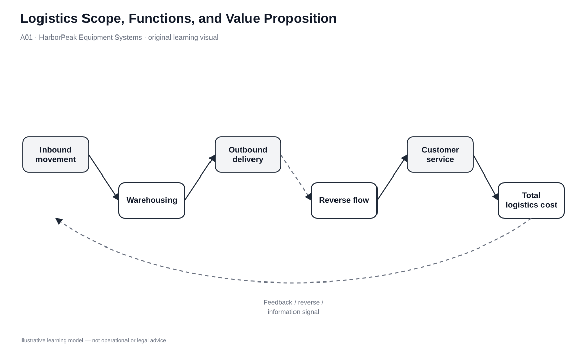

# 1. Logistics Scope, Functions, and Value Proposition

## Learning objectives

After this topic, you should be able to:

- explain where logistics sits inside end-to-end supply chain management;
- identify the core physical and information activities that logistics must coordinate;
- describe logistics service in terms of complete, correct, damage-free, timely delivery; and
- apply the total cost concept instead of optimizing one logistics expense in isolation.

## Concept in plain English

Logistics is the part of supply chain management that makes physical flow work. It coordinates the movement, handling, and storage of materials and finished products from origin through distribution, while also supporting reverse movement when products come back. In practice, that means transportation and warehousing are central, but packaging, materials handling, import/export activity, inventory positioning, and logistics information all influence the result.

A useful way to think about logistics is not “move it as fast as possible” or “move it as cheaply as possible.” The real job is to provide the required customer service at the lowest **total** logistics cost that can support that service. A very cheap transportation choice can be a poor logistics choice if it forces larger inventories, creates damage, or misses a customer’s required date. Likewise, premium transportation is wasteful when the customer gains no value from the extra speed.

## Why it matters

Logistics decisions connect functions that are often measured separately. Transportation may be rewarded for low freight spend, warehousing for high utilization, inventory for low carrying cost, and customer service for fast response. Those local goals can conflict. A supply chain performs better when the decision is made around the customer requirement and the combined economic effect.

This also explains why logistics can create competitive advantage. A customer that receives the right quantity, in usable condition, when promised, with reliable information has less need to protect itself with extra inventory or emergency action. Reliability therefore has economic value, not just service value.

## Decision model and workflow

| Decision element | Section A application |
|---|---|
| Boundary | Forward/reverse movement, handling, storage, and related logistics information. |
| Primary inputs | Customer service requirement, product characteristics, demand pattern, network design, current cost. |
| Hard gate | The proposed design must meet the agreed service requirement. |
| Owner | Logistics leader with cross-functional input from planning, sales, finance, sourcing, and operations. |
| Output | Documented service promise plus total-logistics-cost view and accountable operating model. |

### Evidence retained through the workflow

| Evidence | Why retain it |
|---|---|
| Customer service requirement | Defines what the logistics system is actually expected to deliver. |
| Cost-by-function baseline | Prevents a “saving” in one function from hiding a larger increase elsewhere. |
| Failure impact | Shows when premium service is justified because a logistics failure would be costly to the customer. |
| Network assumptions | Makes warehouse, transportation, inventory, and information dependencies visible. |

## Practical process flow

This lesson establishes the system boundary and value logic rather than a step-by-step operating procedure. The original visual is therefore the primary model; later lessons introduce operational flows for coordination, outsourcing, warehousing, and transportation decisions.

## Original visualization

The visual places the logistics decision at the center and shows the connected flows rather than presenting warehousing or transportation as stand-alone silos. The circular relationship is intentional: changes in one logistics element can move cost, service, inventory, and risk elsewhere.

## Realistic example — HarborPeak Equipment Systems

HarborPeak sells connected commercial power tools through industrial distributors, retail partners, and direct e-commerce. A distributor that stocks a critical controller used in field repairs values delivery reliability more than a consumer buying a nonurgent accessory. HarborPeak therefore should not apply one blanket “fastest possible” logistics standard. For the critical controller, a failure may stop customer operations and justify a more responsive transport plan. For the accessory, the same premium service may add cost without meaningful customer benefit.

The logistics team starts by defining the service need, then designs the warehouse and transportation choices that can meet it. Finance is included because inventory carrying cost and service-failure exposure belong in the same decision.

## Applied decision or worked calculation

The locked [`logistics-strategy.csv`](../../assets/data/module-5/logistics-strategy.csv) illustrates why total cost matters. HarborPeak’s internal model totals **$8.97 million** across transportation, warehousing, inventory, and modeled failure exposure. The three externally managed alternatives total approximately **$8.39 million**, **$8.07 million**, and **$7.90 million** respectively.

The $7.90 million option is not automatically best: it is marked as failing the capability gate and is modeled at a lower service target. Once the service/capability boundary is applied, the lowest qualified cost in the dataset is the Northstar 4PL scenario at **$8.07 million**. The exercise is not a recommendation to outsource; it demonstrates the sequence **service feasibility first, total cost second**.

Dataset: [`logistics-strategy.csv`](../../assets/data/module-5/logistics-strategy.csv)

## Decision logic

- Define the customer/service outcome before choosing the asset or provider.
- Treat warehousing, transportation, inventory, handling, and service-failure effects as one economic system.
- Compare alternatives only when they satisfy the same mandatory service boundary.
- Escalate a “cheap” option that shifts cost or risk to another function instead of calling it a saving.
- Revisit the service/cost balance when customer importance, product risk, demand pattern, or network structure changes.

## Trade-offs

| Tension | Decision implication |
|---|---|
| Service vs. cost | Higher service can be valuable, but only when the customer or risk exposure justifies the extra total cost. |
| Local efficiency vs. system efficiency | A lower freight rate can create more inventory, handling, or service cost. |
| Speed vs. reliability | The fastest mode is not useful if reliability, damage control, or information quality is poor. |

## Commonly confused with

**Logistics** is narrower than **supply chain management**. Supply chain management also coordinates sourcing, planning, production, relationships, risk, and other end-to-end decisions. Logistics is the flow-and-storage discipline inside that larger system.

## Common mistakes

- Treating lowest freight cost as lowest logistics cost.
- Assuming faster transportation is always better customer service.
- Ignoring packaging, inventory, and handling effects when redesigning distribution.
- Measuring every logistics function separately without a shared customer outcome.
- Comparing alternatives that do not deliver the same service level.

## Original knowledge check

**Question.** HarborPeak can save $120,000 in annual line-haul expense by switching to a slower carrier, but doing so would require $180,000 of extra inventory and adds $60,000 of modeled service-failure exposure. Which principle should govern the decision?

A. Choose the lower freight rate because transportation owns the budget

B. Evaluate the combined service and total-logistics-cost effect

C. Choose the fastest carrier regardless of cost

D. Increase warehouse utilization before reviewing the change

Answer and rationale

### Correct answer

**B. Evaluate the combined service and total-logistics-cost effect**

### Why it is correct

The isolated freight saving is smaller than the downstream inventory and failure exposure created by the change. Logistics should compare the complete system effect at the required service level.

### Why the other answers are wrong

- **A.** This optimizes a functional budget while ignoring the larger system cost.

- **C.** Speed by itself is not the objective; the service requirement and economics determine the appropriate response.

- **D.** Warehouse utilization does not answer whether the transportation change creates value.

## Practitioner perspective

In an ERP/TMS/WMS environment, the hardest part is often not recording freight or inventory transactions; it is connecting them into one decision model. When a business case claims a logistics saving, ask which service assumption, inventory consequence, handling change, and exception cost were included. If those items are missing, the business case is probably measuring a function rather than the supply chain.

## Related concepts

- [Logistics Objectives, Tactics, and Cross-Functional Coordination](./02-logistics-objectives-tactics-and-cross-functional-coordination.md)
- [Warehouse Network Count and Location Decisions](./06-warehouse-network-count-and-location-decisions.md)
- [Transportation Strategy](./11-transportation-strategy-product-movement-and-temporary-storage.md)
- [Module 2 — network design and performance](../../02-network-design-digital-connectivity-performance/)

---

[Previous: Section A overview](./README.md) · [Section overview](./README.md) · [Next: Logistics Objectives, Tactics, and Cross-Functional Coordination](./02-logistics-objectives-tactics-and-cross-functional-coordination.md)