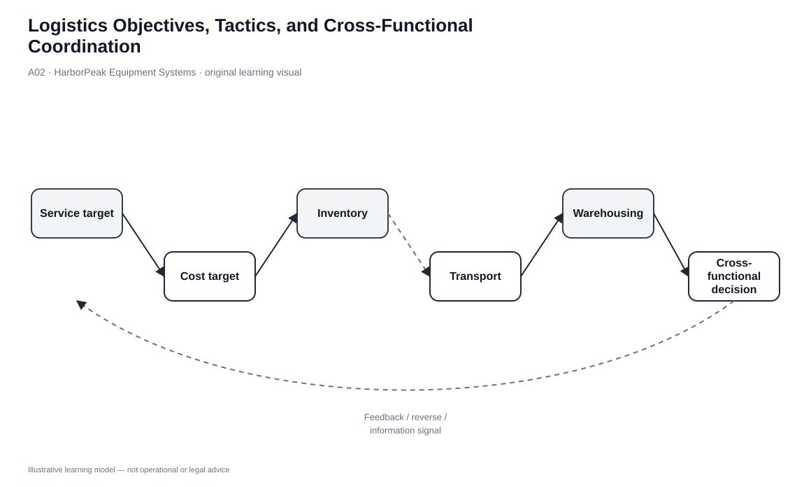
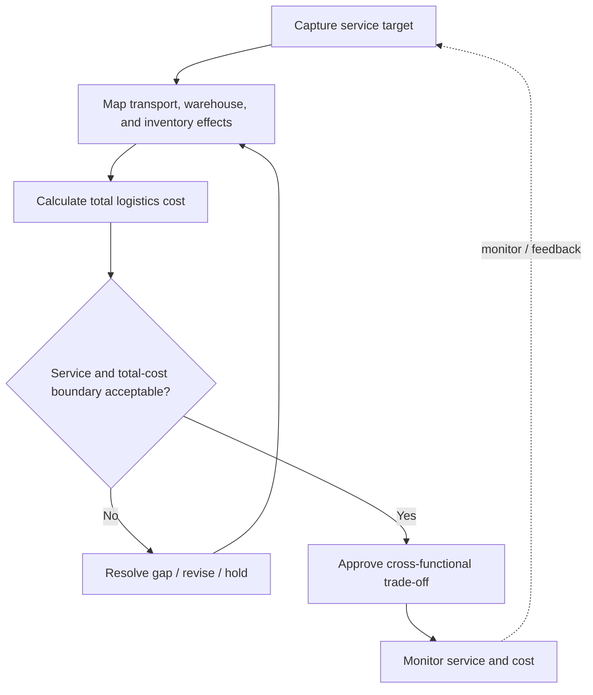

# 2. Logistics Objectives, Tactics, and Cross-Functional Coordination

## Learning objectives

After this topic, you should be able to:

- explain the main operating objectives of a logistics system;
- connect those objectives to coordination, integration, information, partner, and risk-pooling tactics;
- identify cross-functional trade-offs before they become local optimization; and
- use service gates before ranking logistics alternatives by cost.

## Concept in plain English

A strong logistics strategy converts customer requirements into a set of operating objectives and then uses coordinated tactics to achieve them. The objectives include rapid response, consistent service, controlled inventory, shipment consolidation, quality improvement, and support across the product life cycle. These objectives can pull in different directions. Frequent shipments can improve response but increase transportation expense. Consolidation can reduce unit freight cost but lengthen waiting time. Extra inventory can protect service but consumes cash and space.

The solution is cross-functional coordination. Logistics decisions should be made with a shared view of demand, inventory, warehouse capacity, transportation, service risk, and product-life-cycle needs. The purpose of coordination is not to eliminate trade-offs; it is to make them visible and choose them deliberately.

## Why it matters

Without explicit trade-off governance, departments can hit their own KPIs while damaging overall performance. A transportation team may wait to build a full load; customer service may then expedite a second shipment to recover the missed promise. Both actions can look rational locally, yet the combined result is more expensive than a planned middle ground.

A decision record also matters because logistics conditions change. A choice that was sensible at one demand level or service promise may become wrong after a promotion, new customer segment, or network redesign.

## Decision model and workflow

| Decision element | Section A application |
|---|---|
| Boundary | Service, inventory, transportation, warehousing, quality, and life-cycle effects considered together. |
| Inputs | Customer promise, demand/forecast, logistics costs, inventory exposure, failure consequence. |
| Gate | Mandatory service and capability requirements pass before cost ranking. |
| Owner | Cross-functional logistics decision team. |
| Output | Approved trade-off with assumptions, owner, trigger, and monitoring measures. |

### Evidence retained through the workflow

| Evidence | Why retain it |
|---|---|
| Service target | Prevents low-cost options from being compared as if they were equivalent when service differs. |
| Cost decomposition | Shows where a change moves expense instead of removing it. |
| Inventory implication | Makes hidden working-capital and space effects visible. |
| Exception history | Identifies whether the proposed design is robust or depends on repeated expediting. |

## Practical process flow

## Original visualization

The decision matrix separates objectives from tactics. The point is not to maximize every objective simultaneously; it is to choose a coherent combination. The operating flow then forces HarborPeak to calculate the system impact, reject alternatives outside the service boundary, and monitor the approved trade-off after implementation.

## Realistic example — HarborPeak Equipment Systems

HarborPeak’s e-commerce team wants next-day service for a new promotion. Transportation proposes reserving premium capacity. Warehousing proposes positioning extra finished goods near the target market. Finance wants to minimize inventory. The right answer is not determined by any one function. The team must model demand uplift, available capacity, delivery promise, inventory cost, and failure exposure together.

If the promotion is temporary, reserving short-term carrier capacity might be better than creating permanent inventory or a new facility. If the demand pattern persists, a network or inventory-positioning decision may become more appropriate. Coordination determines which lever matches the duration and cause of the requirement.

## Applied decision or worked calculation

Using the locked strategy dataset, the four modeled total logistics costs are:

| Alternative | Modeled total logistics cost | Gate |
|---|---:|---|
| HarborPeak internal network | $8.97M | PASS |
| BlueHarbor 3PL regional | $8.39M | PASS |
| Northstar 4PL orchestrated | $8.07M | PASS |
| BudgetFreight 3PL basic | $7.90M | **FAIL** |

The apparent lowest-cost alternative fails the capability boundary. It therefore cannot win a weighted price comparison until the gap is resolved. Among the qualified options, Northstar is the lowest modeled total cost, but a real decision would still require contract, control, risk, and implementation evidence.

Dataset: [`logistics-strategy.csv`](../../assets/data/module-5/logistics-strategy.csv)

## Decision logic

- Write the service target and hard requirements first.
- Map how each option changes transportation, warehousing, inventory, and failure exposure.
- Reject options that fail mandatory service/capability requirements.
- Compare total cost only among feasible choices.
- Assign an owner and review trigger so the trade-off is revisited when conditions change.

## Trade-offs

| Tension | Decision implication |
|---|---|
| Shipment consolidation vs. response | Waiting for a larger load reduces unit freight cost but can lengthen customer lead time. |
| Inventory minimization vs. resilience | Lower inventory reduces cost but leaves less protection against variability. |
| Standardization vs. segment service | One service model is easier to manage, but high-impact customers may require differentiated treatment. |

## Commonly confused with

**Coordination** is not the same as **centralization**. A logistics process can be decentralized operationally while still using shared service standards, data, and decision rules. The objective is aligned decisions, not necessarily one physical location or one manager.

## Common mistakes

- Using one KPI, such as freight cost per unit, to decide a multi-function issue.
- Allowing a weighted score to compensate for a failed mandatory requirement.
- Treating a one-time promotion as evidence for a permanent network change.
- Approving a trade-off without documenting the condition that would trigger a review.

## Original knowledge check

**Question.** A 3PL proposal has the lowest total modeled cost but cannot meet HarborPeak’s mandatory two-day service requirement for a critical customer segment. What should the team do first?

A. Accept it because total cost is lowest

B. Exclude or redesign the option until the service gate passes

C. Increase the weight of cost in the scorecard

D. Average the 3PL service with the internal network service

Answer and rationale

### Correct answer

**B. Exclude or redesign the option until the service gate passes**

### Why it is correct

A mandatory service requirement is a gate, not a preference. Weighted scoring is appropriate only after the option is feasible.

### Why the other answers are wrong

- **A.** Lowest cost does not make an infeasible service design acceptable.

- **C.** Changing weights cannot legitimately override a mandatory constraint.

- **D.** Averaging service results does not make the proposed operating model meet the customer promise.

## Practitioner perspective

When supply chain teams struggle with “cost versus service,” the problem is often that service has not been defined precisely. Translate service into measurable terms—lead time, completeness, damage rate, reliability, and exception response—then analyze the total economic consequences. This makes the discussion operational rather than philosophical.

## Related concepts

- [Logistics Scope, Functions, and Value Proposition](./01-logistics-scope-functions-and-value-proposition.md)
- [Supply Chain Integration and Risk Pooling](./03-supply-chain-integration-information-substitution-partner-reduction-and-risk-pooling.md)
- [Transportation Capacity Constraints](./12-transportation-capacity-constraints-and-transport-economics.md)

---

[Previous: Logistics Scope, Functions, and Value Proposition](./01-logistics-scope-functions-and-value-proposition.md) · [Section overview](./README.md) · [Next: Supply Chain Integration, Information Substitution, Partner Reduction, and Risk Pooling](./03-supply-chain-integration-information-substitution-partner-reduction-and-risk-pooling.md)