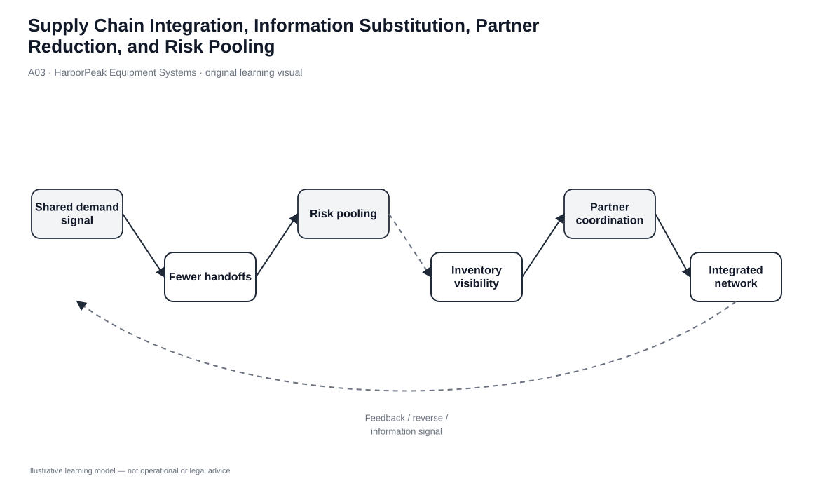
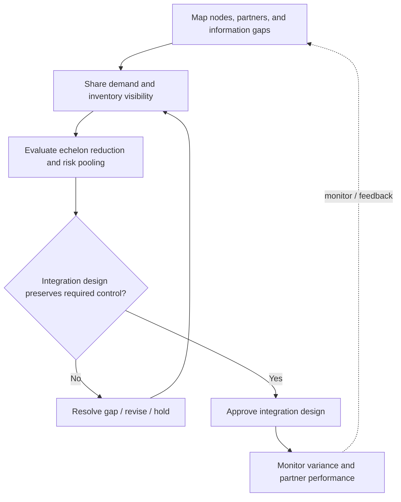

# 3. Supply Chain Integration, Information Substitution, Partner Reduction, and Risk Pooling

## Learning objectives

After this topic, you should be able to:

- sequence major logistics-network integration decisions;
- explain how better information can reduce some forms of physical inventory;
- recognize when removing partners or echelons simplifies the network and when it adds risk; and
- explain why risk pooling can reduce aggregate inventory while creating transportation or response trade-offs.

## Concept in plain English

Logistics integration means designing geography, borders, warehouses, transportation, partners, and information as one network. The work is iterative rather than a rigid six-step project. A location choice changes transportation choices; a customs strategy changes inventory placement; information visibility may allow an echelon to be removed; removing that echelon changes service and risk.

Two important ideas support integration. First, **information can sometimes substitute for inventory**. Better demand visibility, accurate item location, cross-docking, postponement, preclearance, mixed loads, and on-demand production can reduce the need to keep extra stock “just in case.” Second, **risk pooling** aggregates demand so that one shared stock position can cover variability across multiple customers or markets. Neither idea eliminates inventory or uncertainty; both change where and why inventory is held.

## Why it matters

Networks accumulate complexity over time. Extra warehouses, forward stock points, logistics providers, and buffers are often added to solve a local problem and never removed. Each additional handoff creates coordination effort, cycle time, information loss, and often another inventory position.

Simplification can create value, but “fewer partners” is not a goal by itself. Too much concentration can increase dependency, lengthen response time, or reduce resilience. The design question is the **effective** number of nodes and partners for the required service and risk profile.

## Decision model and workflow

| Decision element | Section A application |
|---|---|
| Boundary | Countries, trade paths, warehouses, modes/carriers, logistics partners, and information flows. |
| Inputs | Demand variability, customer locations, service targets, inventory positions, partner capabilities, information latency. |
| Gate | Integration must preserve required control, service, and risk protection. |
| Owner | End-to-end logistics/network design team. |
| Output | Approved integration design plus data-sharing, inventory, and partner-control plan. |

### Evidence retained through the workflow

| Evidence | Why retain it |
|---|---|
| Node-and-partner map | Makes handoffs and duplicated inventory visible. |
| Demand/inventory visibility | Supports pooling, postponement, and better replenishment. |
| Service-by-market data | Tests whether consolidation increases response time beyond the acceptable boundary. |
| Partner dependency/risk record | Prevents simplification from becoming uncontrolled concentration. |

## Practical process flow

## Original visualization

The network visual treats information as an active design element rather than a reporting layer added after the physical network. Shared signals can reduce uncertainty buffers, while the feedback path reminds the learner that a network must be monitored after nodes or partners are removed.

## Realistic example — HarborPeak Equipment Systems

HarborPeak holds the same slow-moving controller spare in three regional locations because each site independently protects itself against uncertainty. The combined safety position is high, but actual demand is intermittent. The team considers pooling the spare at Cedar Junction while improving order visibility and reserving responsive transportation.

Pooling may reduce aggregate inventory because demand from multiple regions is combined, but some customers will be farther from the stock. HarborPeak therefore evaluates whether the inventory reduction is worth the added response distance. For truly critical service parts, it may retain a small local emergency position rather than centralize everything.

## Applied decision or worked calculation

A useful integration checklist asks five questions before removing an echelon or inventory point:

1. What demand or inventory uncertainty is the node currently protecting against?
2. Can better information, pooling, postponement, or a different replenishment rule address that uncertainty?
3. What transportation distance and lead time are added if the node is removed?
4. Does the remaining network have enough capacity and disruption tolerance?
5. Which partner/data handoffs disappear, and which new dependencies are created?

The goal is not “centralize” or “decentralize.” It is to reduce avoidable complexity while preserving required service and control.

Dataset: [`logistics-strategy.csv`](../../assets/data/module-5/logistics-strategy.csv)

## Decision logic

- Map the physical network and information delays together.
- Improve visibility before assuming additional inventory is the only way to protect service.
- Remove redundant echelons only when the remaining nodes can support service and risk requirements.
- Use risk pooling where aggregation reduces variability, then quantify the response-time/transport impact.
- Keep enough partners and capacity alternatives to avoid replacing complexity with fragility.

## Trade-offs

| Tension | Decision implication |
|---|---|
| Risk pooling vs. risk transfer | Pooling changes how demand variability is covered; it does not transfer contractual responsibility to another party. |
| Information substitution vs. zero inventory | Better information can reduce buffers, but physical stock is still needed where replenishment time and service requirements demand it. |
| Partner reduction vs. single sourcing | Reducing unnecessary logistics handoffs is different from creating an unmitigated single-point dependency. |

## Commonly confused with

**Centralization** and **risk pooling** are related but not identical. Centralization is a structural choice. Risk pooling is the statistical/operating benefit that may result when variable demand is aggregated. A central location that serves unrelated, perfectly synchronized peaks may not create the same benefit.

## Common mistakes

- Removing an echelon solely to reduce headcount without testing service impact.
- Treating data visibility as proof that inventory can be eliminated.
- Pooling stock without reserving the transportation capacity needed for longer response distances.
- Reducing partners below the level needed for resilience or local regulatory capability.

## Original knowledge check

**Question.** HarborPeak can centralize a slow-moving spare and reduce duplicate stock, but doing so adds one day of transport time to a critical customer. What should determine the decision?

A. The inventory reduction alone

B. The combined service, transportation, inventory, and risk effect

C. The number of warehouses alone

D. Whether centralization is considered a best practice

Answer and rationale

### Correct answer

**B. The combined service, transportation, inventory, and risk effect**

### Why it is correct

Risk pooling can reduce aggregate inventory, but the service and transportation consequences remain part of the logistics decision. The network should be judged as a system.

### Why the other answers are wrong

- **A.** This ignores the added response time and transport dependency.

- **C.** Warehouse count is an input, not the decision criterion.

- **D.** A structural pattern is not automatically correct for every service requirement.

## Practitioner perspective

In real networks, “information in place of inventory” often shows up as better promise logic, inventory visibility, ETA quality, and exception management. Before adding safety stock, check whether the real problem is inaccurate or delayed information. Conversely, do not reduce physical buffers until the information process is demonstrably reliable.

## Related concepts

- [Logistics Objectives and Tactics](./02-logistics-objectives-tactics-and-cross-functional-coordination.md)
- [Warehouse Network Count and Location Decisions](./06-warehouse-network-count-and-location-decisions.md)
- [Module 4 — Inventory](../../04-internal-operations-inventory/section-c-inventory/)

---

[Previous: Logistics Objectives, Tactics, and Cross-Functional Coordination](./02-logistics-objectives-tactics-and-cross-functional-coordination.md) · [Section overview](./README.md) · [Next: 3PL and 4PL Strategy, Outsourcing, and Contract Governance](./04-3pl-and-4pl-strategy-outsourcing-and-contract-governance.md)