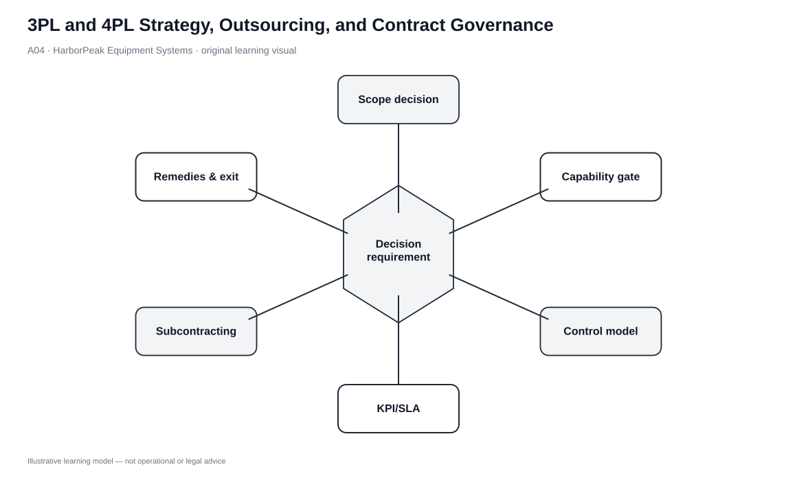
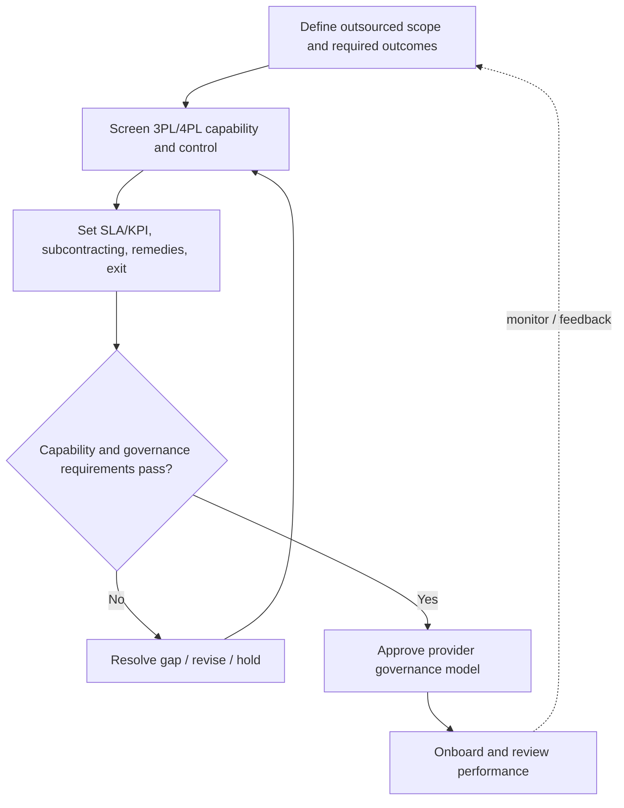

# 4. 3PL and 4PL Strategy, Outsourcing, and Contract Governance

## Learning objectives

After this topic, you should be able to:

- distinguish the operating roles of a 3PL and a 4PL;
- identify when logistics outsourcing supports focus, capability, technology, or flexibility;
- recognize the control, confidentiality, subcontracting, and performance risks created by outsourcing; and
- structure provider selection and contract governance so that capability is tested before price.

## Concept in plain English

**Third-party logistics (3PL)** is the use of an outside provider to perform logistics services for a client. The scope can be narrow, such as transportation or warehousing, or broad and integrated. **Fourth-party logistics (4PL)** uses an integrator role one level higher: the integrator manages the overall logistics operation and coordinates multiple service providers on the client’s behalf.

The decision is therefore not simply “outsourced or internal.” It has at least two dimensions: **which logistics work should leave the company**, and **how much orchestration/control authority should the provider receive**. A 3PL may operate a warehouse extremely well without being responsible for the entire network. A 4PL may be valuable when the client wants one integrator to coordinate several providers, but that convenience increases the importance of governance and unbiased subcontractor selection.

## Why it matters

Outsourcing can improve focus, access to logistics technology, geographic reach, scalability, and specialist capability. It can also put an external organization directly in front of customers and suppliers. Poor performance can therefore damage the client’s reputation even if the failure occurs outside the client’s legal entity.

The contract must be treated as an operating-control document, not just a commercial agreement. Startup responsibilities, service metrics, confidentiality, subcontracting rules, remedies, dispute handling, and exit conditions determine how the relationship behaves when something goes wrong.

## Decision model and workflow

| Decision element | Section A application |
|---|---|
| Boundary | Functions to outsource, decision rights retained internally, and provider/subcontractor scope. |
| Inputs | Current cost/service baseline, capability requirements, technology needs, geography, customer impact, risk tolerance. |
| Gate | Provider capability, governance, confidentiality, subcontracting, and exit requirements must pass. |
| Owner | Logistics owner with procurement, legal, IT/security, finance, and customer-service participation. |
| Output | Selected operating model, SLA/KPI set, transition plan, remedies, and exit path. |

### Evidence retained through the workflow

| Evidence | Why retain it |
|---|---|
| Current-state cost and service | Provides the baseline against which the provider is judged. |
| Capability evidence and references | Tests whether the provider can perform the required work, not just sell it. |
| Subcontractor policy | Controls hidden fourth-party behavior and quality risk. |
| SLA/KPI and remedy clauses | Defines what happens when performance misses the agreed boundary. |
| Exit/continuity plan | Prevents dependency from becoming operational lock-in. |

## Practical process flow

## Original visualization

The governance visual separates execution capability from orchestration and control. It also makes contract clauses part of the operating model. This is deliberate: a provider cannot be evaluated only on transport or warehouse rates when it will also hold data, interact with customers, and potentially appoint subcontractors.

## Realistic example — HarborPeak Equipment Systems

HarborPeak is considering outsourcing regional fulfillment. BlueHarbor offers a 3PL model in which it operates warehouse and transport services directly. Northstar offers a 4PL model that will coordinate multiple warehouse, carrier, and parcel partners.

HarborPeak’s requirement is broader than “find a cheaper warehouse.” The team needs reliable integration to order data, controlled subcontracting, customer-service performance, documented remedies, and a credible exit path. The 4PL model may fit a complex network better, while the 3PL model may preserve more direct client control. The correct choice depends on required scope and governance, not the label.

## Applied decision or worked calculation

The locked strategy data shows the 4PL scenario at **$8.07M** modeled total logistics cost and the regional 3PL at **$8.39M**. BudgetFreight is lower at **$7.90M** but fails the capability gate.

A practical scorecard should therefore have two layers. **Layer 1** is pass/fail: service capability, data/technology, confidentiality, subcontracting, continuity, and exit. **Layer 2** compares qualified providers on total cost, control, flexibility, and improvement potential. This prevents a low bid from winning simply because hard requirements were converted into soft weights.

Dataset: [`logistics-strategy.csv`](../../assets/data/module-5/logistics-strategy.csv)

## Decision logic

- Define the outcome and boundaries before issuing the request to providers.
- Distinguish direct execution from orchestration of multiple providers.
- Establish pass/fail capability and governance criteria.
- Compare qualified alternatives against the internal baseline and total logistics cost.
- Contract the transition, metrics, feedback, remedies, subcontracting, confidentiality, and exit rules.
- Review provider performance as part of logistics governance, not only procurement savings.

## Trade-offs

| Tension | Decision implication |
|---|---|
| 3PL vs. carrier | A carrier provides transportation; a 3PL may combine transportation with warehousing and other logistics services. |
| 4PL vs. 3PL with many services | The defining issue is orchestration/integration of the client’s logistics providers, not simply the number of services sold. |
| Outsourcing vs. abdication | A client can outsource execution but still owns service strategy, risk appetite, and governance. |

## Commonly confused with

A **4PL** is not automatically “better” or “more advanced” than a 3PL. It is a different governance model. Using a 4PL for a simple, stable lane may add cost and distance from execution. Using disconnected 3PLs for a complex global network may leave the client with integration work it intended to avoid.

## Common mistakes

- Selecting a provider before documenting current cost and service.
- Calling a low bid a saving while transition, integration, or failure costs are excluded.
- Allowing a 4PL to choose subcontractors without conflict-of-interest controls.
- Omitting remedy and exit clauses because the relationship is expected to be long term.
- Measuring only cost while ignoring customer-facing service.

## Original knowledge check

**Question.** HarborPeak wants one external organization to coordinate several warehouse and transportation providers while HarborPeak retains strategic oversight. Which operating model most directly matches that requirement?

A. A private fleet

B. A narrow single-service 3PL

C. A 4PL-style logistics integrator

D. A fixed-location storage system

Answer and rationale

### Correct answer

**C. A 4PL-style logistics integrator**

### Why it is correct

The requirement is orchestration across multiple logistics service providers. That is the distinguishing role of the 4PL-style model in this section.

### Why the other answers are wrong

- **A.** A private fleet addresses transportation ownership, not multi-provider integration.

- **B.** A narrow 3PL performs a service but does not necessarily orchestrate the full provider network.

- **D.** Fixed-location storage is a warehouse slotting method, not an outsourcing model.

## Practitioner perspective

The implementation risk is often highest during the first months, when data, processes, staffing, and customer expectations are transferring. Treat transition governance as part of the contract. A mature outsourcing decision specifies who does what on day one, how exceptions are escalated, and how the organization can recover if the provider relationship fails.

## Related concepts

- [Logistics Objectives and Tactics](./02-logistics-objectives-tactics-and-cross-functional-coordination.md)
- [Warehousing Strategy and Ownership Choices](./05-warehousing-strategy-objectives-and-ownership-choices.md)
- [Module 3 — Sourcing and Contracting](../../03-sourcing-strategy-product-design-supplier-execution/)

---

[Previous: Supply Chain Integration, Information Substitution, Partner Reduction, and Risk Pooling](./03-supply-chain-integration-information-substitution-partner-reduction-and-risk-pooling.md) · [Section overview](./README.md) · [Next: Warehousing Strategy, Objectives, and Ownership Choices](./05-warehousing-strategy-objectives-and-ownership-choices.md)