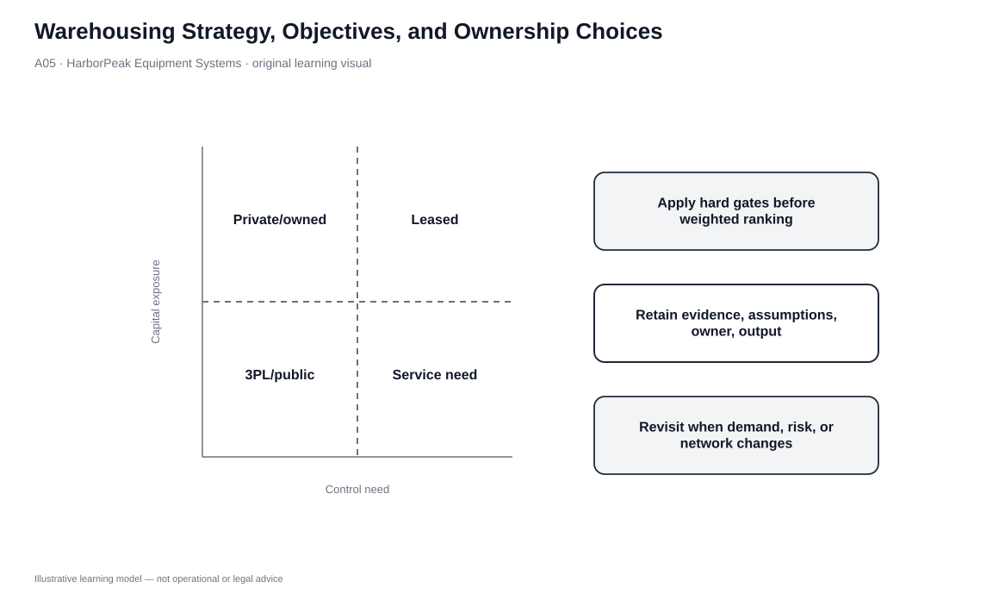
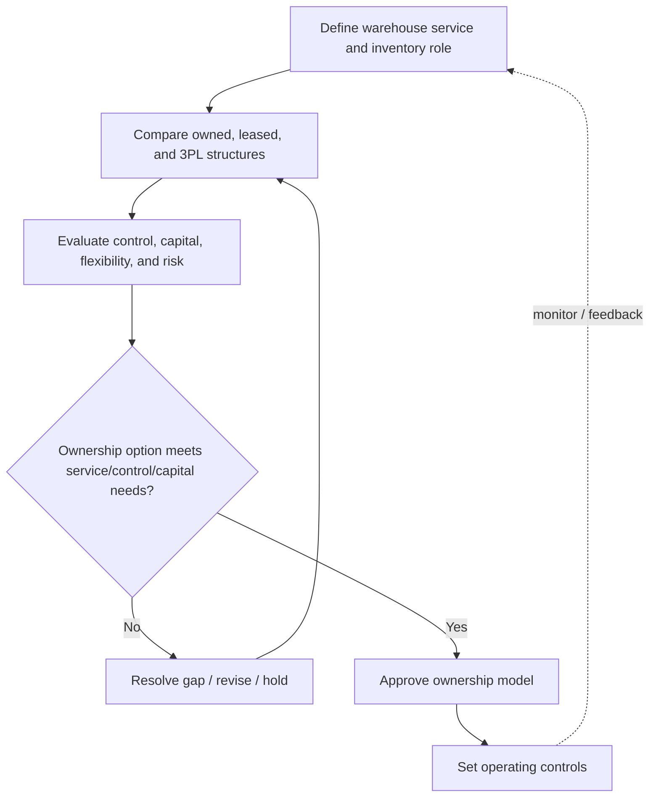

# 5. Warehousing Strategy, Objectives, and Ownership Choices

## Learning objectives

After this topic, you should be able to:

- explain how warehousing supports response, consistency, inventory control, consolidation, quality, and reverse flow;
- distinguish private, public, and contract warehouse structures;
- evaluate ownership using control, capital, flexibility, cost, and market-access requirements; and
- use a mixed ownership model when demand or geography makes one structure insufficient.

## Concept in plain English

A warehouse is not just a building that holds inventory. It is a logistics node that receives, stores, handles, and ships goods so that the broader network can meet customer lead-time and service requirements. Warehouse design and ownership should therefore begin with the role the node must play: buffer variability, consolidate freight, support rapid response, perform value-added work, enable reverse flow, or some combination.

Three common ownership structures create different economics and control. A **private warehouse** is owned by the company and offers strong control and a local market presence, but it creates fixed capital and utilization risk. A **public warehouse** sells storage/service capacity to multiple clients and is easier to scale, though the user gives up some control. **Contract warehousing** creates a longer-term relationship with more tailored space and service commitments than a simple public-warehouse arrangement while preserving more flexibility than ownership.

## Why it matters

Ownership is a structural decision. If HarborPeak owns a facility, a demand downturn does not make depreciation and fixed overhead disappear. If it rents public capacity, it may scale more easily but accept standard processes and shared capacity. If it signs a dedicated contract, it gains tailored service but creates contractual commitments.

The right model can also change over the product life cycle. A company may use owned capacity for stable base demand and public/contract capacity for seasonal peaks or market tests.

## Decision model and workflow

| Decision element | Section A application |
|---|---|
| Boundary | Warehouse node role, ownership structure, committed capacity, and operating control. |
| Inputs | Demand stability, service promise, inventory profile, process specialization, geography, capital appetite. |
| Gate | Chosen structure must support required service, control, and product-handling needs. |
| Owner | Logistics/network owner with finance, real estate, operations, and commercial input. |
| Output | Ownership/lease/contract decision and operating-control requirements. |

### Evidence retained through the workflow

| Evidence | Why retain it |
|---|---|
| Demand and peak profile | Shows fixed-versus-variable capacity exposure. |
| Service/process requirements | Determines whether generic public capacity is sufficient. |
| Capital and occupancy assumptions | Makes the fixed-cost commitment transparent. |
| Provider SLA where outsourced | Translates warehouse role into measurable service obligations. |

## Practical process flow

## Original visualization

The ownership matrix contrasts control and capital commitment instead of presenting one ownership type as universally superior. The operating flow makes the sequence explicit: define the warehouse role, compare structures, apply service/control/capital gates, then set operating controls for the selected model.

## Realistic example — HarborPeak Equipment Systems

HarborPeak’s Cedar Junction site handles steady distributor demand and sensitive controller inventory, while holiday e-commerce demand creates a short seasonal spike. HarborPeak may choose to keep Cedar as a controlled base facility and acquire temporary public or contract space for the peak rather than build enough private capacity for the highest week of the year.

If HarborPeak enters a new geographic market with uncertain demand, a contract warehouse can also let the company test the market without immediately committing to land, construction, and a permanent workforce.

## Applied decision or worked calculation

The locked `warehouse-network.csv` provides several ownership contexts: owned Cedar Junction and Mesa Crossing facilities, a 3PL node at Harbor East, and a leased North Metro candidate. Use the dataset as an ownership discussion record rather than as proof that one structure is cheaper in every situation.

A simple ownership decision matrix should include **service role, required control, demand volatility, capital/fixed-cost exposure, process specialization, geographic expansion value, and exit flexibility**. Hard requirements—such as controlled handling of sensitive products—must be satisfied before the economics are compared.

Dataset: [`warehouse-network.csv`](../../assets/data/module-5/warehouse-network.csv)

## Decision logic

- Start with what the warehouse must accomplish in the network.
- Separate steady base demand from temporary, seasonal, or experimental demand.
- Use ownership where control and stable utilization justify the fixed commitment.
- Use public/contract capacity where flexibility and geographic reach have higher value.
- Combine structures when one model would either overcommit capital or underdeliver service.

## Trade-offs

| Tension | Decision implication |
|---|---|
| Ownership vs. operation | A company can own a facility and outsource its operation, or use a third-party facility under a dedicated contract. |
| Public vs. contract warehouse | Both are external capacity, but contract arrangements normally provide a more committed, tailored relationship. |
| Warehouse cost vs. logistics cost | A lower warehouse rate may increase transport distance, inventory, or service failures. |

## Commonly confused with

**Private** does not mean “always cheaper because there is no provider markup.” Fixed cost, utilization, management capability, and capital opportunity cost can outweigh the markup avoided. Likewise, an external warehouse is not automatically cheaper; the decision depends on the role and volume profile.

## Common mistakes

- Building for a temporary peak without testing flexible capacity alternatives.
- Choosing an external warehouse solely on storage rate.
- Ignoring the value of control for products that need special security, condition, or handling.
- Assuming ownership must be uniform across the entire network.

## Original knowledge check

**Question.** HarborPeak needs extra space for a three-month seasonal peak but expects base demand to return to normal afterward. Which structural characteristic is most valuable?

A. Maximum fixed capital commitment

B. Ability to scale capacity without permanent ownership

C. A rule that all inventory use fixed locations

D. Elimination of transportation planning

Answer and rationale

### Correct answer

**B. Ability to scale capacity without permanent ownership**

### Why it is correct

Temporary public or contract capacity can match a short-lived peak without forcing HarborPeak to carry a permanent facility sized for exceptional demand.

### Why the other answers are wrong

- **A.** A temporary need generally does not justify maximizing fixed commitment.

- **C.** Slotting method is separate from warehouse ownership.

- **D.** Warehousing does not remove the need to plan transportation.

## Practitioner perspective

Warehouse ownership discussions often become real-estate discussions too early. First define the operating role, then translate that role into facility and contract requirements. Real estate is one implementation decision inside a logistics design, not the starting point.

## Related concepts

- [Warehouse Network Count and Location Decisions](./06-warehouse-network-count-and-location-decisions.md)
- [Warehouse Capacity Forecasting](./08-warehouse-capacity-forecasting-and-space-sizing.md)
- [3PL and 4PL Strategy](./04-3pl-and-4pl-strategy-outsourcing-and-contract-governance.md)

---

[Previous: 3PL and 4PL Strategy, Outsourcing, and Contract Governance](./04-3pl-and-4pl-strategy-outsourcing-and-contract-governance.md) · [Section overview](./README.md) · [Next: Warehouse Network Count and Location Decisions](./06-warehouse-network-count-and-location-decisions.md)