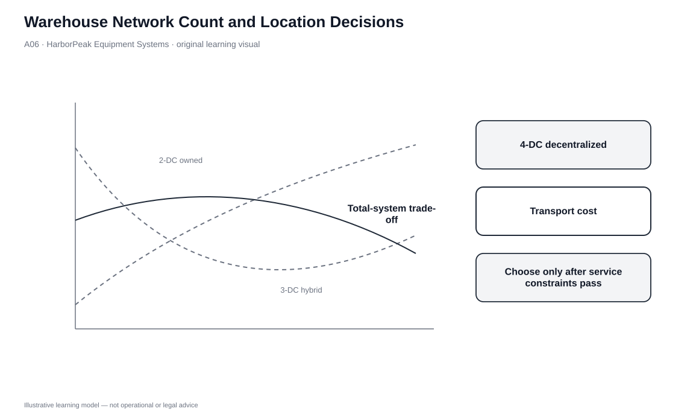
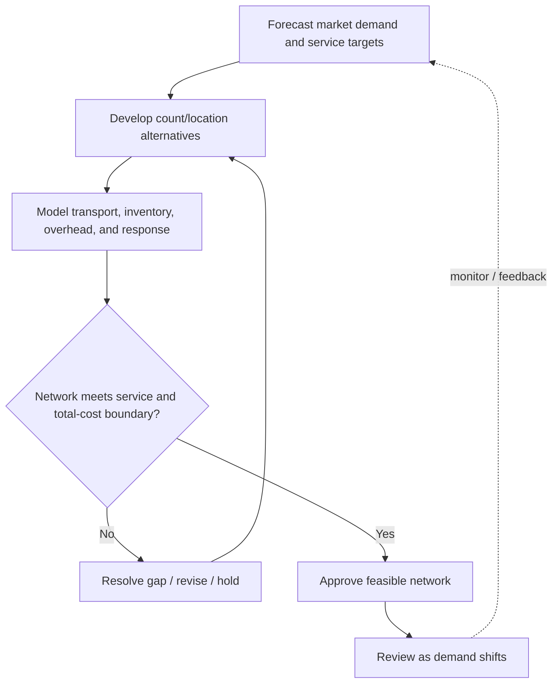

# 6. Warehouse Network Count and Location Decisions

## Learning objectives

After this topic, you should be able to:

- explain why warehouse count is a total-cost and service trade-off;
- distinguish count decisions from location decisions while recognizing their interaction;
- evaluate location factors such as transportation access, utilities, land/labor cost, regulation, and incentives; and
- compare network alternatives using both cost and response evidence.

## Concept in plain English

Adding warehouses places inventory closer to customers, which can improve response time and sometimes reduce outbound distance. But every additional facility can duplicate inventory, people, equipment, systems, and overhead. The relationship is therefore not linear. Total logistics cost may initially fall as service improves and transport distances shrink, then rise as duplicated inventory and facility cost overwhelm the benefit.

Warehouse **count** asks how many stocking/handling nodes the network needs. Warehouse **location** asks where the chosen nodes should be placed. The questions are connected but not identical. A business may need a facility in a particular country or region because of market, regulatory, infrastructure, or product requirements even if the demand volume alone would not justify it.

## Why it matters

Network decisions are difficult to reverse quickly. They also propagate through transportation, inventory, workforce, tax/regulatory exposure, and customer service. A local site with cheap land is not attractive if it lacks suitable truck/rail access or skilled labor. A high-cost urban site may still create value when same-day response is an order qualifier.

The lesson is systems thinking: the “best warehouse” cannot be selected independently from the network it serves.

## Decision model and workflow

| Decision element | Section A application |
|---|---|
| Boundary | Number of stocking/handling nodes and their feasible locations. |
| Inputs | Market demand, service target, distance, transport cost, inventory cost, facility overhead, infrastructure, labor, regulation. |
| Gate | Required services, labor, regulatory, and service-response conditions must be feasible. |
| Owner | Network design team with logistics, finance, operations, commercial, and site/regulatory input. |
| Output | Feasible warehouse network alternative with total-cost and service rationale. |

### Evidence retained through the workflow

| Evidence | Why retain it |
|---|---|
| Demand/service map | Shows which markets justify proximity. |
| Cost-by-node and cost-by-flow | Separates transport, inventory, and facility effects. |
| Infrastructure/labor/regulatory screen | Eliminates locations that cannot operate as required. |
| Response-time estimate | Tests whether the network meets the customer promise. |

## Practical process flow

## Original visualization

The cost curve is intentionally paired with a location map concept. Count and location interact: a third node can shorten response distance, but it adds another inventory and overhead position. The decision is where the total-system curve and the service boundary make sense together.

## Realistic example — HarborPeak Equipment Systems

HarborPeak compares a two-DC owned network with a three-DC hybrid network that adds Harbor East 3PL capacity. The additional node places inventory closer to eastern customers and improves modeled response, but it also adds inventory and operating overhead.

A fourth decentralized candidate offers even faster local response at one North Metro site, but the dataset flags labor as a watch item. HarborPeak should not approve that site simply because the map looks attractive; the workforce constraint must be resolved first.

## Applied decision or worked calculation

From the locked dataset, the complete two-DC option has modeled annual transport + inventory + overhead of **$8.35M**. The complete three-DC hybrid totals **$8.67M**. The three-DC design is therefore about **$0.32M** higher on those modeled cost categories.

However, its service-weighted response is much faster: roughly **1.63 days** versus **2.44 days** for the two-DC network. That does not prove the three-DC design is better. It frames the real question: is the modeled response improvement worth the incremental network cost for HarborPeak’s customer promise and competitive position?

Dataset: [`warehouse-network.csv`](../../assets/data/module-5/warehouse-network.csv)

## Decision logic

- Determine the service target and market geography first.
- Develop count alternatives, then screen feasible locations for required services/infrastructure.
- Calculate transport, inventory, and facility overhead together.
- Compare service response and cost for each complete network—not individual buildings.
- Treat labor, utilities, regulatory feasibility, and required transportation access as gates.
- Revisit the network when demand geography, service expectations, or major cost drivers change.

## Trade-offs

| Tension | Decision implication |
|---|---|
| More warehouses vs. better service | Additional nodes can improve proximity, but only if stock availability and operations support the promise. |
| Cheap land vs. low total cost | A distant low-cost site can raise transportation, lead time, or labor difficulty. |
| Safety stock per site vs. network inventory | A shorter local lead time can lower stock at one site while total network inventory still rises because stock is duplicated. |

## Commonly confused with

**Warehouse consolidation** is not synonymous with cost reduction. Fewer facilities may lower overhead and aggregate inventory but increase response distance and transportation dependence. The correct answer depends on the required service and total network economics.

## Common mistakes

- Selecting locations before deciding what network role and service each node must provide.
- Comparing only facility rent or land price.
- Ignoring duplicated inventory and equipment when adding nodes.
- Ignoring required infrastructure, labor, or regulatory feasibility.
- Treating an industry trend toward consolidation as proof that HarborPeak should consolidate.

## Original knowledge check

**Question.** HarborPeak’s three-DC option costs more than its two-DC option but improves modeled customer response by about 0.8 day. What should management do next?

A. Reject three DCs because facility count is higher

B. Approve three DCs because response is faster

C. Evaluate whether the service improvement creates enough customer/business value to justify total network cost

D. Average the two designs into 2.5 warehouses

Answer and rationale

### Correct answer

**C. Evaluate whether the service improvement creates enough customer/business value to justify total network cost**

### Why it is correct

The decision is a service-versus-total-cost trade-off. Neither facility count nor response speed is sufficient by itself.

### Why the other answers are wrong

- **A.** Higher count can be justified if it produces valuable service improvement.

- **B.** Faster response may not be worth the incremental cost for every customer or product.

- **D.** Warehouse count is a discrete network design, not something resolved by averaging alternatives.

## Practitioner perspective

A location model should have an explicit “cannot operate here” screen before weighted scoring. Required transportation access, power, space, workforce, safety/environmental constraints, and legal feasibility are different from preferences. This keeps a low-cost site from winning a scorecard even though it is operationally impossible.

## Related concepts

- [Warehousing Strategy and Ownership Choices](./05-warehousing-strategy-objectives-and-ownership-choices.md)
- [Warehouse Capacity Forecasting](./08-warehouse-capacity-forecasting-and-space-sizing.md)
- [Module 2 — Network Design](../../02-network-design-digital-connectivity-performance/)

---

[Previous: Warehousing Strategy, Objectives, and Ownership Choices](./05-warehousing-strategy-objectives-and-ownership-choices.md) · [Section overview](./README.md) · [Next: Warehouse Layout, Slotting, and Stock-Location Strategy](./07-warehouse-layout-slotting-and-stock-location-strategy.md)