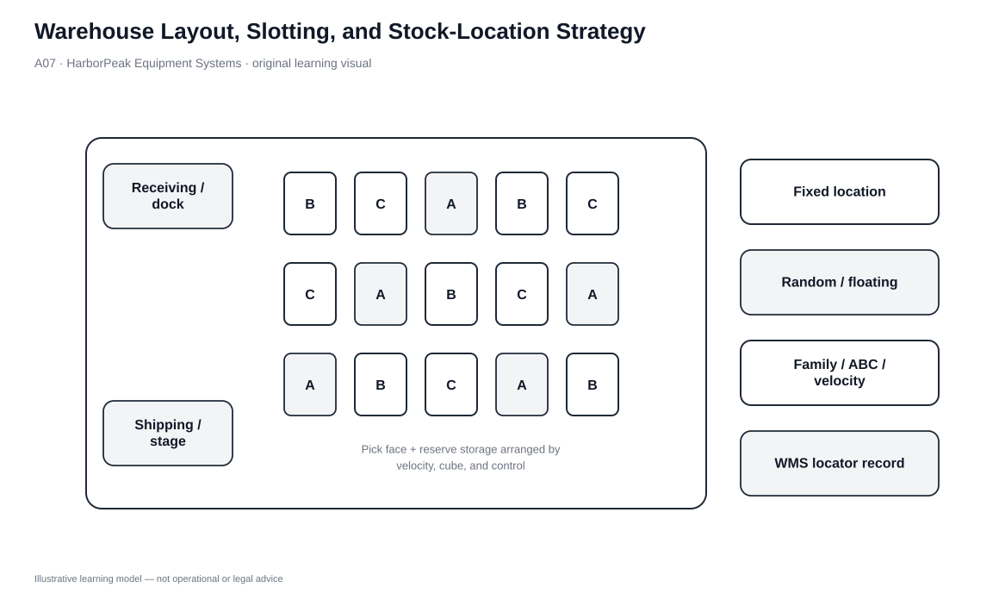
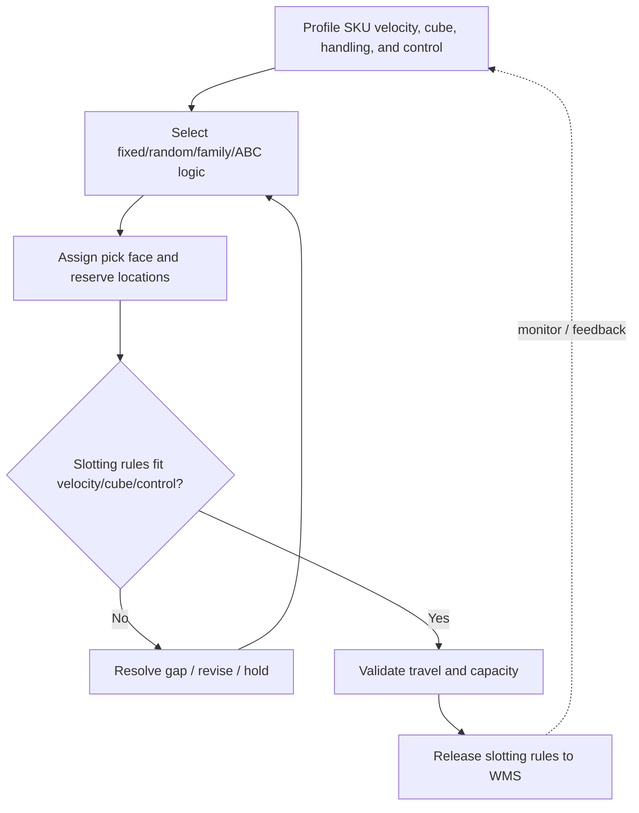

# 7. Warehouse Layout, Slotting, and Stock-Location Strategy

## Learning objectives

After this topic, you should be able to:

- explain how warehouse layout balances velocity, accessibility, and cube utilization;
- distinguish random-location and fixed-location storage;
- apply ABC, functional, velocity, physical-characteristic, and reserve-stock grouping rules; and
- connect slotting rules to WMS location control and travel reduction.

## Concept in plain English

Internal warehouse design starts with flow. Receiving, staging, storage, picking, value-added work, and shipping need enough space to operate without turning storage density into congestion. High cube utilization is valuable, but filling every possible location with racks can reduce throughput if people and equipment cannot move efficiently.

Slotting then decides where individual items should live. **Random-location storage** uses available locations dynamically and requires a reliable locator record; it usually uses space efficiently. **Fixed-location storage** assigns a relatively permanent home to each item; it is simpler to learn but can leave empty space when the item is below its maximum level. Other rules group inventory by value/ABC class, function or product family, velocity, physical requirements, or reserve versus working stock.

## Why it matters

Travel, touches, and location errors are major warehouse cost and service drivers. A fast-moving item placed far from outbound staging creates unnecessary travel every day. A hazardous or temperature-controlled item cannot be slotted solely by velocity. A random system without accurate location data creates chaos instead of efficiency.

The best slotting logic therefore combines product characteristics with operating priorities. It is a decision rule, not a one-time floor-plan exercise.

## Decision model and workflow

| Decision element | Section A application |
|---|---|
| Boundary | Storage zones, pick faces, reserve areas, and SKU-to-location rules. |
| Inputs | SKU velocity, cube, handling requirements, security/temperature needs, order profile, equipment capability. |
| Gate | Safety, product-integrity, access, and locator-control requirements pass. |
| Owner | Warehouse operations with WMS/master-data ownership. |
| Output | Approved slotting rules and maintained location assignments. |

### Evidence retained through the workflow

| Evidence | Why retain it |
|---|---|
| Velocity profile | Identifies what should be closest to high-frequency flow paths. |
| Cube/physical profile | Prevents poor fit and wasted storage space. |
| Control requirements | Protect hazardous, secure, chilled, defective, or obsolete inventory. |
| WMS locator accuracy | Makes random/floating storage executable. |
| Travel and congestion observations | Tests whether the slotting rule improves actual flow. |

## Practical process flow

## Original visualization

The layout visual separates receiving/shipping flow from storage zones and shows that A/B/C or family rules live inside a physical process. It also presents fixed, random, and hybrid approaches as design choices rather than mutually exclusive philosophies.

## Realistic example — HarborPeak Equipment Systems

At HarborPeak, high-velocity drill kits are picked daily for distributor and e-commerce orders. Slow-moving spare components may be requested only a few times per month. Placing both groups equally far from shipping wastes travel capacity.

HarborPeak can place high-velocity working stock near the pick/ship path, keep reserve pallets farther away, and use WMS-directed random locations for variable overflow. A sensitive battery return awaiting inspection belongs in a controlled hold location even if it has high movement frequency; control requirements override pure velocity logic.

## Applied decision or worked calculation

Use a slotting worksheet with at least five fields: **velocity class, cube/weight, special-handling requirement, working-versus-reserve role, and preferred location rule**. Then validate the proposed rule against travel distance, congestion, replenishment frequency, and location accuracy.

The locked `warehouse-network.csv` contains example site-level slotting policies such as “ABC + velocity,” “ABC + family,” and “dynamic slotting.” These are not universal answers; they show that the policy can vary by facility role and information capability.

Dataset: [`warehouse-network.csv`](../../assets/data/module-5/warehouse-network.csv)

## Decision logic

- Map receiving-to-shipping flow before filling the building with storage.
- Apply non-negotiable safety/condition/security zones first.
- Use velocity and order profile to position frequently handled working stock.
- Use reserve storage to separate bulk inventory from active pick faces.
- Choose random/fixed/hybrid rules that match WMS accuracy and operating complexity.
- Re-slot when demand mix changes materially instead of preserving historical locations forever.

## Trade-offs

| Tension | Decision implication |
|---|---|
| Cube utilization vs. accessibility | Dense storage is not efficient if every pick requires moving other inventory or creating congestion. |
| Random location vs. no control | Random storage still requires exact system location control. |
| ABC value vs. velocity | A high-value item is not necessarily the fastest mover; value, security, and handling frequency answer different questions. |

## Commonly confused with

**Random-location storage** does not mean warehouse employees choose any open space and remember where the item went. The method depends on accurate location records and disciplined put-away/pick confirmation. Without that information control, fixed storage may be operationally safer even if it uses more space.

## Common mistakes

- Maximizing rack density without protecting travel and staging space.
- Slotting solely by item value when movement frequency is the real cost driver.
- Using random storage without reliable WMS/location transactions.
- Mixing quarantine, obsolete, or hazardous items with available stock.
- Forgetting that reserve and working stock can use different location strategies.

## Original knowledge check

**Question.** HarborPeak wants to improve cube utilization for thousands of variable-SKU spare parts and has accurate WMS-directed put-away and picking. Which approach is most consistent with that objective?

A. Random/floating locations with reliable locator control

B. Permanent fixed space sized for every item’s maximum quantity

C. Place every item nearest the shipping dock

D. Eliminate location records because the storage is random

Answer and rationale

### Correct answer

**A. Random/floating locations with reliable locator control**

### Why it is correct

Dynamic locations can use open space more efficiently when the system accurately records where every item is stored.

### Why the other answers are wrong

- **B.** Sizing a permanent location for every item can create large amounts of unused space.

- **C.** Dock proximity should be reserved for items whose velocity or process needs justify it.

- **D.** Random storage increases the need for accurate location records; it does not remove it.

## Practitioner perspective

Warehouse slotting is one of the clearest examples of data turning into physical work. If velocity classifications are stale, WMS locations are inaccurate, or packaging dimensions are wrong, the warehouse will physically experience the master-data problem as extra travel, congestion, and failed picks.

## Related concepts

- [Warehouse Capacity Forecasting](./08-warehouse-capacity-forecasting-and-space-sizing.md)
- [Materials-Handling Strategy](./09-materials-handling-strategy-and-mechanized-systems.md)
- [Module 4 — Inventory Accuracy](../../04-internal-operations-inventory/section-c-inventory/)

---

[Previous: Warehouse Network Count and Location Decisions](./06-warehouse-network-count-and-location-decisions.md) · [Section overview](./README.md) · [Next: Warehouse Capacity Forecasting and Space Sizing](./08-warehouse-capacity-forecasting-and-space-sizing.md)