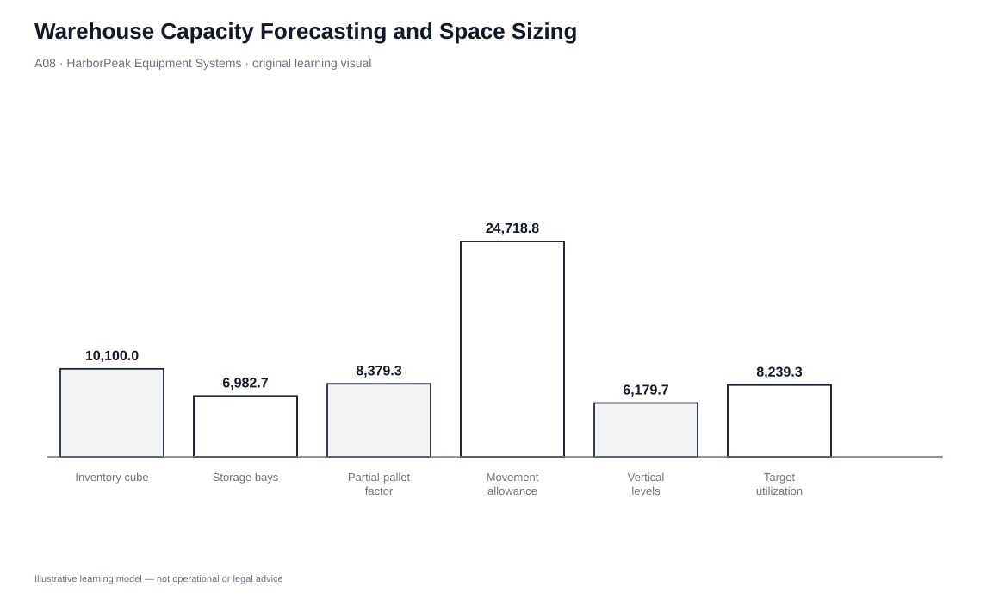
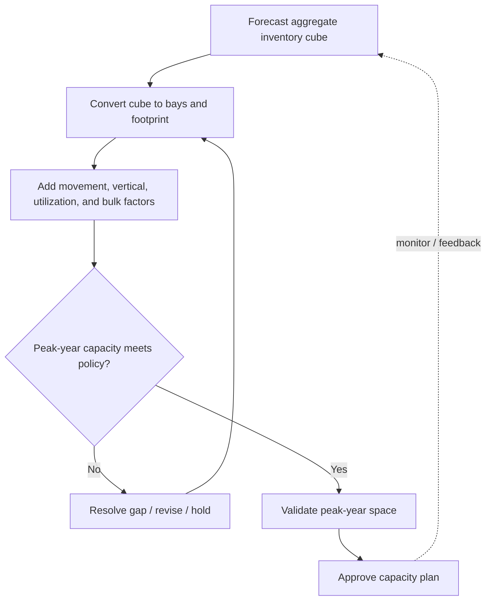

# 8. Warehouse Capacity Forecasting and Space Sizing

## Learning objectives

After this topic, you should be able to:

- translate forecasted aggregate inventory cube into storage-bay and floor-space requirements;
- adjust capacity for partial pallets, movement/aisle space, vertical levels, target utilization, and bulk storage;
- explain why warehouse capacity is planned over a multi-year horizon; and
- reproduce the HarborPeak capacity calculation from the locked dataset.

## Concept in plain English

Warehouse space planning begins with the amount of inventory the network expects to hold, not with an arbitrary building size. Forecasted aggregate inventory is converted into a storage requirement, then expanded for real operating needs such as partially filled pallets, aisles, equipment movement, picking/staging space, and separate bulk storage. Vertical rack levels reduce the floor footprint, while a target utilization below 100% creates operating and growth headroom.

The capacity horizon is longer than a day-to-day labor plan because buildings, leases, racks, and automation are difficult and expensive to change quickly. The planning process therefore examines several future years and designs for the most demanding credible requirement in the chosen horizon.

## Why it matters

A warehouse that is sized only for the average current year can become congested as demand grows. A warehouse sized at 100% theoretical utilization can also be operationally unusable because receiving, replenishment, picking, and peak variation need empty locations and movement space. On the other hand, building excessive headroom creates idle capital and overhead.

The important discipline is to make every factor visible. “We need 10,000 square meters” is not auditable unless the team can show the inventory forecast, pallet assumptions, handling allowance, vertical design, utilization policy, and special storage needs behind it.

## Decision model and workflow

| Decision element | Section A application |
|---|---|
| Boundary | Storage and operational floor area needed across the planning horizon. |
| Inputs | Forecast inventory cube, pallet dimensions, partial-pallet factor, movement allowance, vertical levels, utilization policy, bulk area. |
| Gate | Peak-year requirement must fit within approved capacity and operating-utilization policy. |
| Owner | Warehouse/network planning with operations, engineering/real estate, and finance. |
| Output | Reproducible space requirement and capacity action plan. |

### Evidence retained through the workflow

| Evidence | Why retain it |
|---|---|
| Inventory-cube forecast | Provides the physical demand for storage. |
| Pallet/load dimensions | Converts inventory volume into usable storage positions. |
| Warehouse-layout factors | Accounts for movement and working space rather than theoretical storage only. |
| Utilization policy | Documents deliberate capacity headroom. |
| Peak-year calculation | Identifies the sizing year within the chosen horizon. |

## Practical process flow

## Original visualization

The waterfall uses HarborPeak’s locked numbers so each adjustment is visible. It is not a copy of the source example. The visual moves from inventory cube to bays/footprint, then applies movement, vertical-storage, utilization, and bulk-space logic.

## Realistic example — HarborPeak Equipment Systems

HarborPeak is evaluating a five-year warehouse plan. Demand growth increases its forecast inventory cube each year, but in 2031 it also changes the design from four to five vertical storage levels. That extra vertical level means the largest inventory-cube year is not automatically the largest floor-space year.

The result is useful because it shows why capacity planning is more than applying a growth percentage to building area. Storage technology and policy assumptions can change the floor footprint materially.

## Applied decision or worked calculation

For the peak modeled year **2030**, the locked data uses:

- forecast aggregate inventory cube = **10,100 m³**;
- loaded pallet cube = **1.2 × 1.0 × 1.35 = 1.62 m³**;
- base bays = **10,100 ÷ 1.62 = 6,234.57**;
- partial-pallet factor = **1.12**, producing **6,982.72 adjusted bays**;
- pallet floor footprint = **1.2 m²**, producing **8,379.26 m² raw footprint**;
- movement/aisle factor = **2.95**, producing **24,718.83 m²** before vertical adjustment;
- four storage levels, producing **6,179.71 m²**;
- target utilization = **81%**, producing **7,629.27 m² core area**;
- separate bulk allowance = **610 m²**.

Final modeled requirement = **8,239.26 m²**.

Use the [Module 5 formula sheet](../../calculations/logistics-trade-reverse/formula-sheet.md) to reproduce the sequence. Notice that 2031 has more forecast inventory but five vertical levels, so its modeled floor-space need is lower than 2030.

Dataset: [`warehouse-capacity.csv`](../../assets/data/module-5/warehouse-capacity.csv)

## Decision logic

- Forecast inventory cube for each year in the planning horizon.
- Convert cube to storage positions using controlled load dimensions.
- Adjust for partial pallets or other real occupancy loss.
- Add operating/movement space based on the proposed handling design.
- Divide by usable vertical storage levels.
- Divide by target utilization to create approved headroom.
- Add separately modeled bulk/special storage.
- Select the peak credible requirement and test sensitivity to growth, layout, and utilization assumptions.

## Trade-offs

| Tension | Decision implication |
|---|---|
| Cube capacity vs. floor area | Cubic inventory volume must be translated through storage design before it becomes a real-estate requirement. |
| Average inventory vs. maximum inventory | Random/flexible storage may support aggregate-average planning; fixed item locations can require more dedicated space. |
| High utilization vs. high efficiency | A warehouse operated near 100% occupancy can suffer congestion and poor flexibility. |

## Commonly confused with

**Target utilization** is not the same as forecast accuracy. Dividing by 81% in this scenario does not claim the forecast will be 81% accurate; it creates deliberate capacity headroom so the facility is not planned to operate at theoretical full occupancy.

## Common mistakes

- Using current inventory instead of a multi-year forecast for a long-lived facility decision.
- Forgetting partial-pallet or reserve-space effects.
- Multiplying for aisle space and then forgetting to account for vertical levels.
- Treating 100% storage occupancy as an efficient operating target.
- Adding bulk/special storage into pallet logic even when it needs separate treatment.

## Original knowledge check

**Question.** HarborPeak’s vertical-adjusted storage requirement is 6,180 m² and policy target utilization is 80%. Before adding separate bulk space, approximately how much core area is required?

A. 4,944 m²

B. 6,180 m²

C. 7,725 m²

D. 8,240 m²

Answer and rationale

### Correct answer

**C. 7,725 m²**

### Why it is correct

Target utilization creates headroom by dividing required operating space by the utilization rate: 6,180 ÷ 0.80 = 7,725 m².

### Why the other answers are wrong

- **A.** This multiplies by 80%, which removes capacity instead of creating headroom.

- **B.** This assumes 100% target utilization.

- **D.** This is close to the separate 2030 total after bulk allowance, but the question asks for core area before adding bulk space.

## Practitioner perspective

Warehouse-capacity discussions should be reproducible. If engineering, finance, and operations cannot trace the final square meters back to inventory, load dimensions, movement, vertical storage, and utilization policy, the number is a negotiated guess rather than a controlled planning result.

## Related concepts

- [Warehouse Layout and Slotting](./07-warehouse-layout-slotting-and-stock-location-strategy.md)
- [Materials-Handling Strategy](./09-materials-handling-strategy-and-mechanized-systems.md)
- [Module 4 — Inventory](../../04-internal-operations-inventory/section-c-inventory/)

---

[Previous: Warehouse Layout, Slotting, and Stock-Location Strategy](./07-warehouse-layout-slotting-and-stock-location-strategy.md) · [Section overview](./README.md) · [Next: Materials-Handling Strategy and Mechanized Systems](./09-materials-handling-strategy-and-mechanized-systems.md)