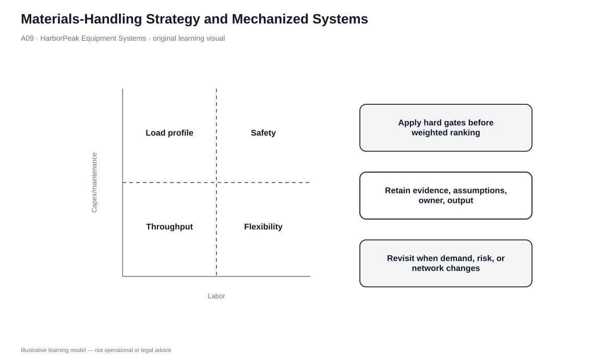
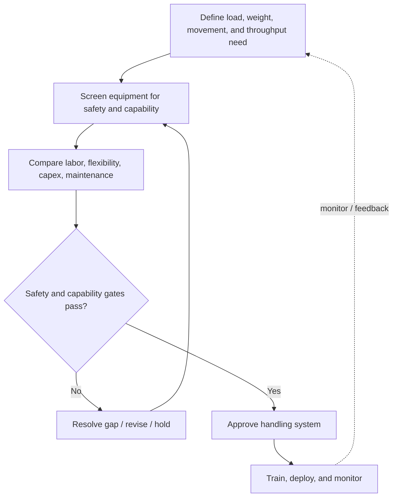

# 9. Materials-Handling Strategy and Mechanized Systems

## Learning objectives

After this topic, you should be able to:

- define materials handling as the movement and storage of goods inside a facility;
- compare forklifts, conveyors, towlines, tow tractors, cranes, carousels, and related mechanized choices;
- screen handling options for load fit and safety before comparing economics; and
- balance space, labor, flexibility, throughput, equipment, and information requirements.

## Concept in plain English

Materials handling determines how goods physically move between receiving, storage, picking, value-added work, and shipping. The best method depends on what is being moved, how often, how far, how heavy or awkward it is, and how much flexibility the process needs.

Mechanized systems solve different problems. Forklifts are flexible and can work with pallet loads and high storage. Conveyors move a steady flow efficiently but can constrain the layout. Towlines and tow tractors support repeated movement routes; tow tractors keep more routing flexibility because they are driver-controlled. Bridge or wagon cranes handle heavy or awkward loads that ordinary forklifts or conveyors cannot. Carousels bring smaller inventory to a stationary picker and can reduce walking and space.

## Why it matters

Poor equipment selection can lock a warehouse into the wrong process. Buying an expensive system that does not fit the load or layout increases fixed cost without adding value. Choosing cheap manual equipment can create safety, throughput, or labor problems.

Safety and physical capability therefore come before price. A piece of equipment that cannot safely lift the product or operate in the available aisle is not a “low-cost option”; it is infeasible.

## Decision model and workflow

| Decision element | Section A application |
|---|---|
| Boundary | Internal material movement and short-term storage method within the warehouse. |
| Inputs | Load type/weight, path, throughput, aisle/layout, safety, labor, automation/readiness, flexibility. |
| Gate | Safety and physical capability pass before economic ranking. |
| Owner | Warehouse operations/engineering with safety and maintenance input. |
| Output | Approved equipment/handling method and operating controls. |

### Evidence retained through the workflow

| Evidence | Why retain it |
|---|---|
| Load profile | Defines weight, dimensions, pallet/tote/carton characteristics, and special handling. |
| Travel and throughput requirement | Shows whether flexible point-to-point or continuous flow is needed. |
| Safety assessment | Eliminates structurally unsafe options. |
| Capex/maintenance/labor view | Supports lifecycle economics after feasibility is established. |
| Training/maintenance capability | Tests whether the facility can sustain the chosen equipment. |

## Practical process flow

## Original visualization

The selection matrix positions handling technologies by capability and operating trade-offs. It deliberately separates load/safety fit from cost because HarborPeak should never use a weighted economic score to “compensate” for an unsafe solution.

## Realistic example — HarborPeak Equipment Systems

HarborPeak handles palletized drill kits, cartons of electronics, and occasional heavy service fixtures. One piece of equipment will not be optimal for all three. Reach trucks can support pallet rack work; conveyor/sortation can support repeatable carton flow; a crane may be justified for a heavy awkward load that ordinary lift equipment cannot handle safely.

The warehouse can therefore use a portfolio of handling methods, with process boundaries designed so that each method operates where it creates the most value.

## Applied decision or worked calculation

The locked data provides five options. The low-cost manual-cart option has only **$65,000** modeled capex, but its safety and capability gates fail. It is therefore removed before financial comparison.

Among feasible options, the dataset illustrates very different operating profiles: counterbalance forklifts provide high flexibility at **34 units/hour** in the modeled scenario; conveyor/sortation provides **560 units/hour** for carton flow; AS/RS-style shuttle capability reaches **820 units/hour** but carries the highest modeled capex and maintenance. Those throughput figures are fictional teaching values, not equipment benchmarks.

The correct selection depends on load type and flow. Comparing all technologies as if they perform the same job would be invalid.

Dataset: [`material-handling.csv`](../../assets/data/module-5/material-handling.csv)

## Decision logic

- Define the physical load and movement requirement.
- Apply safety, aisle, weight, and product-condition gates.
- Match equipment type to flow pattern: flexible point-to-point, repetitive route, continuous flow, heavy lift, or goods-to-person.
- Compare labor, throughput, flexibility, capex, maintenance, and information requirements among feasible options.
- Pilot or stage investments where uncertainty is high.
- Monitor damage, travel, congestion, throughput, safety, and downtime after deployment.

## Trade-offs

| Tension | Decision implication |
|---|---|
| Mechanization vs. automation | Mechanized equipment assists movement; automated systems reduce or remove direct operator control for some tasks. |
| Throughput vs. flexibility | High-rate fixed systems can outperform flexible equipment in stable flows but become constraints when the process changes. |
| Equipment cost vs. handling cost | Purchase price is only one part of labor, maintenance, damage, space, and productivity economics. |

## Commonly confused with

A **tow tractor with trailers** and a **towline** may support similar repeated movement, but the tractor remains driver-operated and more flexible, while a fixed/automated towline can reduce labor but constrains routing. The equipment name alone does not determine suitability; flow stability matters.

## Common mistakes

- Buying equipment because it has the highest throughput rating without matching the load and process.
- Allowing low capex to outweigh a safety failure.
- Ignoring maintenance, training, or facility geometry.
- Automating a poor layout before simplifying the movement path.
- Using pallet-oriented equipment for a high-volume small-carton flow without testing alternatives.

## Original knowledge check

**Question.** HarborPeak must move an occasional extremely heavy, awkward service fixture that exceeds normal forklift capability. Which class of handling equipment should be evaluated first?

A. Bridge/wagon crane-type heavy-lift equipment

B. Pick-to-light carousel

C. Light manual carts

D. Parcel sortation conveyor only

Answer and rationale

### Correct answer

**A. Bridge/wagon crane-type heavy-lift equipment**

### Why it is correct

The requirement is heavy, awkward lifting beyond normal forklift capability. Crane-type equipment is designed for that structural need.

### Why the other answers are wrong

- **B.** Carousels support smaller goods-to-person picking, not heavy awkward loads.

- **C.** The option would not meet the physical/safety requirement.

- **D.** Parcel sortation addresses carton routing, not heavy lifting.

## Practitioner perspective

Warehouse engineering works best when operations owns the problem statement rather than a preferred technology. Describe the load, movement, volume, variability, safety, and process first; then allow equipment choices to compete against that requirement. This prevents “solution-first” automation projects.

## Related concepts

- [Warehouse Layout and Slotting](./07-warehouse-layout-slotting-and-stock-location-strategy.md)
- [Warehouse Automation Systems](./10-warehouse-automation-systems-and-automation-trade-offs.md)
- [Performance and Continuous Improvement — Module 4](../../04-internal-operations-inventory/section-d-performance-and-continuous-improvement/)

---

[Previous: Warehouse Capacity Forecasting and Space Sizing](./08-warehouse-capacity-forecasting-and-space-sizing.md) · [Section overview](./README.md) · [Next: Warehouse Automation Systems and Automation Trade-offs](./10-warehouse-automation-systems-and-automation-trade-offs.md)