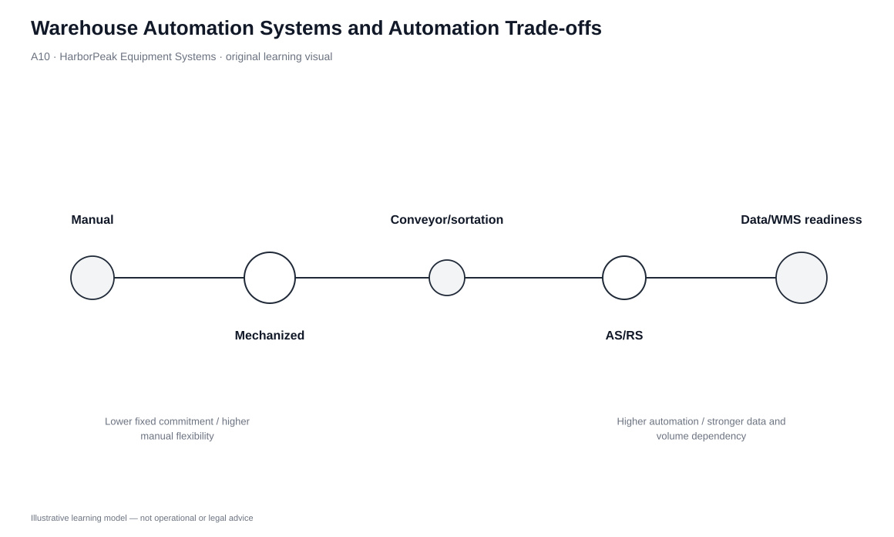
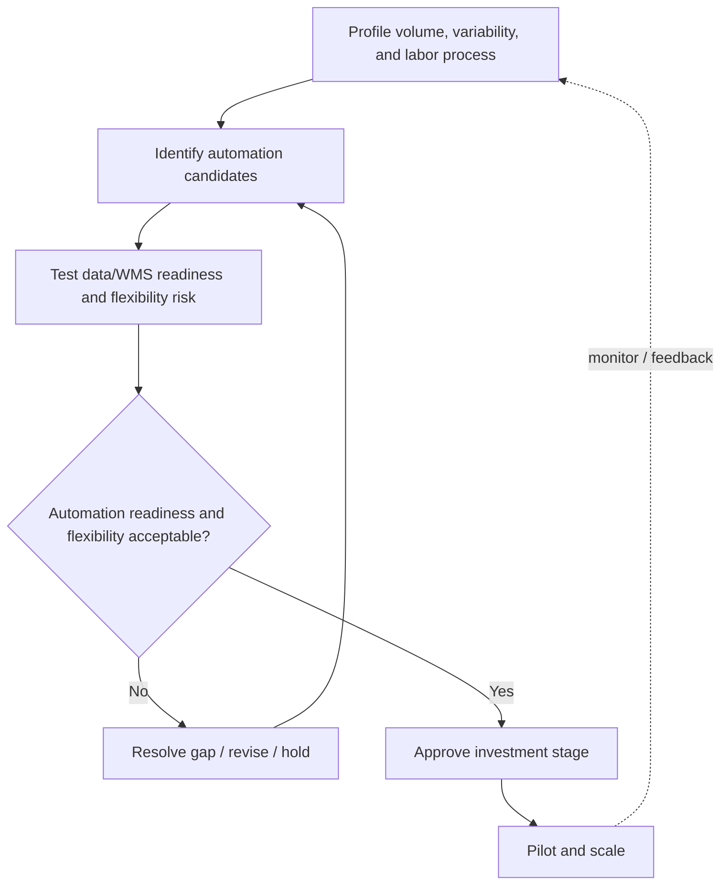

# 10. Warehouse Automation Systems and Automation Trade-offs

## Learning objectives

After this topic, you should be able to:

- distinguish major automated warehouse-system categories from mechanized handling;
- explain the fixed-cost/variable-cost trade-off created by automation;
- evaluate automation against volume, variability, process stability, information readiness, safety, and flexibility; and
- avoid automating a process before its operating logic is stable.

## Concept in plain English

Automation can reduce direct labor and increase speed, accuracy, storage density, or safety, but it shifts more of the operating model into fixed equipment, software, maintenance, and data dependencies. Typical automated categories include automated guided vehicles, sortation, robotics, live-rack flow systems, and automated storage/retrieval systems.

Different technologies automate different work. AGV-type systems automate vehicle movement; sortation directs items into the correct shipment flow; robotics can build or break unit loads; live racks use gravity to support flow and rotation; AS/RS combines high-density storage with programmable retrieval. These technologies should not be ranked by “automation level” alone.

## Why it matters

Automation is economically attractive when enough stable volume uses the system to justify fixed cost. It becomes risky when product dimensions, order profiles, volumes, or process logic change faster than the equipment can adapt. A highly automated facility also depends on software, master data, sensors, maintenance skill, and contingency plans when equipment fails.

The decision is therefore a readiness question as much as a capital question.

## Decision model and workflow

| Decision element | Section A application |
|---|---|
| Boundary | Tasks suitable for automation and the fixed infrastructure/software commitment required. |
| Inputs | Volume, variability, labor content, safety, layout, product dimensions, WMS/data readiness, maintenance capability. |
| Gate | Process/data readiness, safety, and acceptable flexibility risk. |
| Owner | Warehouse operations/engineering with IT, maintenance, finance, and safety. |
| Output | Staged automation roadmap, pilot scope, control measures, and contingency plan. |

### Evidence retained through the workflow

| Evidence | Why retain it |
|---|---|
| Volume and variability history | Tests whether the automated task is stable enough to justify fixed investment. |
| Process standard work | Prevents technology from hard-coding a broken process. |
| WMS/master-data readiness | Automation depends on reliable identities, locations, and instructions. |
| Downtime/maintenance capability | Makes single-point failure and recovery requirements visible. |
| Flexibility scenario | Tests how the system responds to SKU, volume, or layout change. |

## Practical process flow

## Original visualization

The automation spectrum emphasizes that more automation generally increases fixed commitment while reducing some direct labor. It is not a maturity ladder where the far-right option is always best. The correct point depends on flow stability and economics.

## Realistic example — HarborPeak Equipment Systems

HarborPeak’s carton flow is growing rapidly, while its service-parts assortment changes frequently. Automated sortation may fit the high-volume parcel stream because the routing logic is repeatable. A fully rigid system for long-tail service parts may be harder to justify because assortment and demand vary.

HarborPeak could pilot automation in the stable flow first, confirm data and maintenance capability, then scale. This staged approach preserves learning and reduces the risk of a large irreversible investment.

## Applied decision or worked calculation

The locked handling dataset makes the trade-off visible. The AS/RS shuttle scenario has the highest modeled throughput (**820 units/hour**) and lowest modeled direct labor (**2 FTE**), but it also has the highest modeled capex (**$1.85M**) and maintenance (**$178k/year**) with lower flexibility. Counterbalance forklifts require more labor but have much lower fixed commitment and higher flexibility.

The data should not be converted into a single “automation score.” HarborPeak should first identify which process is stable enough for automation and which flexibility constraints are acceptable.

Dataset: [`material-handling.csv`](../../assets/data/module-5/material-handling.csv)

## Decision logic

- Stabilize and simplify the process before automating it.
- Separate repeatable high-volume work from volatile exception work.
- Validate master data, WMS interfaces, safety, and maintenance capability.
- Model fixed investment against realistic utilization, not peak marketing volume.
- Test flexibility under SKU, volume, and layout changes.
- Pilot where possible and define a manual/alternate recovery path for downtime.

## Trade-offs

| Tension | Decision implication |
|---|---|
| Automation vs. digitization | A WMS or scanning system improves information; automation physically executes or directs work. |
| Maximum throughput vs. required throughput | Unused high-speed capacity can be an expensive fixed cost rather than an advantage. |
| Labor reduction vs. total cost | Automation can reduce direct labor but add maintenance, software, engineering, depreciation, and downtime exposure. |

## Commonly confused with

**AS/RS** is not simply “better racking.” It is a storage-and-retrieval operating system combining high-density physical storage with controlled automated movement. Its value depends on throughput, accuracy, space economics, and process stability—not just storage height.

## Common mistakes

- Automating unstable processes because labor cost is visible.
- Using peak volume instead of sustainable utilization in the business case.
- Ignoring downtime and maintenance skill.
- Assuming every manual task should be removed rather than redesigned.
- Underestimating the loss of flexibility after fixed infrastructure is installed.

## Original knowledge check

**Question.** A warehouse has highly variable product dimensions and frequently changes its layout. Which issue should receive special attention before committing to rigid automation?

A. Flexibility and change risk

B. Whether the equipment has the highest advertised speed

C. Whether all manual work can be eliminated

D. Whether the facility can increase inventory regardless of demand

Answer and rationale

### Correct answer

**A. Flexibility and change risk**

### Why it is correct

A rigid automated system can become a constraint when product or process requirements change. Fit with variability is a core readiness gate.

### Why the other answers are wrong

- **B.** Peak technical speed is useful only if it fits the actual flow and utilization.

- **C.** Eliminating all manual work is not the objective; the objective is a better operating system.

- **D.** Increasing inventory is not a justification for automation.

## Practitioner perspective

Automation projects often fail at the interfaces: item dimensions, pack hierarchies, location master data, order priorities, exception handling, or maintenance ownership. Treat those interfaces as design deliverables. A physically impressive system with weak data and exception logic will still fail customers.

## Related concepts

- [Materials-Handling Strategy](./09-materials-handling-strategy-and-mechanized-systems.md)
- [Warehouse Capacity Forecasting](./08-warehouse-capacity-forecasting-and-space-sizing.md)
- [Module 2 — Digital Connectivity](../../02-network-design-digital-connectivity-performance/)

---

[Previous: Materials-Handling Strategy and Mechanized Systems](./09-materials-handling-strategy-and-mechanized-systems.md) · [Section overview](./README.md) · [Next: Transportation Strategy: Product Movement and Temporary Storage](./11-transportation-strategy-product-movement-and-temporary-storage.md)