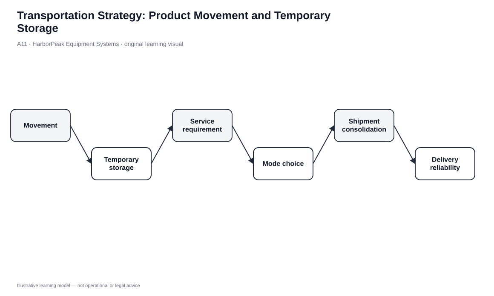
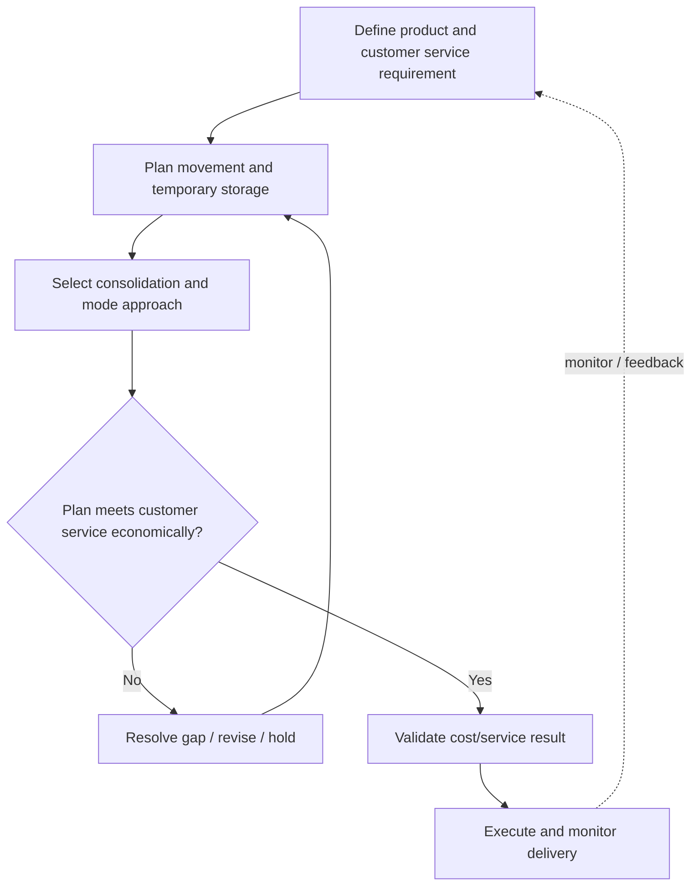

# 11. Transportation Strategy: Product Movement and Temporary Storage

## Learning objectives

After this topic, you should be able to:

- explain product movement as transportation’s primary role and temporary in-transit storage as a secondary role;
- connect transportation time, money, service, and environmental effects to logistics strategy;
- explain line-haul cost as one component of transportation economics; and
- identify when temporary storage in a vehicle is a deliberate trade-off rather than an accidental delay.

## Concept in plain English

Transportation connects physical nodes in the supply chain. Its primary purpose is product movement: carrying goods between suppliers, plants, warehouses, distributors, retailers, and customers. A secondary role is temporary storage when inventory remains in a vehicle rather than being unloaded into a facility.

Movement consumes time and money while inventory is unavailable for use elsewhere. Faster service can reduce lead time and inventory exposure, but it usually costs more. Slower consolidated movement can reduce transportation expense but may increase inventory or response time. Transportation strategy therefore belongs in the same total-logistics-cost discussion as warehousing and inventory.

## Why it matters

Transport decisions are highly visible to customers because the delivery is often the last physical step before product use. Yet the cheapest route can be false economy if it causes missed delivery promises, damage, theft exposure, or emergency expedites.

Temporary storage can sometimes avoid an unload-store-reload cycle or provide flexibility when a destination changes. It can also create detention/demurrage-type charges, refrigeration expense, security exposure, and loss of equipment availability. The practice needs an economic and operational reason, not just a parked trailer.

## Decision model and workflow

| Decision element | Section A application |
|---|---|
| Boundary | Movement between nodes plus controlled temporary in-transit storage. |
| Inputs | Service requirement, shipment size, origin/destination, product condition/security, capacity, timing, cost. |
| Gate | Chosen movement/storage plan must meet service and product-protection requirements. |
| Owner | Transportation/logistics planning with warehouse and customer-service coordination. |
| Output | Mode/consolidation/storage plan with timing, ownership, and exception controls. |

### Evidence retained through the workflow

| Evidence | Why retain it |
|---|---|
| Shipment requirement | Defines quantity, timing, handling, and product-protection need. |
| Line-haul and accessorial cost view | Separates movement expense from temporary storage/exception charges. |
| In-transit visibility | Allows destination or timing changes to be managed instead of guessed. |
| Temporary-storage reason and duration | Shows whether parking inventory is deliberate and still economical. |

## Practical process flow

## Original visualization

The visual shows movement and temporary storage as two connected transportation functions. It also makes the service requirement the anchor: temporary storage is only useful when it improves the overall flow or avoids a more expensive handling step.

## Realistic example — HarborPeak Equipment Systems

A HarborPeak inbound trailer arrives before receiving space is available, and the contents are not needed for two days. Unloading the trailer into overflow space would require additional handling and then reloading part of the shipment. HarborPeak considers leaving the sealed trailer in a controlled yard position temporarily.

That can be sensible only if the parking/detention cost, security, equipment availability, and product-condition requirements are acceptable. A battery shipment requiring special controls would need stricter treatment than ordinary tool stands.

## Applied decision or worked calculation

A transportation decision record should separate **movement requirement** from **temporary-storage choice**. For movement, record required delivery date, quantity, mode/carrier need, protection class, and consolidation opportunity. For temporary storage, record reason, expected duration, location, security/temperature need, equipment release impact, and incremental cost.

The [`transportation-capacity.csv`](../../assets/data/module-5/transportation-capacity.csv) provides lane/mode planning evidence used in later lessons. At this stage, the important point is that transportation is planned as a service/cost system rather than as a spot shipment transaction.

Dataset: [`transportation-capacity.csv`](../../assets/data/module-5/transportation-capacity.csv)

## Decision logic

- Define the delivery/service requirement and product constraints.
- Minimize unnecessary movement and handling, not necessary movement.
- Consider consolidation where the lead-time trade-off is acceptable.
- Use temporary vehicle storage only when it lowers total handling/storage cost without violating product, service, security, or equipment requirements.
- Preserve in-transit visibility so changes can be managed deliberately.
- Include environmental and risk effects where they influence the business decision.

## Trade-offs

| Tension | Decision implication |
|---|---|
| In-transit inventory vs. available inventory | Inventory on a vehicle still belongs to the system economically, but it may not be available for production or customer use. |
| Temporary storage vs. delay | A planned storage decision has an owner, reason, duration, and cost boundary; an uncontrolled delay is an exception. |
| Line-haul cost vs. total transport cost | Driver/vehicle movement cost is not the entire transportation cost picture. |

## Commonly confused with

**Demurrage** and **detention** are accessorial concepts associated with keeping transport equipment beyond allowed time; terminology and contracts vary by mode and market. For learning purposes, focus on the operating principle: using transport equipment as storage can generate additional cost and capacity consequences.

## Common mistakes

- Treating time in transit as free because the goods are “already shipped.”
- Using a vehicle as storage without considering equipment availability and accessorial charges.
- Paying for speed that the customer does not need.
- Consolidating loads until the service promise is missed.
- Ignoring product security or temperature needs during temporary storage.

## Original knowledge check

**Question.** HarborPeak can leave a sealed trailer loaded for two days instead of unloading and reloading it. Which factor is most important before approving temporary storage?

A. Whether the trailer is already at the facility

B. The combined service, security/product-condition, equipment, and incremental-cost effect

C. Whether warehouse utilization is exactly 100%

D. Whether the goods were transported by the cheapest carrier

Answer and rationale

### Correct answer

**B. The combined service, security/product-condition, equipment, and incremental-cost effect**

### Why it is correct

Temporary storage is a logistics trade-off. It is acceptable only when the full operating impact is better than the handling/storage alternative and required controls are preserved.

### Why the other answers are wrong

- **A.** Physical presence alone does not make the storage choice economical or safe.

- **C.** Full utilization is neither required nor desirable as a universal condition.

- **D.** Original freight rate does not answer the incremental storage decision.

## Practitioner perspective

Transportation and warehousing should be reviewed together. When a warehouse repeatedly uses trailers as overflow storage, the issue may be receiving capacity, appointment discipline, inventory positioning, or building capacity rather than a transportation tactic. Repeated exceptions are often signals of a structural design problem.

## Related concepts

- [Transportation Capacity Constraints](./12-transportation-capacity-constraints-and-transport-economics.md)
- [Transportation Capacity Forecasting](./13-transportation-capacity-forecasting-planning-and-carrier-readiness.md)
- [Warehouse Capacity Forecasting](./08-warehouse-capacity-forecasting-and-space-sizing.md)

---

[Previous: Warehouse Automation Systems and Automation Trade-offs](./10-warehouse-automation-systems-and-automation-trade-offs.md) · [Section overview](./README.md) · [Next: Transportation Capacity Constraints and Transport Economics](./12-transportation-capacity-constraints-and-transport-economics.md)