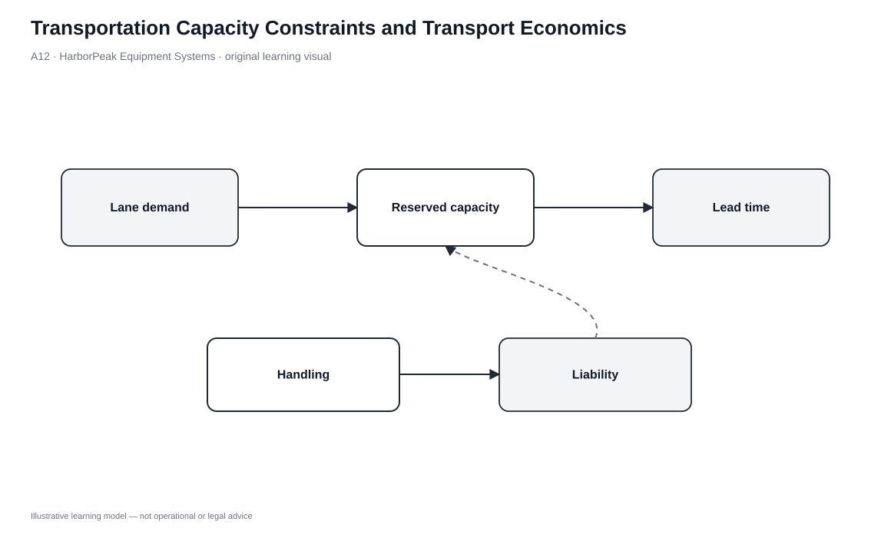
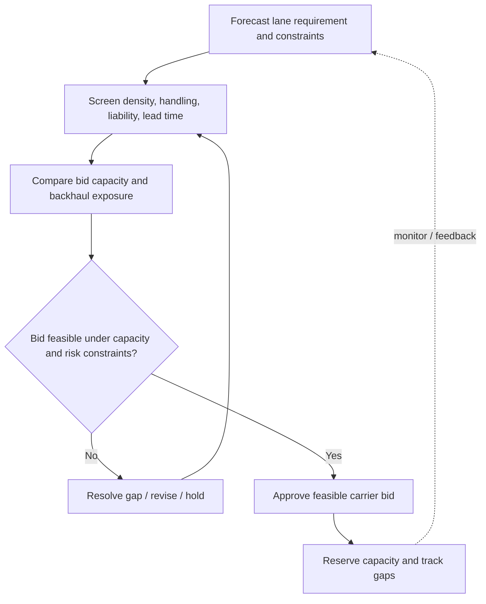

# 12. Transportation Capacity Constraints and Transport Economics

## Learning objectives

After this topic, you should be able to:

- explain how distance, volume, density, stowability, handling, liability, and stakeholder conflicts affect transportation cost/capacity;
- describe economies of distance and scale without assuming cost increases linearly;
- evaluate carrier bids against physical and risk constraints before price; and
- recognize inventory-versus-transportation, lead-time-versus-consolidation, and product-variety trade-offs.

## Concept in plain English

Transportation capacity is constrained by more than the number of trucks, railcars, containers, or aircraft available. A shipment has physical and economic characteristics that determine whether a carrier option is practical.

**Distance** increases total cost, although longer moves can benefit from economies of distance because fixed/start-stop portions are spread over more miles. **Volume** creates economies of scale when fixed movement cost is spread over a fuller load. **Density** influences how effectively weight and cube are used. **Stowability** describes how efficiently shape and packaging share cargo space. **Handling** captures loading/unloading difficulty and special equipment needs. **Liability** reflects damage, perishability, theft, and value exposure.

Stakeholders also create conflicting objectives: manufacturing may prefer large stable lots, logistics may want full loads, finance may want less inventory, retailers want fast replenishment, and customers want variety and low price.

## Why it matters

These factors explain why a carrier quote is not simply “rate per mile.” A low price may depend on a load profile that HarborPeak cannot actually provide. A mode may be physically feasible but unsuitable for a damage-sensitive high-value product. A full-load strategy may reduce unit freight cost but increase inventory and lead time.

The logistics planner must test feasibility and then optimize the trade-off, using information and forecasting to reduce unnecessary conflict.

## Decision model and workflow

| Decision element | Section A application |
|---|---|
| Boundary | Shipment/lane feasibility and economics before carrier commitment. |
| Inputs | Distance, volume, density, stowability, handling, liability, lead time, equipment, stakeholder/service requirements. |
| Gate | Carrier/mode option must satisfy physical, service, handling, and risk constraints. |
| Owner | Transportation procurement/planning with product, warehouse, risk, and customer-service input. |
| Output | Feasible carrier/mode alternatives and documented constraint screen. |

### Evidence retained through the workflow

| Evidence | Why retain it |
|---|---|
| Shipment cube/weight and packaging | Tests density, stowability, and handling. |
| Product risk profile | Captures value, damage, theft, perishability, and security exposure. |
| Lane/service requirement | Defines distance, timing, and access constraints. |
| Bid assumptions | Confirms that quoted capacity and rate match the real shipment profile. |
| Inventory/lead-time impact | Prevents full-load savings from hiding downstream cost. |

## Practical process flow

## Original visualization

The constraint/economics visual groups physical factors and business trade-offs around the carrier decision. The paired process flow forces a feasibility screen before a bid is accepted and loops failed options back for redesign rather than lowering the score threshold.

## Realistic example — HarborPeak Equipment Systems

HarborPeak’s Supplier Bay-to-Cedar lane has a forward requirement of **705 units/week** after a promotion adjustment but only **690 units/week** of reserved capacity. The issue is not solved by noting that other lanes have surplus capacity; capacity is lane/mode specific unless a realistic alternative route or mode can be arranged.

The planner also checks product handling, stowability, and backhaul opportunity. If a cheaper carrier requires packaging changes that increase damage or handling cost, that effect belongs in the decision.

## Applied decision or worked calculation

From the locked transportation dataset, five of six modeled lanes have nonnegative reserved-capacity gaps. The Supplier Bay-Cedar intermodal lane has a **-15 unit/week** gap and is marked **SHORT**.

That shortfall should trigger a targeted response: reserve additional capacity, move some volume to a feasible alternate mode/lane, change timing, consolidate differently, or explicitly accept the service risk. It should not be hidden by averaging capacity across unrelated lanes.

The source logic also supports three recurring trade-offs to test: full-load freight economics versus inventory, fast shipment versus consolidation/lead time, and product variety versus warehouse/transport complexity.

Dataset: [`transportation-capacity.csv`](../../assets/data/module-5/transportation-capacity.csv)

## Decision logic

- Characterize the shipment before comparing rates.
- Screen distance/access, weight/cube, density, stowability, handling, and liability.
- Confirm that carrier capacity is available on the required lane and timing.
- Apply service and risk gates before price ranking.
- Evaluate full-load or consolidation savings against inventory and lead-time effects.
- Use better information, packaging, postponement, or flow design to reduce avoidable trade-offs.

## Trade-offs

| Tension | Decision implication |
|---|---|
| Volume vs. density | Volume is the amount shipped; density is weight/value/units relative to space. They affect economics differently. |
| Economies of distance vs. cheap long-distance shipping | Cost generally still rises with distance; the cost does not have to rise proportionally per mile. |
| Full-load efficiency vs. total logistics efficiency | A full load can lower unit freight cost while increasing waiting time and inventory. |

## Commonly confused with

**Economies of distance** does not mean a 2,000-mile shipment costs less in total than a 200-mile shipment. It means the incremental cost per mile can decline because fixed and start/stop effects are spread across a longer movement.

## Common mistakes

- Comparing carrier bids without confirming shipment profile assumptions.
- Treating all weekly capacity as fungible across lanes.
- Ignoring packaging/stowability when forecasting vehicle need.
- Consolidating for freight savings without quantifying inventory and lead-time cost.
- Allowing a low rate to override product security or damage requirements.

## Original knowledge check

**Question.** A carrier offers a low rate, but HarborPeak’s product requires special handling that the carrier cannot provide reliably. What is the correct decision sequence?

A. Accept the lowest rate and handle damage as an exception

B. Reject or redesign the option because handling capability is a feasibility gate

C. Increase shipment volume until the rate is even lower

D. Ignore handling if the distance is short

Answer and rationale

### Correct answer

**B. Reject or redesign the option because handling capability is a feasibility gate**

### Why it is correct

Physical and risk constraints determine whether the transportation option can perform the job. Price comparison comes after feasibility.

### Why the other answers are wrong

- **A.** Known inability to handle the product should not be treated as a future exception.

- **C.** More volume does not correct missing handling capability.

- **D.** Handling requirements do not disappear on a shorter route.

## Practitioner perspective

Transportation procurement works better when the bid package contains operational facts, not just historical spend. Weight/cube profile, lane demand, seasonality, handling, security, delivery windows, and backhaul opportunities let the carrier price the actual work and reduce later disputes over assumptions.

## Related concepts

- [Transportation Strategy](./11-transportation-strategy-product-movement-and-temporary-storage.md)
- [Transportation Capacity Forecasting](./13-transportation-capacity-forecasting-planning-and-carrier-readiness.md)
- [Logistics Objectives and Tactics](./02-logistics-objectives-tactics-and-cross-functional-coordination.md)

---

[Previous: Transportation Strategy: Product Movement and Temporary Storage](./11-transportation-strategy-product-movement-and-temporary-storage.md) · [Section overview](./README.md) · [Next: Transportation Capacity Forecasting, Planning, and Carrier Readiness](./13-transportation-capacity-forecasting-planning-and-carrier-readiness.md)