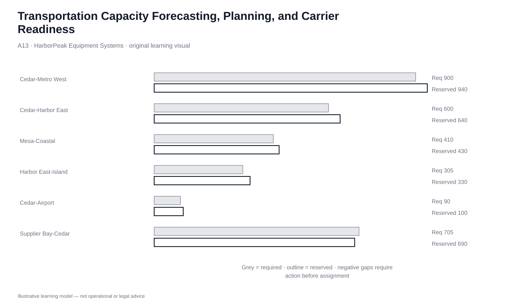
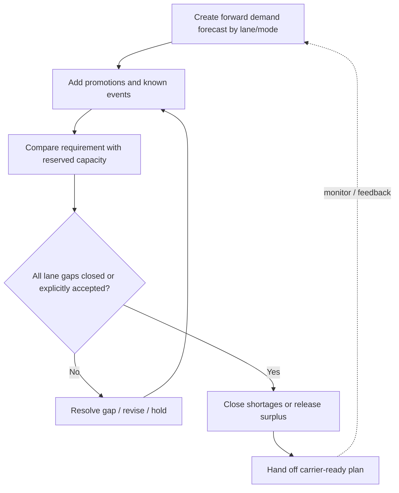

# 13. Transportation Capacity Forecasting, Planning, and Carrier Readiness

## Learning objectives

After this topic, you should be able to:

- build transportation-capacity requirements from forward-looking demand rather than waiting for shipment orders;
- break the forecast down by lane and mode;
- incorporate promotions, product strategies, protection requirements, and known events;
- compare required capacity with reserved capacity and close gaps before execution; and
- explain why earlier planning improves intermodal, backhaul, staffing, and procurement options.

## Concept in plain English

Transportation capacity planning moves the organization from reactive tendering to planned readiness. Instead of waiting for customer orders to create shipment demand, the logistics team uses demand forecasts, promotions, manufacturing/product decisions, and shipment characteristics to estimate future movement by **lane and mode**.

The resulting forecast is compared with owned-fleet capability or carrier capacity that has been reserved or contracted. Surpluses and shortages are visible early enough to act. This is especially important because a market may have available trucks in general while HarborPeak still lacks capacity on a specific origin-destination pair, equipment type, protection class, or week.

## Why it matters

Short planning horizons force the organization into spot-market procurement, last-minute mode changes, poor consolidation, weak backhaul planning, and unstable warehouse staffing. Earlier visibility gives both HarborPeak and its logistics partners time to prepare.

The benefit is not simply lower rates. It is a more responsive system because management has time to add, reduce, or redirect capacity before the customer order becomes an emergency.

## Decision model and workflow

| Decision element | Section A application |
|---|---|
| Boundary | Future movement requirement by lane, mode, week/period, and shipment class. |
| Inputs | Demand forecast, promotion events, production/product plans, mode/protection requirements, current reservations. |
| Gate | All shortages are closed, redesigned, or explicitly accepted before handoff to execution. |
| Owner | Transportation planning/procurement with demand, manufacturing, warehouse, and carrier collaboration. |
| Output | Carrier-ready capacity plan and exception list. |

### Evidence retained through the workflow

| Evidence | Why retain it |
|---|---|
| Lane-mode forecast | Prevents aggregate capacity from hiding local shortages. |
| Promotion/event calendar | Adds known forward demand that historical averages miss. |
| Reserved/owned capacity | Provides the supply side of the transport plan. |
| Gap and action log | Makes shortages and excess capacity accountable. |
| Carrier notice/confirmation | Converts a forecast into executable readiness. |

## Practical process flow

## Original visualization

The lane plan uses the six locked HarborPeak lane scenarios. Required and reserved capacity are shown separately, making shortage visibility the decision point rather than a hidden arithmetic result.

## Realistic example — HarborPeak Equipment Systems

HarborPeak plans a supplier promotion that increases inbound volume on the Supplier Bay-Cedar intermodal lane by 95 units/week. Base forecast is 610, so the forward requirement becomes 705. Only 690 is reserved.

If the team waits until purchase orders are ready to ship, it may have to buy premium spot capacity or delay receipts. If the gap is identified weeks earlier, HarborPeak can ask the carrier for more allocation, shift a portion to another feasible service, adjust delivery timing, or coordinate backhaul capacity.

## Applied decision or worked calculation

The locked plan calculates each lane as:

`required capacity = base forecast + known adjustment`

For the six modeled lanes:

| Lane | Required | Reserved | Gap |
|---|---:|---:|---:|
| Cedar-Metro West | 900 | 940 | +40 |
| Cedar-Harbor East | 600 | 640 | +40 |
| Mesa-Coastal | 410 | 430 | +20 |
| Harbor East-Island | 305 | 330 | +25 |
| Cedar-Airport | 90 | 100 | +10 |
| Supplier Bay-Cedar | 705 | 690 | **-15** |

Units are fictional weekly planning units. The -15 gap must be resolved or explicitly accepted; positive capacity on another lane is not automatically transferable.

Dataset: [`transportation-capacity.csv`](../../assets/data/module-5/transportation-capacity.csv)

## Decision logic

- Build demand by lane/mode from the demand plan, not only open shipment orders.
- Add promotions, launches, maintenance shutdowns, and other known events.
- Add equipment, protection, or handling requirements that constrain which capacity is usable.
- Compare requirement with committed/reserved capacity.
- Close shortages early and release unnecessary reservations where contractually possible.
- Use the longer horizon to plan intermodal moves, backhauls, warehouse staffing, and carrier collaboration.
- Monitor forecast error so the transport plan improves over time.

## Trade-offs

| Tension | Decision implication |
|---|---|
| Transportation forecast vs. shipment schedule | The forecast reserves future capability; actual shipment assignments occur closer to execution. |
| Aggregate carrier capacity vs. lane capacity | A carrier can have spare equipment overall while a specific lane remains constrained. |
| Historical average vs. forward-looking forecast | History is useful but misses known promotions, launches, or product changes unless those signals are added. |

## Commonly confused with

**Reserved capacity** is not the same as an assigned shipment. A useful planning model can secure provider capability before exact orders are known, then convert that reserved capability into detailed assignments later.

## Common mistakes

- Forecasting only from open orders and therefore discovering capacity needs too late.
- Planning transport at total-company level without lane/mode detail.
- Ignoring promotions or product-specific protection requirements.
- Averaging a shortage on one lane against surplus on an unrelated lane.
- Reserving excess capacity indefinitely without reviewing cost or contract terms.

## Original knowledge check

**Question.** HarborPeak forecasts 705 units/week on a lane but has only 690 units/week reserved. What is the most appropriate planning response?

A. Treat the network as balanced because other lanes have surplus

B. Close or explicitly accept the 15-unit lane gap before execution

C. Wait for actual shipment orders because forecasts should not influence transportation

D. Reduce the customer forecast without demand evidence

Answer and rationale

### Correct answer

**B. Close or explicitly accept the 15-unit lane gap before execution**

### Why it is correct

Transportation capacity must be feasible at the relevant lane/mode level. The shortfall should trigger a planned action while there is still time to respond economically.

### Why the other answers are wrong

- **A.** Capacity on other lanes is not automatically interchangeable.

- **C.** Waiting for orders removes the lead time that makes proactive capacity planning valuable.

- **D.** Changing the demand signal merely to make capacity appear balanced corrupts the plan.

## Practitioner perspective

A mature TMS process should connect the demand plan to carrier procurement before orders are released. The goal is not perfect prediction. It is enough forward visibility to reserve scarce capacity, design alternatives, and reduce avoidable spot-market emergencies. Track forecast error by lane so planners know where to hold more flexibility.

## Related concepts

- [Transportation Capacity Constraints](./12-transportation-capacity-constraints-and-transport-economics.md)
- [Logistics Objectives and Tactics](./02-logistics-objectives-tactics-and-cross-functional-coordination.md)
- [Module 1 — Forecasting](../../01-supply-chains-demand-forecasting/)

---

[Previous: Transportation Capacity Constraints and Transport Economics](./12-transportation-capacity-constraints-and-transport-economics.md) · [Section overview](./README.md) · [Next: Section A Review](./14-section-a-review.md)