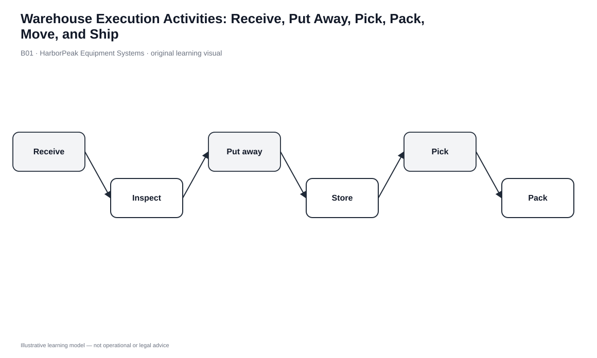
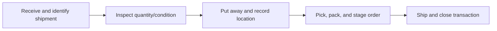

# 1. Warehouse Execution Activities: Receive, Put Away, Pick, Pack, Move, and Ship

## Learning objectives

After this topic, you should be able to:

- trace the controlled warehouse flow from inbound receipt to outbound shipment
- distinguish receiving, put-away, storage, picking, internal movement, packaging, packing/marking, and shipping
- identify the evidence needed to keep physical inventory and system records synchronized
- use activity data to locate waiting, rehandling, and exception exposure

## Concept in plain English

A warehouse is an execution system, not simply a place where inventory waits. Each step changes custody, location, status, or customer readiness. A typical normal path is **receive → verify → put away or route → store → pick → pack/mark → stage → ship**.

Receiving confirms what physically arrived and whether quantity and visible condition agree with the expected shipment. Put-away takes accepted inventory away from the dock and records its destination location. Storage keeps the item under control until demand calls for it. Order picking retrieves the required quantity for a specific demand signal. An internal move changes where the inventory is held and must be reflected in the system. Packaging protects the item; packing and marking create the shipment unit and communicate identity, handling, and tracking information. Shipping confirms that the outbound load has left warehouse custody.

The key discipline is transaction integrity: a physical movement that matters operationally should have a corresponding record. Fast movement with weak records creates inventory that is physically present but difficult to promise, locate, trace, or reconcile.

## Why it matters

Execution quality affects inventory accuracy, labor productivity, customer service, and claims. A receiving mistake can become a picking shortage later. An unrecorded move can look like a stockout. A packing or label error can turn a correct pick into a delivery exception.

Not every warehouse step is customer-value-added in the lean sense, but required control work still has to be performed accurately. The improvement target is avoidable touches, delay, rework, search, and information loss—not the blind elimination of controls.

## Decision model and workflow

### Evidence retained through the workflow

| Evidence | Why it matters |
|---|---|
| Inbound reference and receipt confirmation | Connects the physical arrival to the expected shipment and accepted quantity. |
| Condition/exception record | Separates usable inventory from shortage, damage, excess, or quarantine. |
| Location confirmation | Keeps the WMS/ERP location aligned with physical reality. |
| Pick and pack confirmation | Shows which order consumed which inventory and how it was prepared. |
| Shipment confirmation | Closes warehouse custody and starts downstream tracking. |

## Practical process flow

## Original visualization

The original visual shows both the physical sequence and the record checkpoints. Cross-docked material can bypass normal storage when destination and timing are already known; that is an exception path, not a reason to remove controls.

## Realistic example — HarborPeak Equipment Systems

HarborPeak receives 240 controller assemblies on RCV-2701. The locked data models 38 minutes of receiving touch time and 74 minutes of put-away touch time. If the physical pallet reaches reserve storage but the put-away confirmation is delayed, the inventory can be unavailable to order promising even though it is inside the building.

For order ORD-6114, 86 units require 52 minutes of picking and 31 minutes of packing in the fictional scenario. Improving one step without protecting the handoff can simply move the error downstream.

All organizations, lanes, products, quantities, costs, scores, and operational values in this module are fictional and independently created for learning.

## Applied decision or worked calculation

Dataset: [`warehouse-operations.csv`](../../assets/data/module-5/warehouse-operations.csv)

For RCV-2701:

`receiving + put-away touch time = 38 + 74 = 112 minutes`

For ORD-6114:

`picking + packing touch time = 52 + 31 = 83 minutes`

These totals are not productivity benchmarks. They are process evidence. The improvement question is whether each touch changes status, location, protection, or customer readiness. Repeated handling that changes none of those outcomes is a stronger waste candidate.

## Decision logic

- Confirm identity, quantity, and condition before inventory is released for normal use.
- Record every location or custody change that affects availability or traceability.
- Use a bypass path such as cross-dock only when outbound destination and timing are sufficiently known.
- Treat packing/marking as shipment quality, not clerical cleanup.
- Route shortage, damage, quarantine, and location mismatches to explicit exception handling.

## Trade-offs

| Tension | Decision implication |
|---|---|
| Speed vs. control | Skipping confirmation can make one step look faster while creating larger downstream errors. |
| High utilization vs. flow | Busy staging/packing areas can hide queueing and longer order lead time. |
| Standard path vs. exceptions | Standardize normal work but keep controlled routes for damage, regulation, and priority freight. |

## Commonly confused with

**Receiving** establishes what arrived. **Put-away** establishes where accepted inventory now resides. **Picking** retrieves inventory for demand, while an internal **move** only changes location. **Packaging** protects the product; **packing and marking** prepare the shipment unit and its identification.

## Common mistakes

- Posting inventory available before obvious receipt exceptions are resolved.
- Moving material without recording the destination location.
- Treating packing/label mistakes as carrier problems after pickup.
- Looking only at average touch time while ignoring waiting, rework, and search.

## Original knowledge check

**Question.** A pallet is physically moved from receiving to reserve storage, but its system location is never updated. What is the immediate control failure?

A. Transportation mode selection

B. Physical and system locations are no longer synchronized

C. Customer credit control

D. Carrier classification

Answer and rationale

### Correct answer

**B. Physical and system locations are no longer synchronized**

### Why it is correct

The physical move changed where inventory can be found, but the system still points elsewhere.

### Why the other answers are wrong

- **A.** The issue occurs before transportation-mode choice.
- **C.** No customer-credit issue is described.
- **D.** Carrier legal structure is unrelated to an internal warehouse move.

## Practitioner perspective

In a WMS environment, the fastest way to investigate missing inventory is often to identify the last confirmed physical/system handoff. Clean event history turns a search problem into a traceable exception.

## Related concepts

- [Value-Added Distribution Services](./02-value-added-distribution-services-consolidation-break-bulk-cross-dock-and-postponement.md)
- [Module 4 — Inventory Accuracy](../../04-internal-operations-inventory/section-c-inventory/13-inventory-accuracy-physical-inventory-and-cycle-counting.md)
- [Section B overview](./README.md)

---

[Previous: Section B overview](./README.md) · [Section overview](./README.md) · [Next: Value-Added Distribution Services](./02-value-added-distribution-services-consolidation-break-bulk-cross-dock-and-postponement.md)