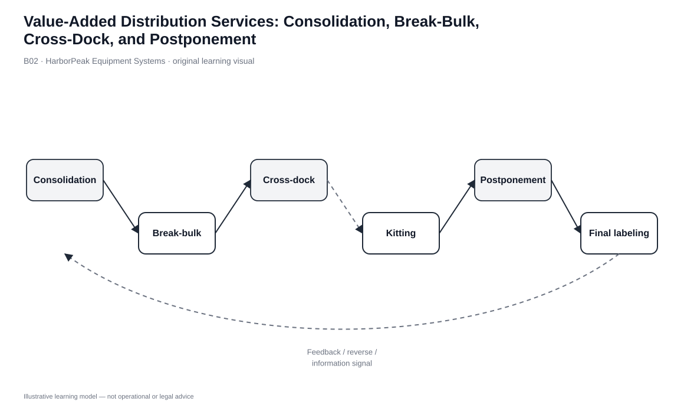
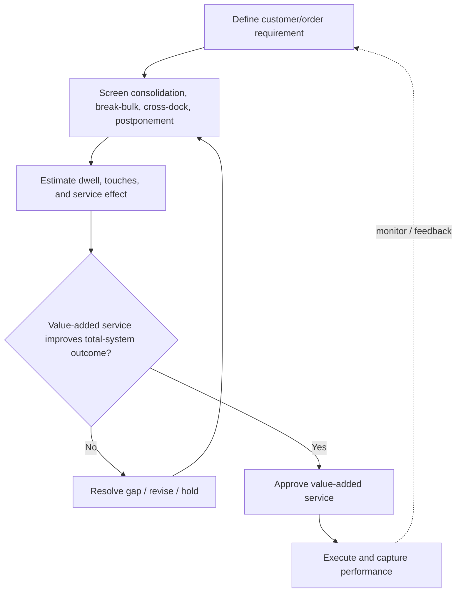

# 2. Value-Added Distribution Services: Consolidation, Break-Bulk, Cross-Dock, and Postponement

## Learning objectives

After this topic, you should be able to:

- distinguish consolidation, break-bulk, cross-docking, mixing, and postponement
- identify when a DC creates value by changing shipment scale, assortment, timing, or configuration
- recognize the information and timing conditions required for cross-docking
- evaluate added handling against total-network cost and service benefits

## Concept in plain English

Distribution facilities can create value without changing the core product. They can change shipment economics, assortment, timing, or final configuration.

**Consolidation** combines smaller inbound flows into a larger outbound load. **Break-bulk** receives a large homogeneous shipment and divides it into downstream quantities. **Cross-docking** transfers goods from inbound to outbound handling with little or no normal storage. **Mixing** combines products from different origins into the assortment required by a customer or market. **Postponement** delays final differentiation—such as labeling, accessory kits, language packs, or final assembly—until demand becomes clearer.

These services are not automatically beneficial. They are justified when the handling and coordination they add are smaller than the transport, inventory, lead-time, forecast-risk, or customer-service cost they remove elsewhere in the network.

## Why it matters

Without these services, each plant or supplier may ship many small loads directly to many destinations, or the network may hold too many finished variants at too many nodes. A well-designed distribution point can reduce that fragmentation.

Cross-docking is especially dependent on information quality. If the outbound destination is unknown, arrival timing is unreliable, or dock capacity is not coordinated, the facility simply creates congestion instead of flow. Postponement has a similar gate: the downstream node must be capable of performing the delayed configuration correctly.

## Decision model and workflow

### Evidence retained through the workflow

| Evidence | Why it matters |
|---|---|
| Inbound/outbound shipment profile | Shows whether consolidation, splitting, or bypass creates scale. |
| Destination certainty and schedule | Determines whether cross-dock transfer can avoid storage safely. |
| Variant/configuration demand | Shows whether delaying differentiation can pool risk. |
| Added process cost | Must be compared with transport, inventory, and service benefits. |
| Quality/traceability requirements | Protect product control when work is moved downstream. |

## Practical process flow

## Original visualization

The visual separates services by what they transform: combine, divide, bypass storage, or delay differentiation. That is more useful than treating them as interchangeable warehouse terms.

## Realistic example — HarborPeak Equipment Systems

The HarborPeak dataset includes a 310-unit cross-dock transaction with 46 minutes of touch time and only 0.2 hour of modeled storage. The same file also includes final labeling for 140 units and kitting for 120 units. Those latter activities are postponement/value-added examples because the DC changes the shipment into a more customer-specific form.

A cross-dock lane only works if the receiving team knows where the material is going before it arrives and outbound capacity is ready. Otherwise the “no storage” design becomes unplanned staging.

All organizations, lanes, products, quantities, costs, scores, and operational values in this module are fictional and independently created for learning.

## Applied decision or worked calculation

Dataset: [`warehouse-operations.csv`](../../assets/data/module-5/warehouse-operations.csv)

| Activity | Units | Touch time | Storage time |
|---|---:|---:|---:|
| Cross-dock | 310 | 46 min | 0.2 hr |
| Final labeling | 140 | 57 min | 0.3 hr |
| Kitting | 120 | 66 min | 0.4 hr |

The correct comparison is not “which has fewer minutes?” Each activity solves a different network problem. The business case must compare the added DC effort with the transport, inventory, forecast-risk, or service cost it avoids.

## Decision logic

- Use consolidation when combining flows creates transportation scale without unacceptable delay.
- Use break-bulk when downstream quantities are smaller than the economic inbound lot.
- Use cross-docking only when identity, destination, schedule, and capacity are synchronized.
- Use postponement when late differentiation meaningfully reduces variant risk or improves responsiveness.
- Measure total network effect rather than rewarding the warehouse for activity volume.

## Trade-offs

| Tension | Decision implication |
|---|---|
| Handling vs. transportation | Extra DC work can be justified by fuller, cheaper line-haul moves. |
| Responsiveness vs. coordination | Cross-dock speed requires tighter schedule and information discipline. |
| Central production vs. late customization | Postponement pools inventory but moves some capability downstream. |

## Commonly confused with

Break-bulk divides a larger shipment. Cross-docking describes minimal-storage transfer. Mixing builds an assortment from multiple origins. A single DC can do all three, but the mechanisms are different.

## Common mistakes

- Calling any fast movement a cross-dock process.
- Creating cross-dock lanes without dependable destination data.
- Adding postponement work without quality or traceability controls.
- Counting warehouse handling cost but not the cost avoided elsewhere.

## Original knowledge check

**Question.** A full trailer arrives with cartons already assigned to six service depots and moves directly to outbound staging. Which service is most directly used?

A. Cross-docking

B. Long-term stockpiling

C. Fixed-location storage

D. Private carriage

Answer and rationale

### Correct answer

**A. Cross-docking**

### Why it is correct

The defining feature is direct transfer from inbound handling to outbound staging without normal storage.

### Why the other answers are wrong

- **B.** Stockpiling intentionally holds inventory for future demand.
- **C.** The cartons are not assigned to normal storage locations.
- **D.** Private carriage describes transport ownership, not the warehouse transfer method.

## Practitioner perspective

These services depend on advance information. ASN quality, destination assignment, dock schedule, inventory identity, and outbound capacity are the real enablers behind the physical flow.

## Related concepts

- [Warehouse Execution Activities](./01-warehouse-execution-activities-receive-put-away-pick-pack-move-and-ship.md)
- [Stockpiling, Spot Stocking, Assortment, and Mixing](./03-stockpiling-spot-stocking-assortment-and-mixing.md)
- [Module 1 — Demand Management](../../01-supply-chains-demand-forecasting/section-c-demand-management/)

---

[Previous: Warehouse Execution Activities](./01-warehouse-execution-activities-receive-put-away-pick-pack-move-and-ship.md) · [Section overview](./README.md) · [Next: Stockpiling, Spot Stocking, Assortment, and Mixing](./03-stockpiling-spot-stocking-assortment-and-mixing.md)