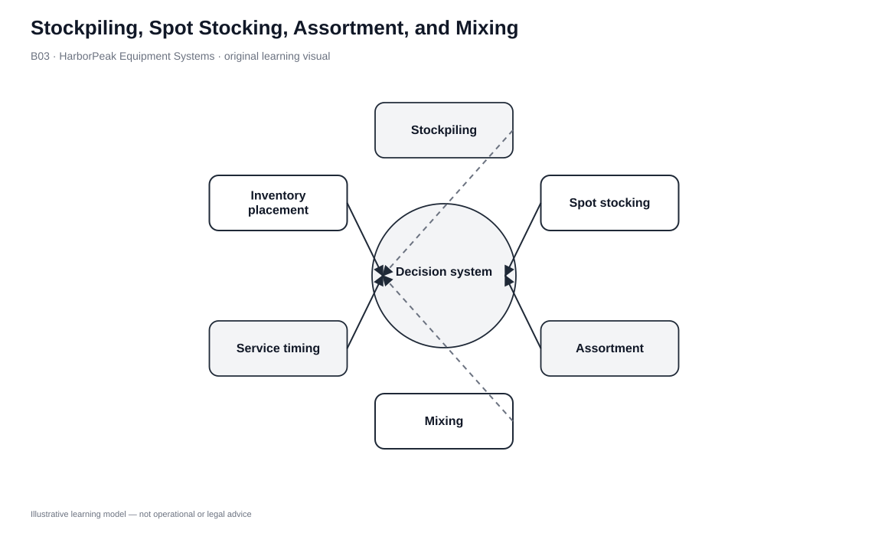
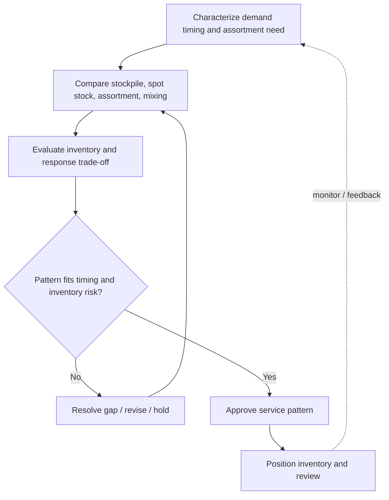

# 3. Stockpiling, Spot Stocking, Assortment, and Mixing

## Learning objectives

After this topic, you should be able to:

- distinguish anticipation stockpiling, spot stocking, assortment warehousing, and mixing
- connect each pattern to demand timing, market proximity, and shipment economics
- identify the inventory/capacity consequences of early positioning
- define review or exit triggers for temporary stocking decisions

## Concept in plain English

These warehouse patterns all position or recombine inventory, but they solve different problems.

**Stockpiling** builds anticipation inventory because supply or demand is seasonal. **Spot stocking** temporarily places inventory near selected markets before a known peak. **Assortment warehousing** keeps a range of products close enough to customers to provide short lead time and one-stop variety. **Mixing** receives products from different origins and recombines them into the product mix required by a customer or market.

The distinguishing question is why the inventory is being held: to bridge time, to pre-position geographically, to provide variety, or to combine multiple inbound sources into a more efficient outbound shipment.

## Why it matters

The wrong pattern creates unnecessary inventory. Permanent local stock is expensive if the problem is only a short promotion. Central stock may be cheaper but unacceptable when customers require immediate availability. A mixing point can reduce multiple customer receipts, but it adds handling and coordination.

The decision must start with the demand/service problem rather than with spare warehouse capacity.

## Decision model and workflow

### Evidence retained through the workflow

| Evidence | Why it matters |
|---|---|
| Demand seasonality and peak calendar | Separates anticipation needs from ordinary cycle stock. |
| Customer response requirement | Shows whether local positioning is necessary. |
| SKU velocity and variability | Supports central-versus-local inventory choices. |
| Inbound/outbound shipment profile | Shows where mixing creates shipment scale. |
| Exit trigger | Prevents temporary spot stock from becoming unmanaged permanent inventory. |

## Practical process flow

## Original visualization

The visual compares the four patterns by the operating problem solved, not by the warehouse equipment used. The same facility could support several of them.

## Realistic example — HarborPeak Equipment Systems

HarborPeak plans a six-week contractor promotion in two regions. Spot stocking selected kits near those markets can protect the peak without permanently duplicating inventory everywhere. Separately, a repair-parts strategy may keep a slow-moving but critical controller near customers because equipment downtime makes response more valuable than inventory efficiency.

For dealer orders that include tools, batteries, stands, and controllers from different upstream flows, a mixing operation can create one outbound assortment rather than several separate receipts.

All organizations, lanes, products, quantities, costs, scores, and operational values in this module are fictional and independently created for learning.

## Applied decision or worked calculation

Dataset: [`warehouse-operations.csv`](../../assets/data/module-5/warehouse-operations.csv)

The activity file provides handling evidence but not a universal stocking formula. A practical stocking decision record should contain:

| Field | Decision question |
|---|---|
| Demand timing | Seasonal, promotional, or continuous? |
| Geography | Which markets need pre-positioned stock? |
| SKU scope | One item or assortment? |
| Time in storage | Temporary peak or ongoing policy? |
| Exit trigger | When is inventory returned to normal policy? |

The exit trigger is a control. Without it, a temporary spot-stock program can quietly become permanent decentralized inventory.

## Decision logic

- Use stockpiling for predictable timing mismatch between supply/production and demand.
- Use spot stocking for defined temporary market peaks.
- Use assortment warehousing when local variety creates customer value.
- Use mixing when multi-origin products can be recombined into fewer, fuller customer shipments.
- Define who owns leftover inventory and when a temporary position ends.

## Trade-offs

| Tension | Decision implication |
|---|---|
| Market proximity vs. duplication | Local stock improves response but increases network inventory. |
| Seasonal readiness vs. obsolescence | Anticipation protects a peak but creates risk if demand is wrong. |
| Assortment breadth vs. capacity | More local variety improves convenience while consuming space and capital. |

## Commonly confused with

Stockpiling is mainly a **time-buffer** decision. Spot stocking is **temporary geographic positioning**. Assortment emphasizes **variety near the customer**. Mixing is a **shipment-combination** service.

## Common mistakes

- Using permanent local inventory to solve a short promotion.
- Centralizing every slow mover without considering service criticality.
- Failing to define disposition of leftover spot stock.
- Confusing mixing with cross-docking; mixing can include stored inventory.

## Original knowledge check

**Question.** HarborPeak positions inventory near a regional market for six weeks before a promotion and plans to remove the excess afterward. Which pattern fits?

A. Spot stocking

B. Permanent assortment expansion

C. Pipeline transport

D. Common carriage

Answer and rationale

### Correct answer

**A. Spot stocking**

### Why it is correct

Spot stocking deliberately pre-positions inventory in selected markets for a temporary demand period.

### Why the other answers are wrong

- **B.** The requirement is temporary, not permanent assortment.
- **C.** Pipeline is a transport mode.
- **D.** Carrier structure does not define inventory positioning.

## Practitioner perspective

Planning and logistics should jointly own these decisions: planning supplies demand timing and uncertainty; logistics supplies node capacity, handling, transportation, and exit economics.

## Related concepts

- [Value-Added Distribution Services](./02-value-added-distribution-services-consolidation-break-bulk-cross-dock-and-postponement.md)
- [Order Channels and Fulfillment Strategy Design](./05-order-channels-and-fulfillment-strategy-design.md)
- [Module 4 — Inventory](../../04-internal-operations-inventory/section-c-inventory/)

---

[Previous: Value-Added Distribution Services](./02-value-added-distribution-services-consolidation-break-bulk-cross-dock-and-postponement.md) · [Section overview](./README.md) · [Next: Channel Design and Service Outputs](./04-channel-design-supply-and-distribution-channels-and-service-outputs.md)