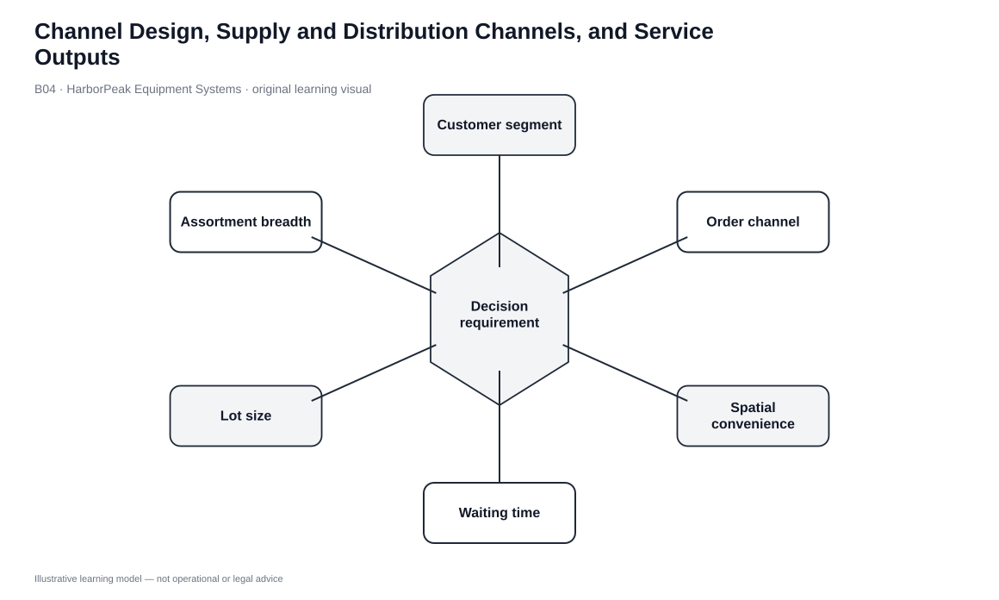
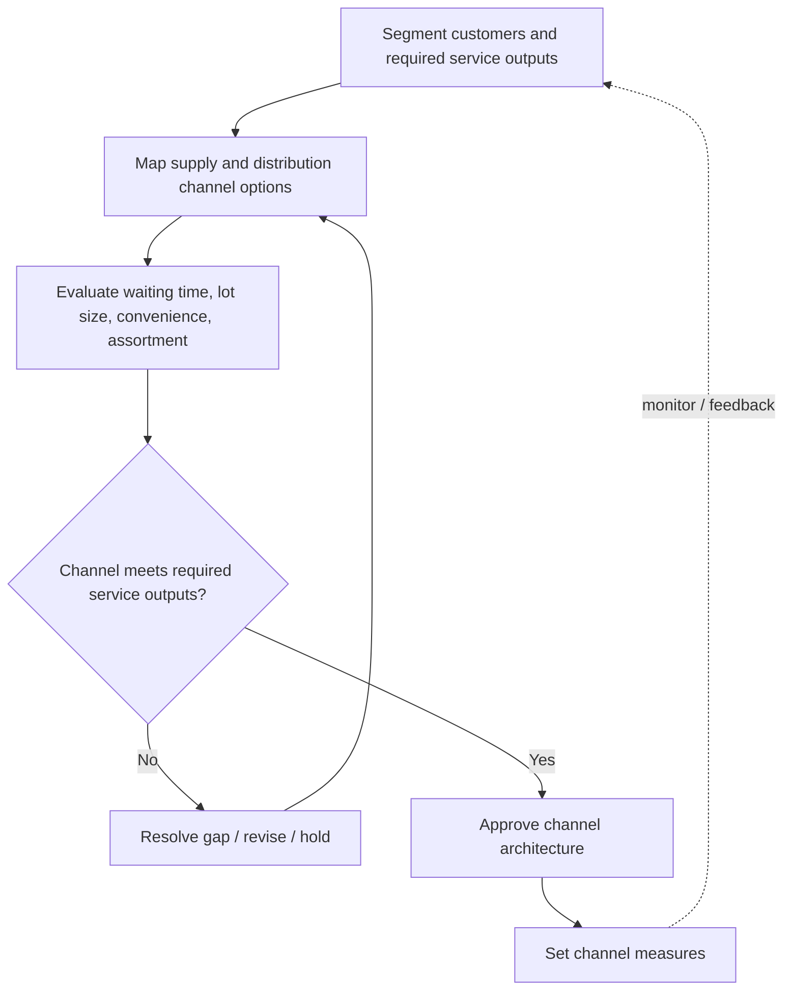

# 4. Channel Design, Supply and Distribution Channels, and Service Outputs

## Learning objectives

After this topic, you should be able to:

- explain supply- and distribution-channel design factors
- translate customer expectations into explicit service outputs
- separate market penetration, integration/control, and intermediary intensity
- treat service outputs as economic design variables

## Concept in plain English

A channel is more than a list of intermediaries. It defines how the organization reaches customers, how much control it retains, how many echelons or partners it uses, and which services customers receive along with the product.

On the supply side, design choices include network complexity, the degree of backward control/integration, and the intensity of supplier relationships. On the distribution side, the organization decides how deeply to penetrate the market, how much forward or horizontal control it wants, and how many intermediaries should operate at each level.

Customers experience these choices through service outputs such as smaller purchase quantities, spatial convenience, waiting/delivery time, assortment, and supporting information/technology. Each output consumes resources, so “better service” must be defined by segment rather than treated as unlimited.

## Why it matters

A channel can be operationally efficient and still be strategically wrong. A low-cost central network may fail customers who require immediate local availability. A highly decentralized channel can overspend on inventory and facilities when customers willingly wait.

Service-output language makes the trade-off concrete: what does the segment value, how much, and what network capability is needed to provide it?

## Decision model and workflow

### Evidence retained through the workflow

| Evidence | Why it matters |
|---|---|
| Customer segment | Defines which service outputs actually create value. |
| Desired market reach | Guides distribution penetration and intermediary intensity. |
| Control requirement | Shows how much forward/backward integration is needed. |
| Lot-size and assortment need | Determines break-bulk and variety services. |
| Lead-time and spatial need | Determines how close inventory/service must be to the customer. |

## Practical process flow

## Original visualization

The visual connects supply-channel design, distribution-channel design, and customer service outputs so that intermediary count is not optimized independently of the customer proposition.

## Realistic example — HarborPeak Equipment Systems

HarborPeak serves a large contractor buying pallet quantities on scheduled deliveries and a field-service technician who may need one controller immediately. The first segment values predictable bulk flow; the second values local availability and short waiting time.

A single network can support both only if it deliberately provides different service outputs. Otherwise the contractor may subsidize expensive local service it does not need, or the technician may receive an unacceptable lead time.

All organizations, lanes, products, quantities, costs, scores, and operational values in this module are fictional and independently created for learning.

## Applied decision or worked calculation

Dataset: [`fulfillment-strategies.csv`](../../assets/data/module-5/fulfillment-strategies.csv)

The fictional **ship from store/service depot** strategy has a modeled 1.1-day lead time, while the **integrated national DC** is 3.2 days and **supplier drop ship** is 5.8 days. The local model also uses eight inventory nodes and high handling intensity.

That is the design trade-off: greater spatial convenience and shorter waiting time require more distributed capability. The 5.8-day drop-ship option is marked FAIL for the modeled service boundary, so low capital cannot compensate for the wrong service output.

## Decision logic

- Define the target customer segment before choosing the channel architecture.
- Translate broad service language into measurable outputs such as lead time, lot size, assortment, and access.
- Set control/integration requirements separately from the number of intermediaries.
- Use mandatory service outputs as gates before cost ranking.
- Revisit channel design when customer behavior or channel mix changes materially.

## Trade-offs

| Tension | Decision implication |
|---|---|
| Coverage vs. control | More intermediaries increase reach but can reduce direct control and customer information. |
| Convenience vs. cost | More local presence reduces customer effort while generally adding network cost. |
| Assortment vs. inventory | Wider local variety improves choice while increasing stock and space. |

## Commonly confused with

**Distribution intensity** concerns how many intermediaries are used. **Distribution integrative intensity** concerns how much downstream control the producer seeks. These can move independently.

## Common mistakes

- Selecting channel partners before defining required service outputs.
- Treating all segments as if they value lead time, assortment, and price equally.
- Equating more intermediaries with better coverage without measuring service.
- Treating service outputs as free benefits.

## Original knowledge check

**Question.** Industrial repair customers value immediate local availability, while project customers accept scheduled pallet deliveries. What is the strongest channel-design response?

A. Force both segments through the same service output

B. Define segment-specific outputs and choose channel capability accordingly

C. Select the cheapest carrier first

D. Maximize intermediary count

Answer and rationale

### Correct answer

**B. Define segment-specific outputs and choose channel capability accordingly**

### Why it is correct

The segments value different lead time, lot size, and spatial convenience. The channel should reflect those differences.

### Why the other answers are wrong

- **A.** A single undifferentiated promise can over-serve one segment and under-serve another.
- **C.** Carrier choice follows the channel/service requirement.
- **D.** Intermediary count is a design variable, not an objective.

## Practitioner perspective

Commercial teams describe channels in customer terms while supply chain teams describe nodes and flows. Service-output language is a useful bridge between the two.

## Related concepts

- [Order Channels and Fulfillment Strategy Design](./05-order-channels-and-fulfillment-strategy-design.md)
- [Distribution Network Architectures](./09-distribution-network-architectures-manufacturer-distributor-and-aggregator-models.md)
- [Module 2 — Network Design](../../02-network-design-digital-connectivity-performance/)

---

[Previous: Stockpiling, Spot Stocking, Assortment, and Mixing](./03-stockpiling-spot-stocking-assortment-and-mixing.md) · [Section overview](./README.md) · [Next: Order Channels and Fulfillment Strategy Design](./05-order-channels-and-fulfillment-strategy-design.md)