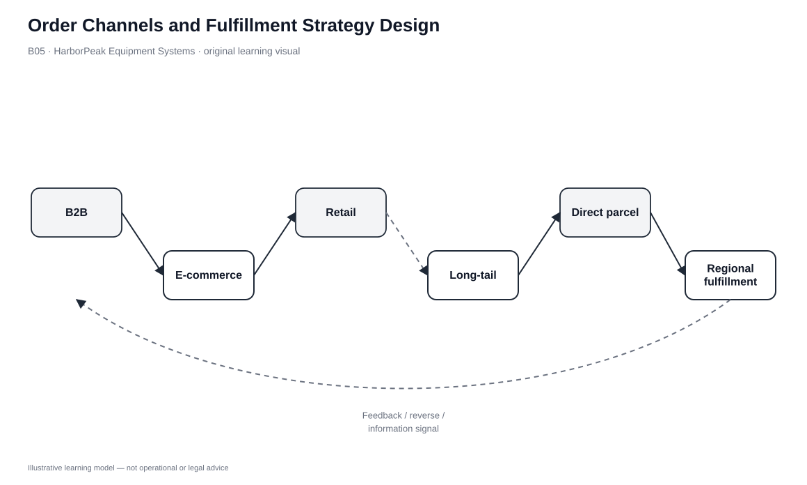
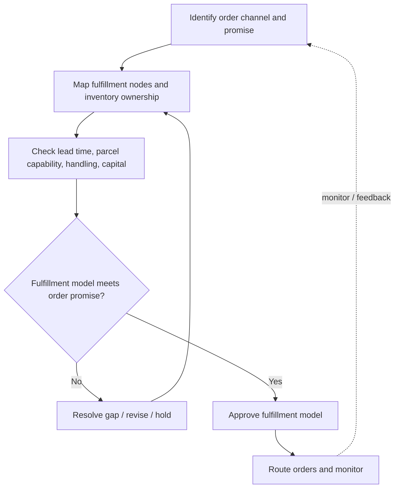

# 5. Order Channels and Fulfillment Strategy Design

## Learning objectives

After this topic, you should be able to:

- distinguish how customers order from how orders are physically fulfilled
- map direct, digital, retail, distributor, and service-channel demand to feasible fulfillment nodes
- identify when each-picking, parcel shipping, allocation, or visibility requirements change
- apply the customer promise before comparing fulfillment economics

## Concept in plain English

An **order channel** is how demand enters the company: sales force, website, store, distributor, call/chat center, marketplace, or another commercial interface. A **fulfillment strategy** is how the physical network satisfies that order.

The distinction matters because a new digital channel can be launched quickly while the warehouse, inventory-allocation logic, parcel capability, and returns process remain unchanged. A DC designed for pallet and case replenishment may face a completely different labor and space profile when it starts shipping individual units directly to customers.

One order channel can route to several fulfillment nodes, and several order channels can share one node. The design task is to match the demand profile to a capable physical path.

## Why it matters

Many omnichannel problems are actually alignment problems between order capture and execution. Marketing can create demand faster than operations can redesign picking, packing, inventory visibility, or carrier cut-offs.

A disciplined design therefore asks two separate questions: **Where can the customer order?** and **From where/how will the order be fulfilled?** Only then should the organization choose integrated, dedicated, outsourced, pooled, local, or drop-ship capability.

## Decision model and workflow

### Evidence retained through the workflow

| Evidence | Why it matters |
|---|---|
| Order-channel volume and growth | Shows whether the new profile is marginal or structural. |
| Order profile | Defines each/case/pallet, lines/order, and parcel workload. |
| Inventory visibility/allocation rule | Prevents channels from promising the same stock. |
| Cut-off and lead-time promise | Sets the response requirement. |
| Return route | Ensures the forward channel has a supported reverse path. |

## Practical process flow

## Original visualization

The visual separates customer-facing order entry from the physical nodes that can execute it, making clear that digital order capture is not itself a distribution network.

## Realistic example — HarborPeak Equipment Systems

HarborPeak historically fulfills B2B pallet/case orders from one national DC. It adds direct web orders for replacement controllers. When direct volume is small, the existing facility may absorb the parcel work. As volume grows, each-picking and parcel staging can interfere with dealer replenishment waves.

The question is not whether e-commerce is strategically important. The question is which fulfillment architecture can deliver the promise without damaging the existing channel.

All organizations, lanes, products, quantities, costs, scores, and operational values in this module are fictional and independently created for learning.

## Applied decision or worked calculation

Dataset: [`fulfillment-strategies.csv`](../../assets/data/module-5/fulfillment-strategies.csv)

The **dedicated e-commerce DC** is modeled at parcel capability 5/5 and 1.4 days lead time. **Ship from store/service depot** is faster at 1.1 days but uses eight nodes and handling intensity 5/5. **Integrated national DC** uses one node and handling intensity 3/5, but modeled lead time is 3.2 days.

Use the table in this order: define the segment and promise, remove strategies that cannot satisfy it, then compare capital, handling, flexibility, and complexity.

## Decision logic

- Define order channel and customer promise separately.
- Translate the order profile into picking, packing, parcel, allocation, and cut-off needs.
- Test whether existing nodes can support the new work without harming current flows.
- Apply service gates before capital-cost ranking.
- Design the returns path at the same time as forward fulfillment.

## Trade-offs

| Tension | Decision implication |
|---|---|
| Channel growth vs. legacy efficiency | Direct orders can create labor/space conflict in a retail-oriented DC. |
| Pooling vs. proximity | Central inventory pools risk; local inventory responds faster. |
| Capital vs. specialization | Dedicated facilities cost more to establish but can optimize a distinct order profile. |

## Commonly confused with

An **order channel** captures demand. An **order-fulfillment channel** is the physical route used to satisfy it. A website is not itself a fulfillment network.

## Common mistakes

- Launching a sales channel without defining allocation.
- Assuming parcel work can be inserted into pallet/case flow with no redesign.
- Using one lead-time promise for nodes with different capability.
- Designing forward delivery but not returns.

## Original knowledge check

**Question.** HarborPeak adds a website, but the existing DC is optimized for pallet and case work. What should be evaluated first?

A. Whether the new order profile can meet the promise without disrupting existing flows

B. Website font choice

C. Move every SKU to stores

D. Use air freight for every web order

Answer and rationale

### Correct answer

**A. Whether the new order profile can meet the promise without disrupting existing flows**

### Why it is correct

The new order channel changes the physical workload. Fulfillment capability and allocation must be tested before scale-up.

### Why the other answers are wrong

- **B.** Presentation does not establish fulfillment feasibility.
- **C.** A wholesale network move is unsupported by the stated problem.
- **D.** Transport mode should follow shipment/service needs.

## Practitioner perspective

In OMS/WMS design, a channel becomes real when sourcing, promising, allocation, and execution rules are configured. Without them, “omnichannel” often means manual exception handling.

## Related concepts

- [Integrated and Dedicated Fulfillment](./06-integrated-and-dedicated-fulfillment.md)
- [Comparing Distribution Strategies](./08-comparing-distribution-strategies.md)
- [Module 1 — Demand Management](../../01-supply-chains-demand-forecasting/section-c-demand-management/)

---

[Previous: Channel Design and Service Outputs](./04-channel-design-supply-and-distribution-channels-and-service-outputs.md) · [Section overview](./README.md) · [Next: Integrated and Dedicated Fulfillment](./06-integrated-and-dedicated-fulfillment.md)