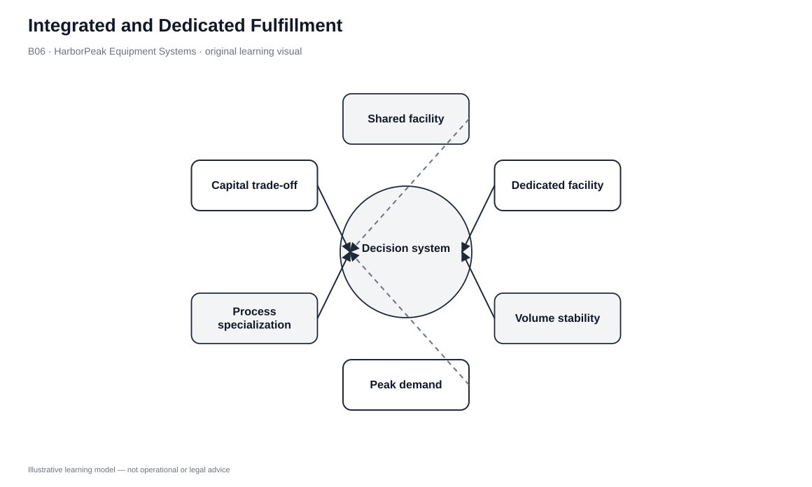
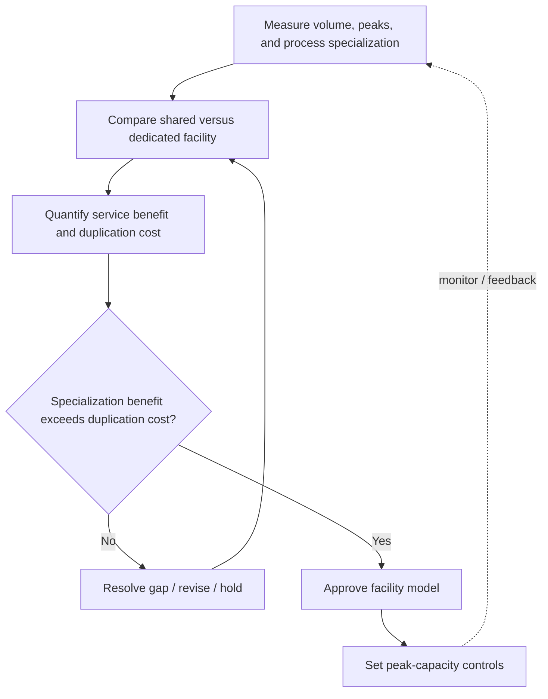

# 6. Integrated and Dedicated Fulfillment

## Learning objectives

After this topic, you should be able to:

- compare integrated and dedicated fulfillment models
- identify volume, labor, space, inventory, and capital effects
- recognize when parcel each-picking conflicts with retail case/pallet flow
- test future volume rather than choosing only from today's workload

## Concept in plain English

Integrated fulfillment uses the same DC network to serve retail/B2B flows and direct parcel orders. Dedicated fulfillment separates the direct-to-customer workload into facilities and processes designed for that profile.

Integrated operations can reuse facility, workforce, inventory, and fixed assets. That is attractive when direct volume is limited and the building has enough space/process flexibility. But each-picking, parcel packing, and consumer cut-off times can be much more labor-intensive than pallet/case fulfillment.

Dedicated fulfillment protects the retail flow and allows parcel-oriented slotting, automation, and process design. The price is duplication: facilities, inventory, systems, and often workforce. The decision is therefore about process compatibility and scale, not whether integration or specialization is philosophically better.

## Why it matters

The choice affects far more than rent. Integrated operations can suffer interference: parcel waves compete with store replenishment, inventory is contested across channels, and layouts optimized for pallets may not support high-frequency each-picking.

Dedicated operations avoid some interference but create duplicate fixed cost and inventory exposure. The right design changes as direct-order volume grows.

## Decision model and workflow

### Evidence retained through the workflow

| Evidence | Why it matters |
|---|---|
| Direct-order share and growth | Shows whether workload is niche, emerging, or structural. |
| Pick profile | Quantifies each/case/pallet and labor intensity. |
| Facility capacity | Shows whether shared space can absorb the new flow. |
| Inventory allocation conflict | Measures competition between retail and direct demand. |
| Capital/duplication cost | Makes the dedicated alternative visible. |

## Practical process flow

## Original visualization

The visual shows one shared node versus specialized networks, highlighting process conflict on the integrated side and duplicated assets on the dedicated side.

## Realistic example — HarborPeak Equipment Systems

HarborPeak initially handles online replacement-part orders from the national DC. As volume grows, each-picking occupies aisles and packing stations during the same hours dealer waves run. Management can redesign the shared DC or separate parcel fulfillment.

Dedicated fulfillment may be faster, but the value must justify added network complexity and inventory duplication.

All organizations, lanes, products, quantities, costs, scores, and operational values in this module are fictional and independently created for learning.

## Applied decision or worked calculation

Dataset: [`fulfillment-strategies.csv`](../../assets/data/module-5/fulfillment-strategies.csv)

- Integrated national DC: modeled capital **$1.35M**, handling intensity **3/5**, lead time **3.2 days**.
- Dedicated e-commerce DC: modeled capital **$0.98M**, handling intensity **5/5**, lead time **1.4 days**.

The fictional numbers deliberately show that “dedicated” is not guaranteed to have the largest capital figure in every scenario. The decision still requires total network cost, duplication, transition, labor, and service—not one line item.

## Decision logic

- Measure the direct-order profile and growth path.
- Test whether shared space, labor, and inventory can support both flows.
- Identify allocation conflicts explicitly.
- Compare redesigning the shared operation with dedicated capability.
- Model peak periods when both channels need capacity simultaneously.

## Trade-offs

| Tension | Decision implication |
|---|---|
| Asset reuse vs. process conflict | Integration reuses assets but can mix incompatible work. |
| Specialization vs. duplication | Dedicated flow improves focus but duplicates capability. |
| Pooling vs. channel protection | Shared stock pools risk but requires disciplined allocation. |

## Commonly confused with

Integrated fulfillment can still use separate zones or work cells inside one DC. Dedicated fulfillment means the fulfillment operation/network is separated, not merely that a few employees are assigned to online work.

## Common mistakes

- Choosing dedicated fulfillment because e-commerce is important without measuring workload.
- Keeping an integrated design after parcel work becomes a structural bottleneck.
- Comparing facility cost while ignoring duplicate inventory.
- Ignoring peak overlap between channels.

## Original knowledge check

**Question.** Online waves regularly delay HarborPeak dealer replenishment. Which signal most strongly suggests the integrated model needs redesign?

A. The order profiles compete for constrained execution capacity

B. Both channels share a brand

C. The DC owns forklifts

D. The company has several suppliers

Answer and rationale

### Correct answer

**A. The order profiles compete for constrained execution capacity**

### Why it is correct

Persistent competition for constrained space, labor, or processing capacity is evidence that the shared design is no longer neutral.

### Why the other answers are wrong

- **B.** Branding does not determine execution feasibility.
- **C.** Forklift ownership is not the architecture decision.
- **D.** Supplier count is unrelated to the described conflict.

## Practitioner perspective

Before building a new facility, test zoning, labor scheduling, automation, and allocation changes. The integrated-versus-dedicated debate is often a process-compatibility problem before it becomes a real-estate problem.

## Related concepts

- [Order Channels and Fulfillment Strategy Design](./05-order-channels-and-fulfillment-strategy-design.md)
- [Pool, Direct-Store, Store, and Flow-Through Fulfillment](./07-pool-direct-store-store-and-flow-through-fulfillment.md)
- [Module 4 — Capacity](../../04-internal-operations-inventory/section-b-capacity-and-production-activity-control/)

---

[Previous: Order Channels and Fulfillment Strategy Design](./05-order-channels-and-fulfillment-strategy-design.md) · [Section overview](./README.md) · [Next: Pool, Direct-Store, Store, and Flow-Through Fulfillment](./07-pool-direct-store-store-and-flow-through-fulfillment.md)