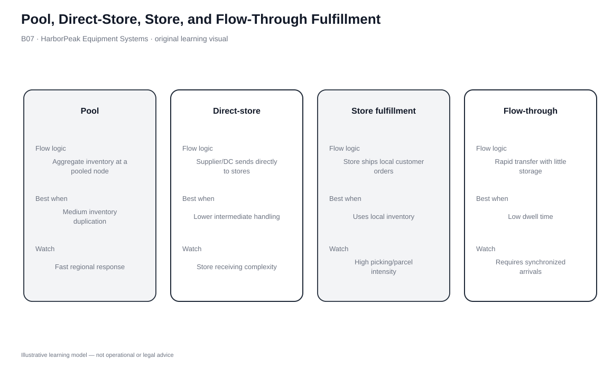
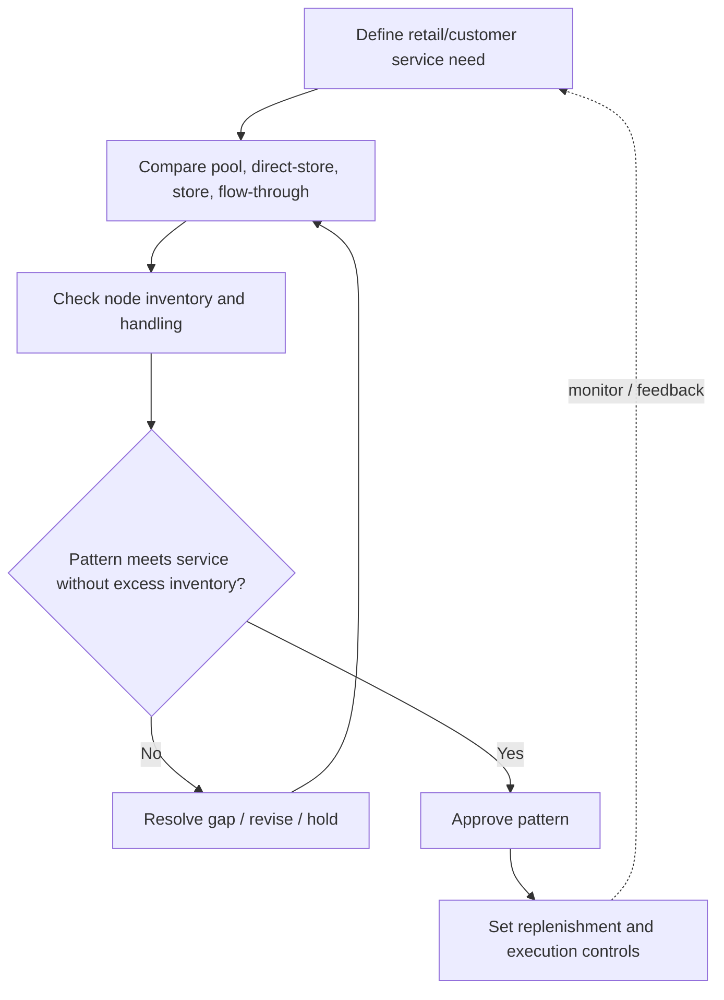

# 7. Pool, Direct-Store, Store, and Flow-Through Fulfillment

## Learning objectives

After this topic, you should be able to:

- explain pool fulfillment, direct store delivery, store fulfillment, and flow-through
- compare where inventory, picking, and last-mile responsibility sit
- connect customer lead time to consolidation and allocation requirements
- select a pattern for a specific customer/product context

## Concept in plain English

These four patterns move work and inventory to different places.

**Pool fulfillment** combines retailer orders through a pooled or third-party node so line-haul freight can be fuller and local drops can follow regular routes. **Direct store delivery** lets the manufacturer bypass a retailer DC and replenish retail locations directly. **Store fulfillment** uses store inventory and store labor to pick online orders for pickup or parcel delivery. **Flow-through fulfillment** sends the customer-specific order from the retailer DC to the store, where it is held for pickup or forwarded; the store does not pick it from shelf inventory.

The design question is where inventory and work should sit, how much consolidation value exists, and how much customer waiting time is acceptable.

## Why it matters

Each model has a different failure mode. Store fulfillment can be fast but requires accurate real-time store inventory and clear allocation between walk-in and online demand. Flow-through avoids that allocation conflict but adds time. Direct store delivery can shorten cycle time for suitable products but adds routing/service responsibility to the manufacturer.

Pool fulfillment improves transportation economics for smaller destinations while adding a coordinating node and schedule dependency.

## Decision model and workflow

### Evidence retained through the workflow

| Evidence | Why it matters |
|---|---|
| Store/DC inventory visibility | Critical for store fulfillment and pickup promises. |
| Order frequency and route density | Determines whether pool or direct-store routes create scale. |
| Shelf life or merchandising need | Can favor direct store delivery. |
| Customer lead-time tolerance | Separates store-pick speed from flow-through consolidation. |
| Ownership of pick and last mile | Clarifies accountability and cost. |

## Practical process flow

## Original visualization

The four-panel visual shows where the customer-specific pick occurs. That one distinction prevents store fulfillment and flow-through from being confused.

## Realistic example — HarborPeak Equipment Systems

HarborPeak service depots hold fast-moving consumables and selected repair parts. A local ship-from-depot model can be highly responsive if inventory is accurate. For a broader assortment, the central DC can pick a parcel and move it with scheduled depot replenishment for pickup—a flow-through pattern.

If the depot itself picks the order from local shelf inventory, HarborPeak needs real-time allocation so a walk-in customer and an online order are not both promised the same last unit.

All organizations, lanes, products, quantities, costs, scores, and operational values in this module are fictional and independently created for learning.

## Applied decision or worked calculation

Dataset: [`fulfillment-strategies.csv`](../../assets/data/module-5/fulfillment-strategies.csv)

The fictional **ship from store/service depot** model has lead time **1.1 days**, the shortest in the dataset, but uses **8 inventory nodes** and handling intensity **5/5**. **Regional pooled inventory** uses **3 nodes**, lead time **1.7 days**, and scores **5/5** on service and flexibility.

The choice is therefore not “fast vs. slow.” It is local inventory and handling intensity versus pooled scale, flexibility, and consolidation.

## Decision logic

- Use pool fulfillment when smaller destinations can share line-haul and scheduled local delivery.
- Use direct store delivery when bypassing retailer DCs improves cycle time and route density is sufficient.
- Use store fulfillment when local inventory accuracy/allocation support the promise.
- Use flow-through when upstream picking/consolidation is preferred and customers can accept extra transit.
- Define returns and exception ownership for every pattern.

## Trade-offs

| Tension | Decision implication |
|---|---|
| Fast local response vs. allocation conflict | Store fulfillment can be fast but demands strong inventory accuracy. |
| Consolidation vs. lead time | Flow-through/pooling improve freight economics but add movement time. |
| Manufacturer control vs. route burden | Direct store delivery adds control and routing responsibility. |

## Commonly confused with

Store fulfillment picks from store inventory. Flow-through sends a pre-picked order through the store as a pickup/last-mile node. They may look similar to the customer but use different inventory logic.

## Common mistakes

- Promising pickup from inaccurate store inventory.
- Using direct store delivery without enough route density.
- Calling flow-through store fulfillment when the store did not pick the order.
- Counting line-haul savings without local-drop and handling costs.

## Original knowledge check

**Question.** A depot receives a pre-picked parcel from the central DC, holds it for customer pickup, and does not allocate depot shelf inventory. Which pattern fits?

A. Flow-through fulfillment

B. Store fulfillment

C. Stockpiling

D. Pipeline transport

Answer and rationale

### Correct answer

**A. Flow-through fulfillment**

### Why it is correct

The order was picked upstream and only passes through the depot for pickup or last-mile handoff.

### Why the other answers are wrong

- **B.** Store fulfillment would source the order from depot/store inventory.
- **C.** The parcel is customer-specific, not anticipation stock.
- **D.** Pipeline is a transport mode.

## Practitioner perspective

OMS sourcing rules must reflect the physical model. If a flow-through order is accidentally sourced from store inventory, the system recreates the allocation conflict the design was meant to avoid.

## Related concepts

- [Integrated and Dedicated Fulfillment](./06-integrated-and-dedicated-fulfillment.md)
- [Comparing Distribution Strategies](./08-comparing-distribution-strategies.md)
- [Distribution Network Architectures](./09-distribution-network-architectures-manufacturer-distributor-and-aggregator-models.md)

---

[Previous: Integrated and Dedicated Fulfillment](./06-integrated-and-dedicated-fulfillment.md) · [Section overview](./README.md) · [Next: Comparing Distribution Strategies](./08-comparing-distribution-strategies.md)