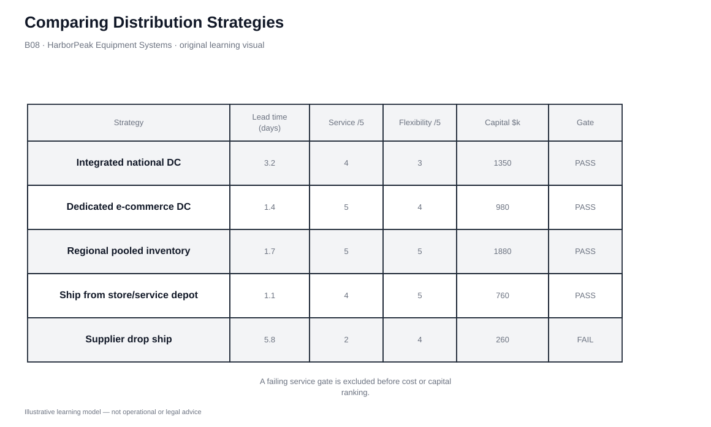

# 8. Comparing Distribution Strategies

## Learning objectives

After this topic, you should be able to:

- compare fulfillment strategies using a common decision frame
- apply hard service/capability gates before weighted ranking
- recognize that different segments can rationally use different strategies
- document rejection reasons so decisions can be revisited

## Concept in plain English

Distribution strategies should be compared using the same assumptions and a common decision frame. There is no universal winner.

A strong comparison separates **hard gates** from **trade-off criteria**. If a model cannot meet the required service, product-handling, compliance, or channel-control condition, it is removed before weighted scoring or cost ranking. Among feasible options, compare lead time, capital, handling intensity, inventory-node count, parcel capability, flexibility, and total-system economics.

This prevents a weighted score from hiding a fatal weakness. A low-capital drop-ship model that misses the customer promise is not “nearly best” for that segment; it is infeasible until the requirement or capability changes.

## Why it matters

Teams often compare distribution alternatives using different assumptions. One option includes parcel cost while another excludes it; one assumes local stock while another assumes central stock; one gets credit for speed but no penalty for inventory duplication.

A common frame makes the decision auditable and also exposes segmentation opportunities: urgent repair parts can use a different route from long-tail accessories.

## Decision model and workflow

### Evidence retained through the workflow

| Evidence | Why it matters |
|---|---|
| Service gate | Minimum lead time, reliability, and availability requirement. |
| Capital requirement | Facility, automation, systems, and transition investment. |
| Handling intensity | Labor/process burden created by the order profile. |
| Inventory-node count | Indicates duplication and pooling effects. |
| Flexibility | Ability to handle mix, peaks, and future change. |

## Practical process flow

This topic compares fulfillment structures rather than prescribing a repetitive transaction flow. First eliminate options that fail the service gate; then compare the surviving alternatives on capital, handling intensity, lead time, and flexibility using the decision visual.

## Original visualization

The comparison visual is sufficient because the learning task is evaluation rather than a recurring operating process. It puts the five fictional strategies on a common basis.

## Realistic example — HarborPeak Equipment Systems

HarborPeak compares an integrated national DC, dedicated e-commerce DC, regional pool, ship-from-depot, and supplier drop ship. Ship-from-depot is fastest but uses the most inventory nodes. Regional pooling has strong service/flexibility but the largest modeled capital. Supplier drop ship is low capital but fails the modeled service gate.

The table turns an argument about preferences into a discussion about explicit service and economic assumptions.

All organizations, lanes, products, quantities, costs, scores, and operational values in this module are fictional and independently created for learning.

## Applied decision or worked calculation

Dataset: [`fulfillment-strategies.csv`](../../assets/data/module-5/fulfillment-strategies.csv)

| Strategy | Lead time | Nodes | Capital | Service | Flexibility | Gate |
|---|---:|---:|---:|---:|---:|---|
| Integrated national DC | 3.2 d | 1 | $1.35M | 4/5 | 3/5 | PASS |
| Dedicated e-commerce DC | 1.4 d | 1 | $0.98M | 5/5 | 4/5 | PASS |
| Regional pooled inventory | 1.7 d | 3 | $1.88M | 5/5 | 5/5 | PASS |
| Ship from store/service depot | 1.1 d | 8 | $0.76M | 4/5 | 5/5 | PASS |
| Supplier drop ship | 5.8 d | 0 | $0.26M | 2/5 | 4/5 | **FAIL** |

The lesson deliberately does not compute a single weighted winner. The segment and management priorities determine how feasible options should be ranked.

## Decision logic

- Use the same horizon and service definition for every option.
- Remove strategies that fail mandatory service/capability gates.
- Compare feasible options across capital, inventory, handling, flexibility, and total cost.
- Test peak and growth scenarios, not only average demand.
- Record why alternatives were rejected so the decision can be revisited.

## Trade-offs

| Tension | Decision implication |
|---|---|
| One winner vs. segmented portfolio | Different products/segments can rationally use different strategies. |
| Low capital vs. weak service | Asset-light models may shift lead time or risk elsewhere. |
| Local speed vs. pooling | Fast local service usually consumes more distributed capability or inventory. |

## Commonly confused with

A comparison score is not a substitute for a hard gate. Weighted scoring ranks feasible alternatives; it should not compensate for a mandatory service, safety, legal, or capability failure.

## Common mistakes

- Giving a failed option enough low-cost points to win.
- Comparing alternatives with different demand assumptions.
- Using average lead time while ignoring the customer promise.
- Forcing one strategy across the whole portfolio without testing segmentation.

## Original knowledge check

**Question.** Supplier drop ship has the lowest capital cost but fails the modeled service gate. What should happen?

A. Keep it in the ranking and let cost compensate

B. Exclude it for that requirement unless service/capability changes

C. Automatically choose the most expensive model

D. Ignore lead time

Answer and rationale

### Correct answer

**B. Exclude it for that requirement unless service/capability changes**

### Why it is correct

A hard service gate defines feasibility. Trade-off scoring only makes sense after the gate passes.

### Why the other answers are wrong

- **A.** A weighted average can conceal a mandatory failure.
- **C.** Failure of one option does not prove the highest-cost option is best.
- **D.** The customer promise is part of the requirement.

## Practitioner perspective

Good decision records preserve assumptions and rejection reasons. A model rejected today may become feasible later if volume, service promise, supplier capability, or node capacity changes.

## Related concepts

- [Order Channels and Fulfillment Strategy Design](./05-order-channels-and-fulfillment-strategy-design.md)
- [Drop Ship and Direct Delivery](./10-drop-ship-direct-delivery-and-order-fulfillment-channel-comparison.md)
- [Module 2 — Metrics](../../02-network-design-digital-connectivity-performance/section-c-performance-and-financial-insight/)

---

[Previous: Pool, Direct-Store, Store, and Flow-Through Fulfillment](./07-pool-direct-store-store-and-flow-through-fulfillment.md) · [Section overview](./README.md) · [Next: Distribution Network Architectures](./09-distribution-network-architectures-manufacturer-distributor-and-aggregator-models.md)