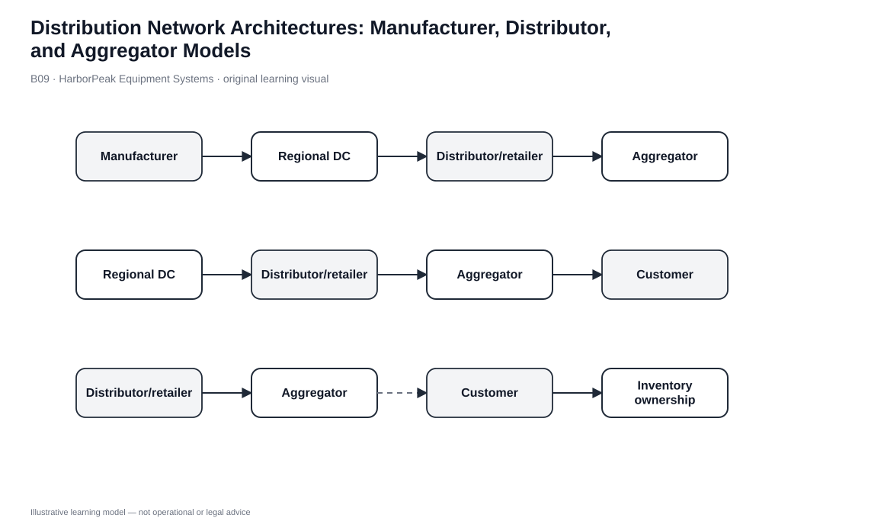
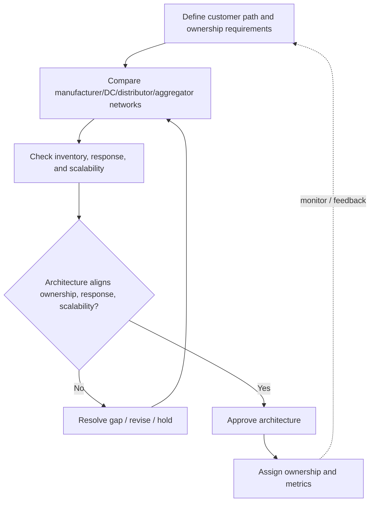

# 9. Distribution Network Architectures: Manufacturer, Distributor, and Aggregator Models

## Learning objectives

After this topic, you should be able to:

- compare manufacturer-led, distributor-led, and aggregator/e-business architectures
- identify where inventory ownership, customer access, and channel control sit
- recognize inventory consequences of multiple echelons
- match architecture to product economics and service needs

## Concept in plain English

A distribution network can be organized around different channel masters.

In a **manufacturer-to-DC-to-retailer** architecture, goods move through one or more distribution echelons before the retailer serves the customer. That can support high availability and broad market presence, but several nodes may hold inventory.

An **independent distributor** buys from multiple manufacturers and creates value through aggregation, break-bulk, assortment, and transportation scale. It needs enough market volume and customer reach to justify the inventory and transport infrastructure.

An **aggregator/e-business** model relies heavily on direct digital access to customers. It can combine many sellers and products, use parcel networks, owned or partner nodes, and drop ship, while making customer information and digital experience important capabilities.

## Why it matters

Architecture determines who owns inventory risk, who sees the customer, who performs assortment and break-bulk, and where economies of scale or scope are created. Removing an intermediary can lower one cost while forcing the manufacturer to replace selling, credit, service, consolidation, or local-availability functions.

The decision therefore belongs in business-model design as much as logistics design.

## Decision model and workflow

### Evidence retained through the workflow

| Evidence | Why it matters |
|---|---|
| Inventory ownership by echelon | Shows working-capital and obsolescence exposure. |
| Customer/order ownership | Shows who controls demand information and relationship. |
| Intermediary value added | Makes break-bulk, assortment, local coverage, credit, or service explicit. |
| Transport economics | Shows whether the architecture can create shipment scale. |
| Service and scalability | Tests whether the network supports growth and response requirements. |

## Practical process flow

## Original visualization

The visual shows multiple architectures without implying that distribution must be one linear chain. Inventory ownership and customer access are called out because those are strategic differences, not just node-count differences.

## Realistic example — HarborPeak Equipment Systems

HarborPeak can use industrial distributors that aggregate its tools with products from other manufacturers, while serving selected national accounts directly. For contractors wanting one-stop assortment and local availability, the distributor can create value. For a strategic account buying full-load standardized products, direct plant or DC delivery may remove an unnecessary echelon.

Different customer segments can therefore use different routes inside the same overall network.

All organizations, lanes, products, quantities, costs, scores, and operational values in this module are fictional and independently created for learning.

## Applied decision or worked calculation

Dataset: [`distribution-networks.csv`](../../assets/data/module-5/distribution-networks.csv)

The fictional **manufacturer-retailer-customer** path has modeled transport cost **$18.70/order**, response time **1.9 days**, and **31 inventory days**. **Direct plant delivery** has **17 inventory days**, but transport cost rises to **$41.50/order** and scalability is only 2/5.

Removing an echelon reduces some inventory exposure in this scenario but increases shipment burden and changes customer ownership. The network choice must therefore include both physical and commercial roles.

## Decision logic

- Identify the target segment before choosing the architecture.
- Assign inventory ownership and customer/order ownership explicitly.
- Confirm what each intermediary contributes before removing or adding it.
- Test transportation scale and response time with the proposed inventory position.
- Use more than one architecture when segment economics justify it.

## Trade-offs

| Tension | Decision implication |
|---|---|
| Market reach vs. direct customer access | Intermediaries extend coverage but can separate the manufacturer from customer data. |
| Availability vs. working capital | More echelons can improve proximity while duplicating stock. |
| Economies of scope vs. complexity | Distributors and aggregators offer breadth but coordinate many suppliers and flows. |

## Commonly confused with

A **distribution network** is the broader system of nodes and channels. An **order-fulfillment channel** is one specific route used for a particular order or segment.

## Common mistakes

- Removing an intermediary without replacing the services it performs.
- Counting distributor margin as pure waste while ignoring assortment, credit, break-bulk, or local service.
- Assuming direct customer access always lowers total cost.
- Leaving inventory and return ownership ambiguous.

## Original knowledge check

**Question.** A distributor combines products from many manufacturers and sells assortments to local dealers and industrial customers. What value is it primarily creating?

A. Aggregation, assortment, break-bulk, and market reach

B. Eliminating all inventory

C. Converting every load to air

D. Removing customer service

Answer and rationale

### Correct answer

**A. Aggregation, assortment, break-bulk, and market reach**

### Why it is correct

The distributor creates economies of scope and distribution services by combining supply and serving downstream markets.

### Why the other answers are wrong

- **B.** Distributors coordinate or hold inventory rather than eliminating it.
- **C.** Mode still depends on shipment requirements.
- **D.** Customer service remains necessary; responsibility simply shifts.

## Practitioner perspective

Network redesign changes enterprise master data: plants/DCs, partner roles, inventory ownership, sourcing rules, sales channels, and order routing. That is why distribution redesign often becomes a systems transformation.

## Related concepts

- [Channel Design and Service Outputs](./04-channel-design-supply-and-distribution-channels-and-service-outputs.md)
- [Drop Ship and Direct Delivery](./10-drop-ship-direct-delivery-and-order-fulfillment-channel-comparison.md)
- [Module 3 — Sourcing Strategy](../../03-sourcing-strategy-product-design-supplier-execution/)

---

[Previous: Comparing Distribution Strategies](./08-comparing-distribution-strategies.md) · [Section overview](./README.md) · [Next: Drop Ship, Direct Delivery, and Order-Fulfillment Channel Comparison](./10-drop-ship-direct-delivery-and-order-fulfillment-channel-comparison.md)