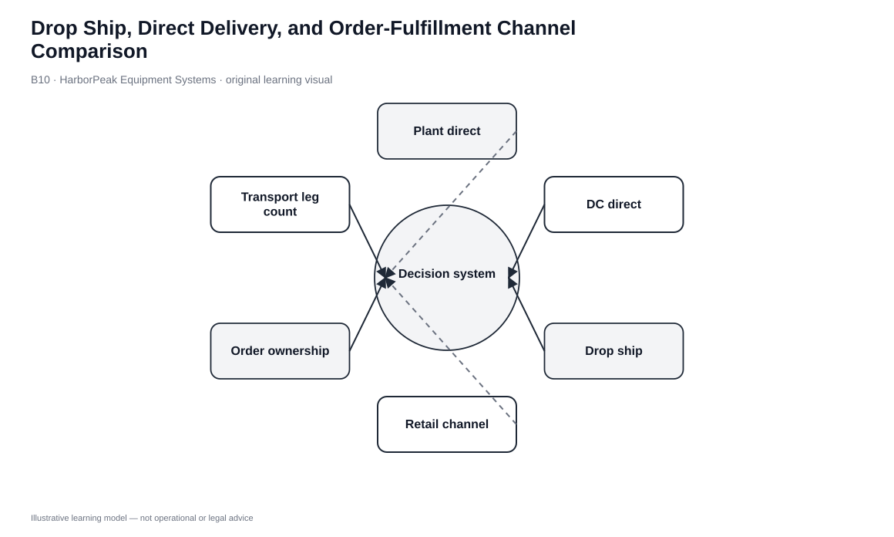
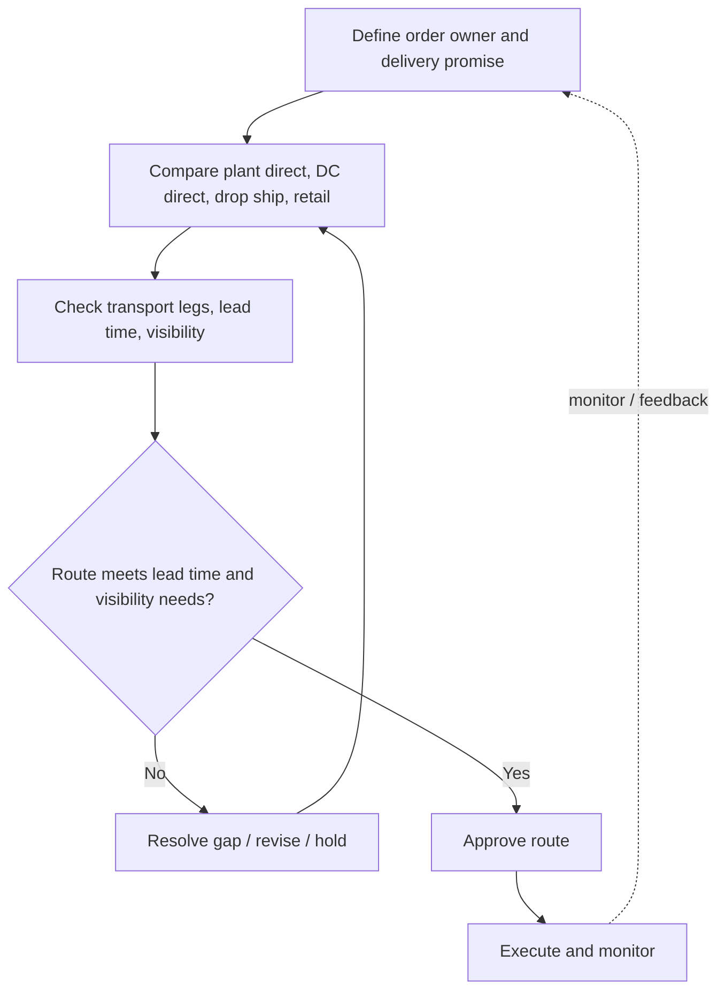

# 10. Drop Ship, Direct Delivery, and Order-Fulfillment Channel Comparison

## Learning objectives

After this topic, you should be able to:

- distinguish manufacturer storage with drop ship from manufacturer direct delivery
- identify customer-information and inventory consequences
- match direct routes to demand frequency, value, lot size, and acceptable lead time
- compare fewer echelons against transportation and service cost

## Concept in plain English

Drop ship and direct delivery both allow goods to move from manufacturer storage toward the customer without a traditional downstream inventory echelon. The difference is **who owns the customer order and relationship**.

In a drop-ship model, a retailer, distributor, or digital seller captures the order while the manufacturer ships the product to the customer. The intermediary can offer the item without holding it physically. This is useful for expensive, low-frequency, customized, or long-tail items.

In manufacturer direct delivery, the manufacturer also captures the order. That creates direct customer access and control but also requires the manufacturer to perform commercial and service work that an intermediary would otherwise provide.

## Why it matters

Both routes can reduce downstream inventory, but they can raise transportation cost because shipments are smaller or more dispersed. Drop ship can also create information gaps: the manufacturer executes delivery but may not control the customer experience.

“One less echelon” therefore does not automatically mean “lower total cost.” The network still has to perform sales, credit, returns, consolidation, service, and last-mile activities somewhere.

## Decision model and workflow

### Evidence retained through the workflow

| Evidence | Why it matters |
|---|---|
| Demand frequency and product value | Supports centralizing high-value or slow-moving items. |
| Customer lead-time tolerance | Tests whether central fulfillment is acceptable. |
| Order ownership | Determines who controls the customer relationship. |
| Shipment size/geography | Determines transport economics. |
| Return/service responsibility | Prevents post-delivery ownership gaps. |

## Practical process flow

## Original visualization

The visual separates the commercial order path from the physical shipment path. They diverge in drop ship and remain with the manufacturer in direct delivery.

## Realistic example — HarborPeak Equipment Systems

HarborPeak sells a specialized control cabinet only a few times per month. A distributor can list it without holding local inventory while HarborPeak ships the configured item after an order arrives. That is drop ship.

A national contractor buying standardized pallets under a direct framework agreement may instead order from HarborPeak and receive direct plant/DC delivery. The manufacturer owns both the commercial relationship and fulfillment route.

All organizations, lanes, products, quantities, costs, scores, and operational values in this module are fictional and independently created for learning.

## Applied decision or worked calculation

Dataset: [`distribution-networks.csv`](../../assets/data/module-5/distribution-networks.csv)

The fictional **drop ship** network carries only **9 inventory days** but has **5.4-day response** and a **WATCH** service gate. **Direct plant delivery** has **17 inventory days**, **2.7-day response**, and modeled transport cost of **$41.50/order**.

A complete route decision should record: demand frequency, order owner, ship-from node, shipment size, service promise, transport economics, and return owner.

## Decision logic

- Use drop ship when downstream inventory duplication is unattractive and the intermediary can still own the customer experience.
- Use direct delivery when direct customer ownership is valuable and shipment economics work.
- Check lead-time promise before centralizing the item.
- Include returns, credits, and service responsibilities in the design.
- Segment high-value/slow-moving and high-volume/standard items rather than forcing one rule.

## Trade-offs

| Tension | Decision implication |
|---|---|
| Low inventory vs. transport cost | Central manufacturer storage reduces duplication but can create smaller shipments. |
| Intermediary reach vs. customer visibility | Drop ship preserves seller reach but can limit manufacturer customer information. |
| Direct relationship vs. commercial workload | Direct delivery increases control while adding sales and service responsibilities. |

## Commonly confused with

Drop ship describes a physical route where the selling intermediary does not stock the item. Direct delivery means the manufacturer receives the order and ships directly. Both can use third-party carriers.

## Common mistakes

- Calling every supplier-to-customer shipment direct sales.
- Removing local inventory without testing lead time.
- Assuming the manufacturer automatically gets complete customer data in drop ship.
- Ignoring returns and credit ownership.

## Original knowledge check

**Question.** A distributor accepts the customer order, but HarborPeak ships directly from its plant to that customer. Which model is this?

A. Manufacturer storage with drop ship

B. Manufacturer direct delivery

C. Store fulfillment

D. Stockpiling

Answer and rationale

### Correct answer

**A. Manufacturer storage with drop ship**

### Why it is correct

The intermediary owns the customer order while the manufacturer performs physical fulfillment.

### Why the other answers are wrong

- **B.** Direct delivery would have HarborPeak own the customer order.
- **C.** No store inventory is used.
- **D.** Stockpiling is anticipation inventory, not an order route.

## Practitioner perspective

OMS master data should distinguish sold-to, ship-to, bill-to, inventory owner, and fulfillment source. Drop ship becomes fragile when those roles are collapsed into one generic customer field.

## Related concepts

- [Distribution Network Architectures](./09-distribution-network-architectures-manufacturer-distributor-and-aggregator-models.md)
- [Comparing Distribution Strategies](./08-comparing-distribution-strategies.md)
- [Reverse Flow — later in Module 5](../section-d-reverse-flow/)

---

[Previous: Distribution Network Architectures](./09-distribution-network-architectures-manufacturer-distributor-and-aggregator-models.md) · [Section overview](./README.md) · [Next: Transportation Mode Selection and Value/Packaging Density](./11-transportation-mode-selection-and-value-packaging-density.md)