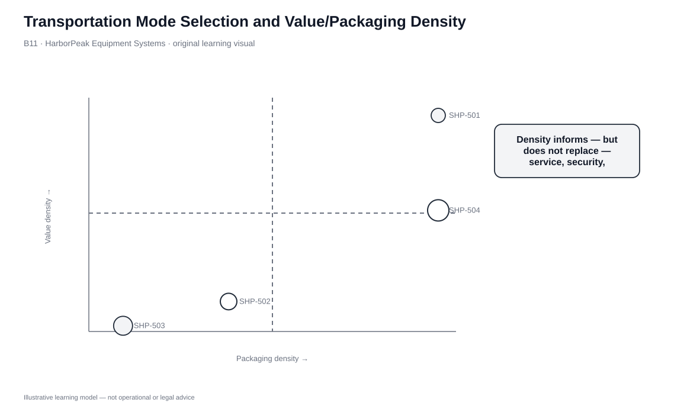
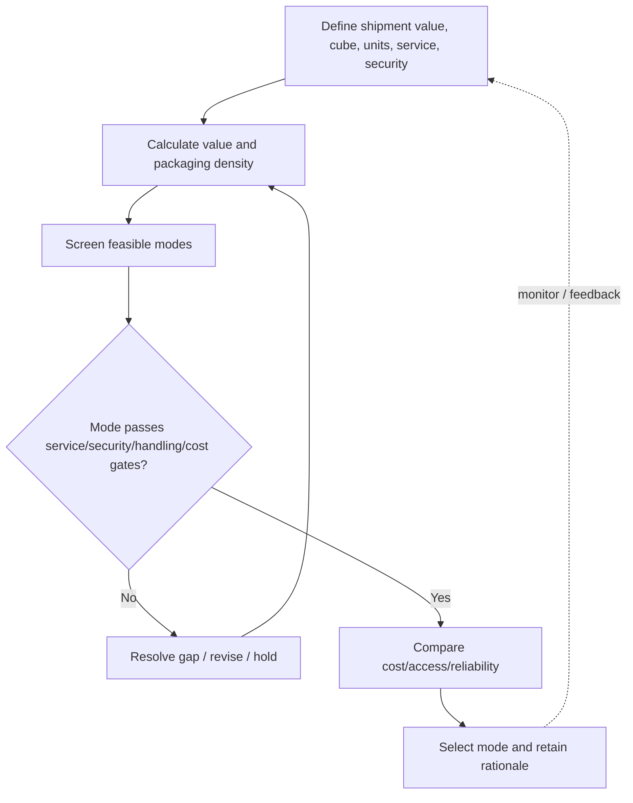

# 11. Transportation Mode Selection and Value/Packaging Density

## Learning objectives

After this topic, you should be able to:

- select mode from product, shipment, lane, and service requirements
- calculate and interpret value density and packaging density
- explain why density informs but does not determine mode choice
- apply service, accessibility, damage, security, and reliability gates before cost ranking

## Concept in plain English

Transportation mode selection begins with the logistics requirement, not with a preferred mode. Rail, motor, water, pipeline, air, and intermodal combinations each have different strengths and limits. Relevant variables include product type, shipment size and weight, value, required speed, lane volume, accessibility, handling, damage sensitivity, security, and reliability.

Two useful lenses are **value density** and **packaging density**. Value density is monetary value divided by occupied shipment volume. High value density can support faster or more secure service because the transportation premium may be small relative to value-at-risk or working capital. Packaging density is unit quantity divided by occupied volume. High packaging density can make high-throughput automated handling attractive.

Neither is an automatic mode rule. A high-value battery shipment may still be constrained by safety requirements; a low-value repair part may deserve premium service because downtime is costly.

## Why it matters

Choosing solely by freight rate ignores why the shipment exists. A slow mode can create stockout exposure; a fast mode can be unnecessary for stable replenishment. Damage, theft, access, and transfer complexity can also change the result.

A structured screen keeps the decision sequence consistent: feasibility first, economics second.

## Decision model and workflow

### Evidence retained through the workflow

| Evidence | Why it matters |
|---|---|
| Required delivery time | Hard service boundary. |
| Cargo value and volume | Inputs to value density. |
| Units and occupied volume | Inputs to packaging density. |
| Damage/security sensitivity | Determines protection needs. |
| Lane access and reliability | Confirms practical service feasibility. |

## Practical process flow

## Original visualization

The quadrant plots the fictional HarborPeak shipments by value and packaging density. It is a diagnostic map rather than a prescriptive mode-selection chart.

## Realistic example — HarborPeak Equipment Systems

HarborPeak’s smart-controller shipment is worth $96,000 and occupies 3.2 m³. It is high-value, damage-sensitive, security-sensitive, and required in two days. Steel tool stands are worth only $7,800 across 9.8 m³ and have an eight-day requirement. The shipments should not be treated the same even before quotes arrive.

All organizations, lanes, products, quantities, costs, scores, and operational values in this module are fictional and independently created for learning.

## Applied decision or worked calculation

Dataset: [`transport-mode-selection.csv`](../../assets/data/module-5/transport-mode-selection.csv)

For SHP-501:

`value density = $96,000 ÷ 3.2 m³ = $30,000/m³`

`packaging density = 160 units ÷ 3.2 m³ = 50 units/m³`

The dataset marks **Air = PASS** and **Motor = WATCH** for the two-day requirement. Motor is cheaper in the fictional quote, but service feasibility must be resolved before cost decides.

For SHP-503, value density is about **$795.92/m³** and packaging density about **4.9 units/m³**, with an eight-day requirement that permits slower alternatives if reliability and access are acceptable.

## Decision logic

- Define required time and lane first.
- Screen modes for physical access, shipment size/weight, restrictions, and service.
- Use value/packaging density to understand economic and handling pressure.
- Evaluate damage, security, reliability, and transfer exposure.
- Rank price only among modes that pass mandatory gates.

## Trade-offs

| Tension | Decision implication |
|---|---|
| Speed vs. cost | Faster modes can reduce transit inventory or downtime but cost more. |
| Direct access vs. line-haul efficiency | Motor has broad access; rail/water often require transfer legs. |
| Low rate vs. transfer risk | Intermodal savings can be offset by dwell, handoffs, or claims. |

## Commonly confused with

Value density is monetary value per volume. Packaging density is units per volume. Neither is the same as mass density, though all can influence logistics.

## Common mistakes

- Selecting the cheapest mode before checking the delivery requirement.
- Using high value density as an automatic air-freight rule.
- Ignoring security or damage sensitivity.
- Comparing quotes that assume different service levels or accessorials.

## Original knowledge check

**Question.** SHP-501 has a two-day requirement. Motor is cheaper but marked WATCH while air is PASS. What is the correct sequence?

A. Choose motor because price is lower

B. Resolve motor service feasibility first; rank cost only among feasible modes

C. Use packaging density alone

D. Choose rail automatically

Answer and rationale

### Correct answer

**B. Resolve motor service feasibility first; rank cost only among feasible modes**

### Why it is correct

The required delivery time is a feasibility gate. Price should not compensate for unresolved service.

### Why the other answers are wrong

- **A.** Lower price does not prove the service requirement can be met.
- **C.** Packaging density is only one input.
- **D.** No rail option has been shown as feasible for this shipment.

## Practitioner perspective

TMS optimization needs complete constraints. Missing service time, equipment fit, security, or receiving-window rules can make the mathematically cheapest route operationally impossible.

## Related concepts

- [Rail and Motor Carrier Transport](./12-rail-and-motor-carrier-transport.md)
- [Water, Pipeline, and Air Transport](./13-water-pipeline-and-air-transport.md)
- [Intermodal Services](./14-intermodal-package-delivery-and-container-services.md)

---

[Previous: Drop Ship, Direct Delivery, and Order-Fulfillment Channel Comparison](./10-drop-ship-direct-delivery-and-order-fulfillment-channel-comparison.md) · [Section overview](./README.md) · [Next: Rail and Motor Carrier Transport](./12-rail-and-motor-carrier-transport.md)