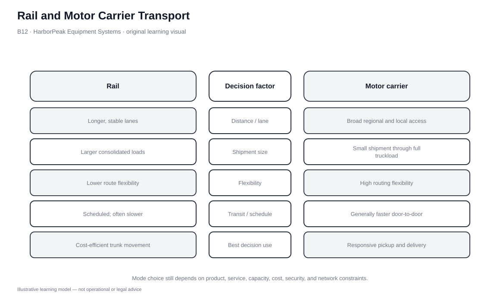

# 12. Rail and Motor Carrier Transport

## Learning objectives

After this topic, you should be able to:

- compare rail and motor using access, cost structure, shipment scale, distance, reliability, and handling
- identify shipment profiles that favor rail, motor, or rail-motor combinations
- explain rail's long-distance/heavy-load logic and motor's accessibility advantage
- compare complete routes rather than base line-haul prices

## Concept in plain English

Rail and motor carriage overlap on many lanes but create value differently.

Rail generally favors heavier loads, longer distances, and freight that can tolerate terminal/transfer handling. Its infrastructure is capital-intensive, but line-haul economics can be attractive when volume and distance support the network. Rail is also an important trunk mode inside intermodal services.

Motor carriage is highly accessible. Trucks can reach a wide range of origins and destinations directly, making them suitable for shorter and medium distances, smaller shipments, high-value goods, and schedules that benefit from door-to-door control. Carrier economics are more exposed to variable operating costs than fixed rail infrastructure.

The decision should use the actual lane and shipment rather than stereotypes such as “rail is cheap” or “truck is fast.”

## Why it matters

Mode choice changes more than freight spend. A rail solution can require drayage, terminal transfer, stronger packaging, and longer lead time. A motor solution can provide direct access but face higher cost on long heavy flows.

The strongest comparison therefore covers the complete route and service promise.

## Decision model and workflow

### Evidence retained through the workflow

| Evidence | Why it matters |
|---|---|
| Shipment weight/volume | Shows whether scale supports rail economics. |
| Origin/destination access | Determines terminal and drayage requirements. |
| Required transit time | Filters options before price ranking. |
| Damage/handling sensitivity | Shows whether extra handling is acceptable. |
| Lane volume/backhaul | Influences carrier capacity and economics. |

## Practical process flow

Rail-versus-motor selection is a lane-fit decision, not a fixed sequence. Screen each option for origin/destination access and required service first, then compare density, shipment size, damage exposure, reliability, flexibility, and total landed transport consequences.

## Original visualization

The comparison visual puts rail and motor on the same decision factors. It intentionally avoids declaring a permanent winner.

## Realistic example — HarborPeak Equipment Systems

HarborPeak’s SHP-502 drill kits have a five-day requirement. Both motor and rail+motor pass the modeled service gate. Rail+motor is cheaper in the fictional line-haul estimate but adds another mode/handoff and slightly less accessibility.

For SHP-503 steel stands, rail+motor is cheaper but marked WATCH because modeled reliability is lower. The longer eight-day window gives flexibility but does not remove the reliability issue.

All organizations, lanes, products, quantities, costs, scores, and operational values in this module are fictional and independently created for learning.

## Applied decision or worked calculation

Dataset: [`transport-mode-selection.csv`](../../assets/data/module-5/transport-mode-selection.csv)

For SHP-502:
- Motor: **$3,300**, access 5/5, reliability 4/5, PASS.
- Rail+Motor: **$2,150**, access 4/5, reliability 4/5, PASS.

The illustrative line-haul difference is **$1,150 per shipment** in favor of rail+motor. It is not yet a total-logistics saving because terminal, drayage, inventory-time, and exception effects are not fully modeled in this one table.

## Decision logic

- Confirm practical rail access on the lane.
- Compare first/last-mile transfer and terminal effects.
- Apply service and reliability gates before rate ranking.
- Include packaging/handling implications for fragile freight.
- Use recurring lane volume to decide whether intermodal capacity is strategic.

## Trade-offs

| Tension | Decision implication |
|---|---|
| Rail economics vs. terminal complexity | A lower trunk cost may require added drayage and transfer. |
| Truck accessibility vs. variable cost | Door-to-door flexibility can cost more on long heavy moves. |
| Consolidation vs. responsiveness | Building larger loads improves economics but can add waiting. |

## Commonly confused with

Rail+motor intermodal is not pure rail. Both modes and all transfer points belong in the service and cost model.

## Common mistakes

- Comparing rail line-haul with truck door-to-door price.
- Assuming rail cannot move finished goods or truck cannot move heavy goods.
- Ignoring packaging/damage implications.
- Using historical average modal cost as a quote for a specific lane.

## Original knowledge check

**Question.** Rail+motor is $1,150 below motor for SHP-502 and both pass the modeled service gate. What should happen next?

A. Claim $1,150 savings immediately

B. Complete the route comparison including transfer, inventory, and exception effects

C. Reject rail because finished goods cannot use it

D. Use air instead

Answer and rationale

### Correct answer

**B. Complete the route comparison including transfer, inventory, and exception effects**

### Why it is correct

The line-haul difference is useful, but total route effects must be included before a savings claim is valid.

### Why the other answers are wrong

- **A.** It treats one cost component as total cost.
- **C.** Rail suitability depends on shipment and lane, not a blanket product rule.
- **D.** Air needs its own service and economic justification.

## Practitioner perspective

Analytics should distinguish a rate comparison from a route comparison. The latter includes drayage, terminal dwell, inventory time, damage/claims, and reliability.

## Related concepts

- [Transportation Mode Selection](./11-transportation-mode-selection-and-value-packaging-density.md)
- [Intermodal Services](./14-intermodal-package-delivery-and-container-services.md)
- [Module 2 — Supply Chain Metrics](../../02-network-design-digital-connectivity-performance/section-c-performance-and-financial-insight/)

---

[Previous: Transportation Mode Selection and Value/Packaging Density](./11-transportation-mode-selection-and-value-packaging-density.md) · [Section overview](./README.md) · [Next: Water, Pipeline, and Air Transport](./13-water-pipeline-and-air-transport.md)