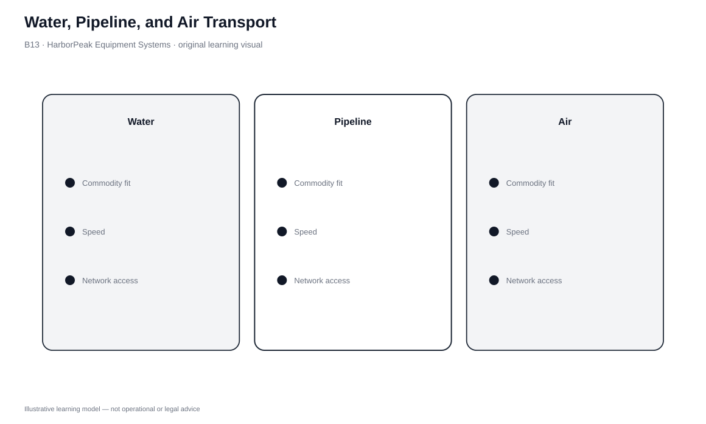

# 13. Water, Pipeline, and Air Transport

## Learning objectives

After this topic, you should be able to:

- compare water, pipeline, and air using commodity fit, scale, access, speed, and cost structure
- recognize why specialized modes are excellent for narrow use cases
- quantify when air speed creates enough business value to offset premium cost
- treat security, safety, and regulatory conditions as hard gates

## Concept in plain English

Water, pipeline, and air occupy very different positions in transportation.

**Water** is attractive for very large or bulky flows that can use navigable waterways or ocean routes and tolerate longer transit. It is central to international freight, but port access, schedules, weather, and long lead time matter.

**Pipeline** is highly specialized. It moves suitable liquids, gases, and some flowable/slurry materials continuously through fixed infrastructure. Construction cost is high, while operating cost per unit can be low once the system is established. Routes are inflexible and access is limited to connected facilities.

**Air** is the speed leader. It fits shipments where time, value, perishability, fragility, or business interruption can justify premium cost. Constraints include price, weight/size, airport access, security, and the surface legs before/after flight.

## Why it matters

These modes demonstrate why freight rate alone cannot drive the choice. Pipeline can be excellent for a compatible continuous commodity and impossible for finished tools. Water can move huge loads economically but fail a short customer window. Air can look expensive per kilogram yet be rational when delay or downtime costs more than the premium.

The decision starts with physical feasibility and business consequence.

## Decision model and workflow

### Evidence retained through the workflow

| Evidence | Why it matters |
|---|---|
| Commodity compatibility | Pipeline and some water services have strong product constraints. |
| Required speed | Separates urgent/time-sensitive freight from long-transit candidates. |
| Port/airport/pipeline access | Determines feeder legs and total-route cost. |
| Shipment scale | Water economics often improve with very large loads. |
| Security/safety/environmental controls | Can be mandatory gates. |

## Practical process flow

Water, pipeline, and air serve fundamentally different cargo and service conditions, so the useful logic is comparative. Test commodity and network feasibility first, then evaluate urgency, accessibility, security, handling, capacity, and cost trade-offs for the feasible modes.

## Original visualization

The visual separates the modes by operating logic: high-scale water movement, fixed-path continuous pipeline movement, and high-speed air movement.

## Realistic example — HarborPeak Equipment Systems

HarborPeak would not move finished tool kits by pipeline because the product is incompatible. It can use ocean freight for high-volume, low-urgency components and then motor transport from port to DC. It can use air for critical controllers when a customer faces expensive downtime.

The best mode changes with the material and consequence of delay.

All organizations, lanes, products, quantities, costs, scores, and operational values in this module are fictional and independently created for learning.

## Applied decision or worked calculation

Dataset: [`transport-mode-selection.csv`](../../assets/data/module-5/transport-mode-selection.csv)

SHP-504 replacement batteries are worth **$74,000**, occupy **4.4 m³**, and have value density about **$16,818.18/m³**. Both fictional air and motor alternatives pass the service gate. Their line-haul estimates are **$6,200** and **$2,760**.

`air premium = $6,200 − $2,760 = $3,440`

Air is justified only if the quantified value of time/risk reduction exceeds that premium after all product-specific safety and regulatory gates pass.

## Decision logic

- Eliminate physically incompatible modes first.
- Check infrastructure access and feeder legs.
- Apply time, safety, security, and regulatory gates.
- Compare total route economics and the value of time.
- Use scenario analysis for disruption-prone ports, airports, or fixed infrastructure.

## Trade-offs

| Tension | Decision implication |
|---|---|
| Water scale vs. time | Large low-cost movements can require long lead time and port handling. |
| Pipeline efficiency vs. inflexibility | Continuous flow needs expensive fixed infrastructure and compatible product. |
| Air speed vs. premium cost | Fast transit reduces time exposure but can be expensive. |

## Commonly confused with

A mode's fixed/variable cost structure explains carrier economics; it does not by itself determine the shipper's rate. Market capacity, lane, service, product, and contract conditions still matter.

## Common mistakes

- Using air because the item is valuable without quantifying time value.
- Treating pipeline as a general-purpose mode.
- Ignoring port/airport feeder transportation.
- Using broad mode-level sustainability or security claims without route evidence.

## Original knowledge check

**Question.** Air costs $3,440 more than motor for SHP-504 and both pass the service gate. What could justify the premium?

A. Only that air is faster

B. Quantified time/risk value greater than the premium, with mandatory controls passed

C. The product has many units

D. A warehouse is busy

Answer and rationale

### Correct answer

**B. Quantified time/risk value greater than the premium, with mandatory controls passed**

### Why it is correct

Premium mode selection should connect incremental cost to measurable service, inventory, perishability, or downtime benefit.

### Why the other answers are wrong

- **A.** Speed is an attribute; it needs business value in the scenario.
- **C.** Unit count alone does not establish mode economics.
- **D.** Warehouse utilization is not a general justification for air freight.

## Practitioner perspective

Mode guides should be treated as screening heuristics. Two high-value shipments can rationally use different modes because urgency, damage, security, and customer impact differ.

## Related concepts

- [Transportation Mode Selection](./11-transportation-mode-selection-and-value-packaging-density.md)
- [Rail and Motor Carrier Transport](./12-rail-and-motor-carrier-transport.md)
- [Intermodal Services](./14-intermodal-package-delivery-and-container-services.md)

---

[Previous: Rail and Motor Carrier Transport](./12-rail-and-motor-carrier-transport.md) · [Section overview](./README.md) · [Next: Intermodal, Package Delivery, and Container Services](./14-intermodal-package-delivery-and-container-services.md)