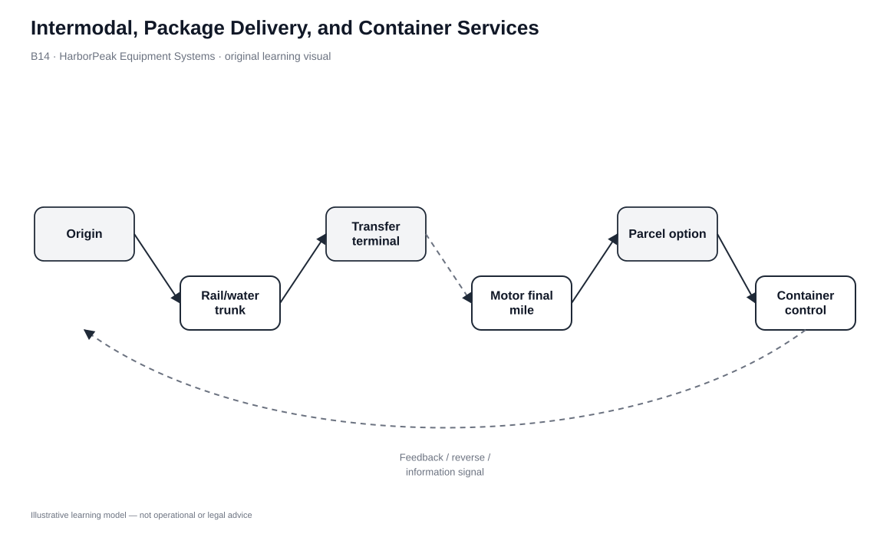
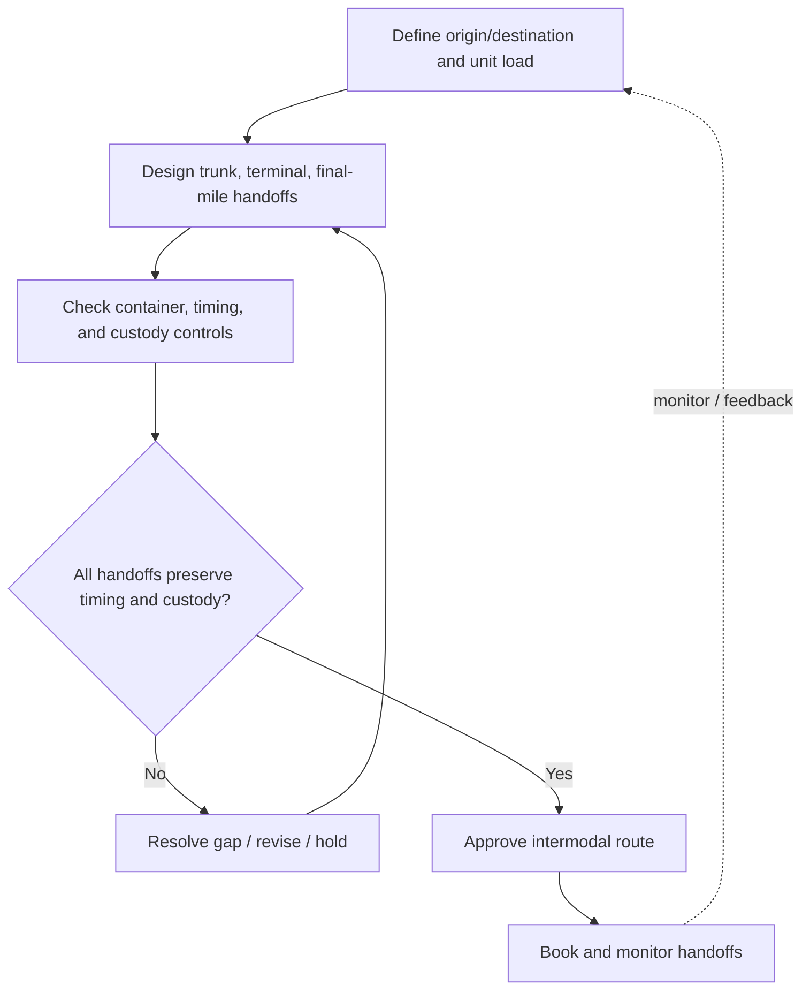

# 14. Intermodal, Package Delivery, and Container Services

## Learning objectives

After this topic, you should be able to:

- explain why intermodal transport deliberately combines modes
- describe containers and package-delivery networks as transfer/scale enablers
- identify handoff, dwell, documentation, security, and service risks
- design routes around end-to-end requirements rather than cheapest individual legs

## Concept in plain English

Many shipments cannot move efficiently from origin to destination with one mode. Intermodal transportation combines modes so each performs the leg it handles best.

A common design uses motor access to a rail or water terminal, long-haul movement by rail or vessel, and motor final delivery. Air freight also depends heavily on surface pickup and delivery. Containers make multimode movement easier because the cargo can transfer between truck, rail, and vessel without unloading individual units at every handoff.

Package-delivery networks are another form of coordinated multimodal logistics. They consolidate many small shipments through hubs and use surface and air capacity to provide time-definite service.

## Why it matters

Intermodal design can reduce cost and expand reach, but every handoff is a control point. Dwell, damage, security, documentation, and visibility can deteriorate if responsibility is unclear.

The correct optimization target is the complete journey. A cheap trunk leg has little value if terminal dwell destroys the customer promise.

## Decision model and workflow

### Evidence retained through the workflow

| Evidence | Why it matters |
|---|---|
| Origin/destination access | Defines first/last-mile modes. |
| Trunk-lane scale | Shows whether rail/water/air consolidation creates value. |
| Container/equipment compatibility | Reduces transfer friction. |
| Transfer-point dwell and reliability | Must be included in transit promise. |
| Visibility/custody | Maintains shipment control across providers. |

## Practical process flow

## Original visualization

The visual follows a shipment from origin through trunk movement and transfer nodes to the final mile, showing the handling unit and control points across the journey.

## Realistic example — HarborPeak Equipment Systems

HarborPeak imports components in containers by vessel to a port, rail to an inland terminal, and truck to Cedar Junction. Water and rail provide trunk scale; truck provides access.

For critical replacement controllers, HarborPeak can use truck-air-truck parcel service. The intermodal concept is the same, but speed rather than bulk scale drives the design.

All organizations, lanes, products, quantities, costs, scores, and operational values in this module are fictional and independently created for learning.

## Applied decision or worked calculation

Dataset: [`transport-mode-selection.csv`](../../assets/data/module-5/transport-mode-selection.csv)

SHP-502 compares **Motor** with **Rail+Motor**. The intermodal option has two modeled legs and a lower line-haul estimate. SHP-503 shows why that is not automatically best: rail+motor is cheaper but reliability is only 3/5 and the service gate is WATCH.

A route control sheet should capture first-mile carrier, transfer terminal/cut-off, trunk mode, final-mile carrier, common shipment identity, dwell expectations, and exception owner.

## Decision logic

- Build the route from origin/destination access inward to the trunk leg.
- Preserve the unit load/container across modes where practical.
- Include transfer time and reliability in the promised transit.
- Assign custody and exception ownership at every handoff.
- Compare total route cost and risk, not only trunk rate.

## Trade-offs

| Tension | Decision implication |
|---|---|
| Lower trunk cost vs. more handoffs | Scale savings can be offset by transfer complexity. |
| Container standardization vs. special requirements | Standard units simplify transfer but do not fit every product. |
| Network reach vs. visibility burden | More nodes increase options but require stronger event integration. |

## Commonly confused with

Intermodal means multiple transportation modes in one journey. It is not simply multiple carriers using the same mode.

## Common mistakes

- Quoting transit time without terminal dwell.
- Changing modes without preserving shipment identity/custody evidence.
- Comparing vessel/rail line-haul with truck door-to-door cost.
- Assuming containerization eliminates all damage or security risk.

## Original knowledge check

**Question.** A truck-rail-truck route repeatedly misses dates because of terminal dwell. What should HarborPeak optimize?

A. The rail rate only

B. The complete route including transfer dwell, reliability, and first/last mile

C. Carrier count

D. Warehouse cube utilization

Answer and rationale

### Correct answer

**B. The complete route including transfer dwell, reliability, and first/last mile**

### Why it is correct

Intermodal performance is end-to-end. Transfer delay is part of the route's service and economic result.

### Why the other answers are wrong

- **A.** A cheap trunk leg can still produce expensive service failure.
- **C.** Fewer or more carriers is not the objective by itself.
- **D.** Warehouse cube does not resolve terminal dwell.

## Practitioner perspective

Visibility platforms should normalize events from several providers into one shipment journey. Otherwise each leg can appear healthy while the customer ETA deteriorates.

## Related concepts

- [Rail and Motor Carrier Transport](./12-rail-and-motor-carrier-transport.md)
- [Water, Pipeline, and Air Transport](./13-water-pipeline-and-air-transport.md)
- [Carrier Classifications and Selection](./15-carrier-classifications-and-carrier-selection.md)

---

[Previous: Water, Pipeline, and Air Transport](./13-water-pipeline-and-air-transport.md) · [Section overview](./README.md) · [Next: Carrier Classifications and Carrier Selection](./15-carrier-classifications-and-carrier-selection.md)