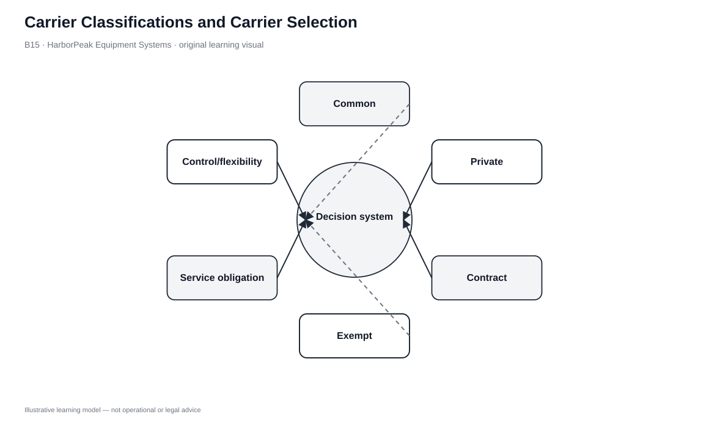
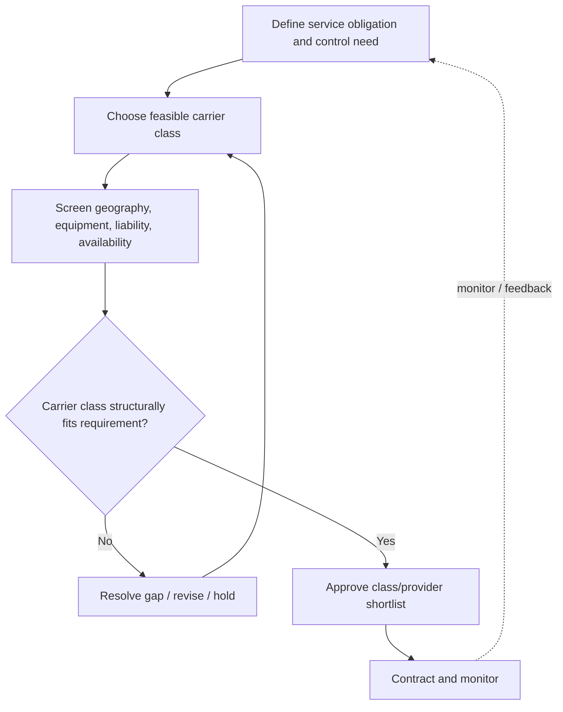

# 15. Carrier Classifications and Carrier Selection

## Learning objectives

After this topic, you should be able to:

- distinguish common/public, private, contract, and exempt carrier concepts at the curriculum level
- separate carrier-class choice from transportation-mode choice
- evaluate control, liability, equipment fit, availability, and backhaul
- verify jurisdiction-specific authority before real operational use

## Concept in plain English

After the transportation mode is chosen, the shipper still has to decide what carrier arrangement should provide the service. The curriculum distinguishes **common/public, private, contract, and exempt** carrier concepts.

A common/public carrier offers service to the market subject to the obligations that apply in its jurisdiction. A private carrier is the shipper's owned or leased fleet used primarily for its own freight. A contract carrier provides transportation under customer-specific contractual arrangements. Exempt-carrier concepts apply to certain commodities or circumstances where economic regulation differs; the exact boundaries depend on jurisdiction.

These categories are separate from mode. A company can use a common motor carrier, a contract motor carrier, or its own private truck fleet; the physical mode remains motor.

## Why it matters

Carrier structure changes control, capital, flexibility, liability, availability, and backhaul economics. A private fleet can provide strong operational control but create unused capacity. A contract carrier can tailor service without requiring fleet ownership. A common/public network can offer broad availability but less customization.

Because legal classifications vary and change, the learning framework must be verified against current official authority before a real contract is executed.

## Decision model and workflow

### Evidence retained through the workflow

| Evidence | Why it matters |
|---|---|
| Mode and lane requirement | Defines the transportation service required. |
| Control/customization need | Influences private, contracted, or public arrangements. |
| Equipment fit | Confirms the carrier can safely handle the freight. |
| Liability/claims requirement | Defines contractual and risk expectations. |
| Availability/backhaul | Shows whether capacity can be sustained efficiently. |
| Current legal authority | Confirms the structure is valid in the jurisdiction. |

## Practical process flow

## Original visualization

The decision visual starts with structural eligibility, then evaluates qualified carrier options. Price comes after fit, not before it.

## Realistic example — HarborPeak Equipment Systems

HarborPeak has recurring regional dealer routes that may justify a private fleet because route frequency and merchandising/service control are important. For irregular multi-region shipments, a contract carrier may offer specialized equipment and schedule flexibility without the fixed fleet commitment.

The fictional AgriLocal exempt option has the lowest rate but fails the structural gate for HarborPeak's industrial shipment. Low price cannot make an inapplicable carrier feasible.

All organizations, lanes, products, quantities, costs, scores, and operational values in this module are fictional and independently created for learning.

## Applied decision or worked calculation

Dataset: [`carrier-options.csv`](../../assets/data/module-5/carrier-options.csv)

| Carrier | Class | Rate | Control | Equipment fit | Availability | Gate |
|---|---|---:|---:|---:|---:|---|
| Atlas Common Freight | Common | $1,840 | 3/5 | 4/5 | 5/5 | PASS |
| HarborPeak Private Fleet | Private | $2,050 | 5/5 | 5/5 | 4/5 | PASS |
| Summit Contract Carriage | Contract | $1,710 | 4/5 | 5/5 | 4/5 | PASS |
| AgriLocal Exempt | Exempt | $1,390 | 2/5 | 2/5 | 2/5 | **FAIL** |

Among the fictional qualified options, Summit has the lowest rate. That still does not prove it is the best real carrier: lane capacity, safety performance, insurance, contract terms, subcontracting, and current authority remain to be checked.

## Decision logic

- Choose mode/service requirement before carrier structure.
- Confirm legal and operational eligibility.
- Apply equipment, safety, liability, and capacity gates.
- Compare control/flexibility and backhaul implications.
- Rank qualified providers on service and total cost; retain contract/performance evidence.

## Trade-offs

| Tension | Decision implication |
|---|---|
| Control vs. asset flexibility | Private fleets increase control but create fixed capacity exposure. |
| Customization vs. market availability | Contract service can be tailored while public networks may be broader. |
| Low rate vs. structural fit | A cheap carrier is irrelevant if commodity, geography, authority, or equipment does not fit. |

## Commonly confused with

Carrier classification describes the operating relationship or legal structure. Transportation mode describes how freight physically moves. Common/contract/private are not synonyms for rail/motor/air.

## Common mistakes

- Selecting the lowest rate before checking eligibility.
- Assuming a private fleet is cheaper because there is no outside carrier margin.
- Treating curriculum legal categories as current advice for every jurisdiction.
- Failing to define liability, subcontracting, metrics, and remedies in contracts.

## Original knowledge check

**Question.** The lowest-rate carrier fails equipment and structural-eligibility gates. What should procurement do?

A. Award it because price is lowest

B. Remove it from the qualified ranking

C. Average the failure with price

D. Ignore the shipment requirement

Answer and rationale

### Correct answer

**B. Remove it from the qualified ranking**

### Why it is correct

Eligibility and capability define feasibility. Economic ranking only makes sense among carriers that can legally and operationally perform the move.

### Why the other answers are wrong

- **A.** Price cannot compensate for inapplicability.
- **C.** A mandatory failure should not be averaged away.
- **D.** The shipment requirement defines the service being purchased.

## Practitioner perspective

Carrier master data and tendering rules should distinguish eligibility from performance scoring. That prevents optimization logic from awarding a shipment to a low-price option that was never actually qualified.

## Related concepts

- [Transportation Mode Selection](./11-transportation-mode-selection-and-value-packaging-density.md)
- [Intermodal Services](./14-intermodal-package-delivery-and-container-services.md)
- [Module 3 — Supplier/Contract Governance](../../03-sourcing-strategy-product-design-supplier-execution/)

---

[Previous: Intermodal, Package Delivery, and Container Services](./14-intermodal-package-delivery-and-container-services.md) · [Section overview](./README.md) · [Next: Section B Review](./16-section-b-review.md)