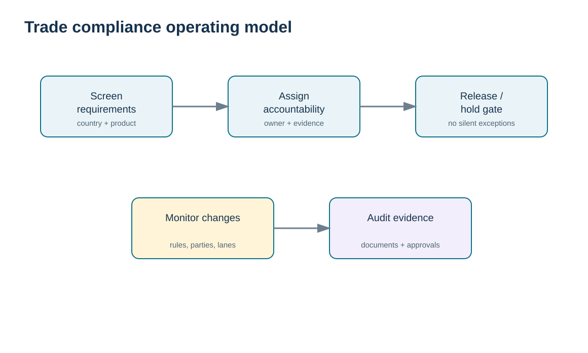
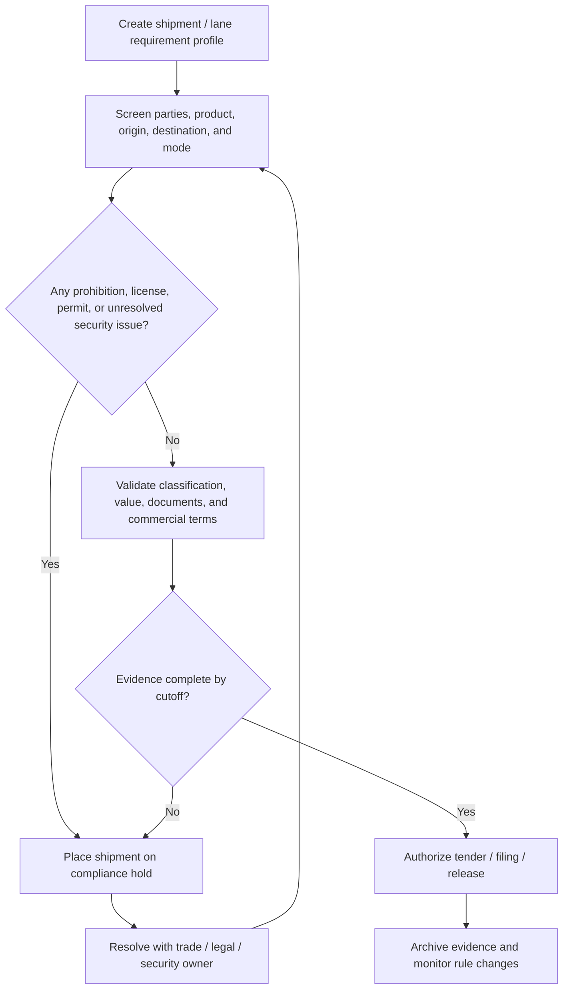

# 1. Trade Compliance Operating Model

## Learning objectives

After this topic, you should be able to:

- separate legal, security, regulatory, and internal-control requirements;
- build a shipment release process with explicit owners and evidence;
- use risk tiering without turning risk labels into automatic clearance decisions;
- explain why compliance cost should be optimized, not ignored.

## Concept in plain English

Cross-border trade adds a second operating system around the physical shipment. The product may be packed and transportation capacity may be available, yet the shipment is not ready until the organization can show that the parties, product, route, documents, licenses, markings, data, and commercial terms satisfy the applicable requirements.

A useful operating model has four layers. **Requirement identification** asks what rules apply. **Control design** assigns preventive and detective controls. **Shipment release** uses a documented gate rather than informal judgment. **Monitoring and assurance** checks whether rules, lanes, suppliers, or system logic have changed. The model should span physical security, import/export compliance, information security, and internal operational/financial controls because a weakness in any one can stop the flow or create exposure.

The goal is not “zero compliance cost.” The goal is reliable compliance with the least avoidable friction: fewer preventable holds, fewer document corrections, less rework, and stronger evidence when a regulator or auditor asks how the company made its decision.

## Why it matters

Trade failures are asymmetric. A missing data element can delay a high-value shipment even when every physical logistics activity was executed correctly. A weak party-screening process can create legal exposure that far exceeds freight cost. A rushed correction after cargo arrives at the border is usually more expensive than a pre-departure control.

That is why compliance belongs in the shipment plan, not at the end of it. The best design makes the compliant path the easiest path and makes exceptions visible early.

## Decision model and workflow

The visual turns the topic into a decision structure that can be audited and repeated instead of relying on shipment-by-shipment memory.

### Evidence retained through the workflow

Retain the applicable jurisdictions and rule sources, product and party screening results, compliance owner, approvals or holds, the released transaction evidence, and the event that requires the compliance assessment to be reopened.

## Practical process flow

## Realistic example — HarborPeak Equipment Systems

HarborPeak Equipment Systems plans eight international movements in the locked [`trade-compliance-register.csv`](../../assets/data/module-5/trade-compliance-register.csv). Shipment **TC-007** has acceptable supplier security information but an unresolved restricted-product screen and incomplete markings. The logistics team has space on the vessel, but the compliance release should remain blocked. Shipment **TC-005**, by contrast, has complete documentation, passed screening, and a low residual risk, so the control design supports release with normal evidence retention.

The decision insight is simple: transportation readiness and trade readiness are different states. A booking confirmation is not evidence of admissibility.

## Applied decision artifact

| Control field | Required decision evidence |
|---|---|
| Party screening | screening result, timestamp, system/list version, reviewer if escalated |
| Product eligibility | description, intended use, restriction/license determination |
| Classification/value | approved classification record and valuation support |
| Documentation | complete document pack with owner and cutoff |
| Security | lane/facility controls and unresolved exceptions |
| Release | named approver, time, and exception reference if any |

## Decision logic

- Profile the lane before the first shipment rather than rediscovering requirements at each booking.
- Separate mandatory controls from voluntary facilitation programs.
- Use hard holds for unresolved prohibitions, missing authorizations, or material data conflicts.
- Require an accountable owner for every exception and a documented reason for release.
- Monitor regulatory and master-data changes so an old approval does not become permanent truth.

## Trade-offs

A stricter gate can reduce compliance exposure but may add lead time if controls happen late. More automation can improve consistency, but poor master data can automate the wrong decision at scale. More intermediaries can add expertise, yet they also increase handoffs and make role clarity more important.

## Commonly confused with

A **risk rating** prioritizes attention; it does not itself authorize trade. A **trusted-trader status** may support lower-risk treatment, but it does not replace product admissibility, licensing, classification, valuation, or document requirements.

## Common mistakes

- Letting logistics staff override a compliance hold because capacity is scarce.
- Treating a broker or forwarder as the party ultimately accountable for the company’s data.
- Keeping evidence only in email rather than a controlled shipment record.
- Using one global checklist without lane- and product-specific requirements.
- Failing to version the rule set or reference data used for a decision.

## Original knowledge check

**Question.** A shipment has confirmed vessel space but its product-permit review is unresolved. What is the strongest action?

A. Tender the cargo because transportation is ready

B. Hold the shipment until the permit determination is resolved

C. Ask the carrier to accept regulatory responsibility

D. Change the Incoterm so the permit no longer matters

Answer and rationale

### Correct answer

**B. Hold the shipment until the permit determination is resolved**

### Why it is correct

Transportation readiness does not remove an unresolved regulatory requirement. The release gate should stay closed until the responsible owner resolves the requirement and retains evidence.

### Why the other answers are wrong

A confuses logistics readiness with legal readiness; C transfers a role the carrier may not own; D changes commercial responsibilities but does not make a legal restriction disappear.

## Practitioner perspective

In an ERP/TMS/GTM landscape, place compliance status where downstream execution can actually consume it. A red status that is visible only in a separate dashboard is weaker than a controlled block that prevents delivery creation, tendering, export filing, or goods issue until the approved release condition is met.

## Freshness checkpoint

Before using this operating model on a live shipment, reconfirm the current requirements of the agencies that govern the product, parties, origin, destination, and mode. See [Section C references](./REFERENCES.md).

## Related concepts

- [Section C overview](./README.md)
- [Section C references](./REFERENCES.md)
- [Section C review](./14-section-c-review.md)

---

[Section overview](./README.md) · [Section overview](./README.md) · [Next: Trusted-Trader Programs](./02-trusted-trader-programs.md)