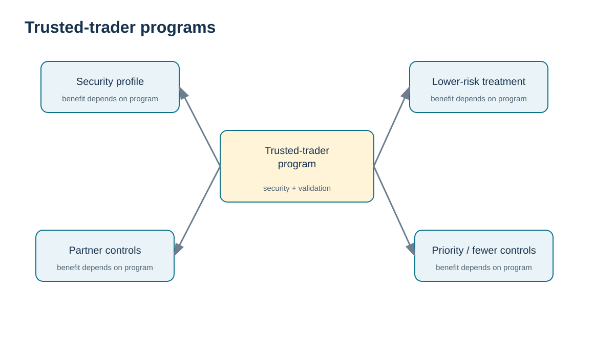
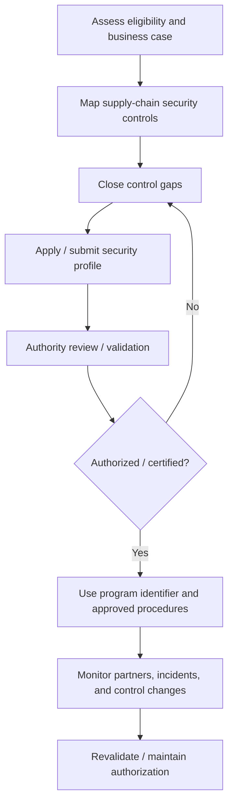

# 2. Trusted-Trader Programs: CTPAT, AEO, and Mutual Recognition

## Learning objectives

After this topic, you should be able to:

- explain the operating logic of trusted-trader programs;
- distinguish security validation from guaranteed expedited clearance;
- compare CTPAT and the EU AEO concept at a high level;
- identify when mutual recognition can matter in a cross-border lane.

## Concept in plain English

Trusted-trader programs create a structured partnership between customs authorities and businesses that demonstrate stronger supply-chain security or customs-control capabilities. The company does not purchase a “fast pass.” It documents controls, is assessed or validated under the program, maintains them over time, and may receive facilitation benefits because authorities can treat the participant as lower risk.

In the United States, **CTPAT** focuses on supply-chain security. CBP describes members as lower risk and therefore less likely to be examined; potential benefits include fewer examinations, front-of-line inspections, and shorter border waits. In the European Union, **AEO** authorizations can cover customs simplification (AEOC), security and safety (AEOS), or both. Depending on the authorization, benefits can include fewer controls, priority treatment, and certain simplifications.

**Mutual recognition** links qualifying security programs across customs administrations. It can allow one administration to recognize a partner administration’s validated operator status. The important exam and practitioner point is that benefits are conditional and program-specific. They improve the risk profile; they do not guarantee that an individual shipment will never be inspected or delayed.

## Why it matters

Security facilitation can shorten variability more than it shortens the average transit time. A company that receives fewer unpredictable exams can plan inventory, transport, and customer commitments with greater confidence. But maintaining program eligibility also requires continuing control discipline, supplier security management, and evidence.

## Decision model and workflow

The visual turns the topic into a decision structure that can be audited and repeated instead of relying on shipment-by-shipment memory.

### Evidence retained through the workflow

Retain program eligibility and membership evidence, partner-validation status, risk assessments, corrective actions, claimed facilitation benefits, accountable owner, and the date or event for the next program review.

## Practical process flow

## Realistic example — HarborPeak Equipment Systems

HarborPeak imports a recurring high-value component lane from Mexico. Instead of promising the plant that CTPAT will “eliminate inspections,” the trade team models two benefits: fewer security-related interruptions on average and better escalation procedures if the lane is examined. It also treats the supplier’s security status as a maintained attribute in the trade-compliance register rather than a one-time onboarding checkbox.

For an EU customer with qualifying AEO security status, HarborPeak records the customer identifier and checks whether mutual-recognition treatment is relevant to the lane. The status is supportive evidence, not a substitute for correct entry data.

## Applied decision artifact

| Business-case dimension | Evidence to collect |
|---|---|
| Exam / hold history | frequency, duration, cause, lane |
| Security maturity | facility, conveyance, personnel, cyber, partner controls |
| Program eligibility | entity type, jurisdiction, required criteria |
| Maintenance cost | audits, training, systems, supplier monitoring |
| Potential benefit | reduced variability, priority treatment, simplification where applicable |
| Continuity | incident reporting, corrective action, revalidation ownership |

## Decision logic

- Start with the lane and risk problem, not with the prestige of a certification.
- Treat program benefits as potential or conditional unless the authority states otherwise.
- Keep partner identifiers and consent/data-sharing requirements accurate where mutual recognition applies.
- Measure variability and exception cost before and after participation.
- Maintain the control environment after authorization; security programs are not set-and-forget.

## Trade-offs

Trusted-trader programs can reduce border friction and strengthen security discipline, but application, validation, monitoring, and partner-control effort are real costs. A company with few cross-border moves may receive less operational value than a company with frequent, time-sensitive flows.

## Commonly confused with

**CTPAT/AEO status** concerns a trader’s control environment and customs/security relationship. It is not the same as **product certification**, **country-of-origin qualification**, an **import license**, or an **Incoterms® rule**.

## Common mistakes

- Promising “no inspections” to operations or customers.
- Assuming every AEO authorization has identical benefits.
- Ignoring changes in ownership, facilities, systems, or business partners after validation.
- Using a partner’s trusted-trader status as a reason to skip restricted-party or product screening.

## Original knowledge check

**Question.** Which statement best describes the benefit of a trusted-trader program?

A. It guarantees every shipment clears without inspection

B. It can support lower-risk treatment and facilitation while normal legal requirements still apply

C. It replaces tariff classification

D. It transfers importer responsibility to customs

Answer and rationale

### Correct answer

**B. It can support lower-risk treatment and facilitation while normal legal requirements still apply**

### Why it is correct

Trusted-trader programs reward stronger controls and can reduce friction, but they do not eliminate the normal requirements for admissibility, classification, value, documents, and other applicable controls.

### Why the other answers are wrong

A overstates facilitation; C and D confuse unrelated responsibilities.

## Practitioner perspective

Track program status, validation dates, facility scope, identifiers, and corrective actions in controlled master data. If a TMS or broker interface depends on a trusted-trader identifier, test that the identifier is actually transmitted in the declaration or booking message where the benefit requires it.

## Freshness checkpoint

Trusted-trader eligibility, benefits, validation procedures, and mutual-recognition arrangements can change. Confirm current program guidance with the relevant customs authority before relying on a benefit. See [Section C references](./REFERENCES.md).

## Related concepts

- [Section C overview](./README.md)
- [Section C references](./REFERENCES.md)
- [Section C review](./14-section-c-review.md)

---

[Previous: Trade Compliance Operating Model](./01-trade-compliance-operating-model.md) · [Section overview](./README.md) · [Next: Import/Export Requirements and Border Readiness](./03-import-export-requirements-and-border-readiness.md)