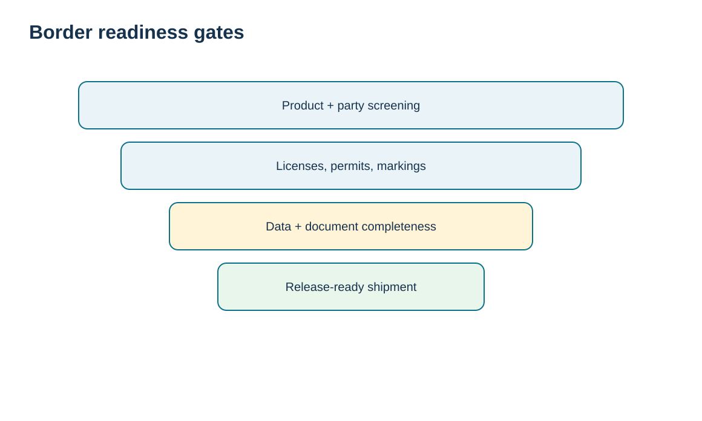
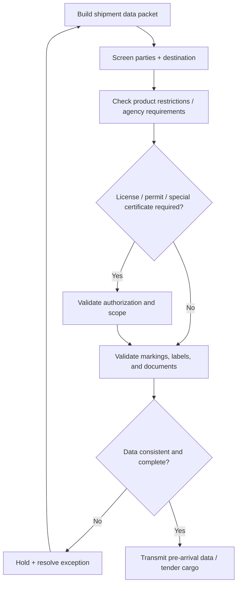

# 3. Import/Export Requirements, Restricted Goods, and Border Readiness

## Learning objectives

After this topic, you should be able to:

- build a border-readiness checklist around product, party, country, and document requirements;
- separate prohibited, restricted, licensed, and merely documented goods;
- explain the value of pre-arrival electronic data;
- design a hold-and-escalate process for incomplete or conflicting shipment information.

## Concept in plain English

A shipment crosses a border only after a set of questions have acceptable answers. **Who are the parties? What is the product? Where did it originate? Where is it going? What is its intended use? Does it require a license, permit, certificate, special marking, inspection, or another agency’s approval? Are the declared value and description supportable? Is the data consistent across the commercial and transport documents?**

A practical control distinguishes four states. **Prohibited** means the transaction or goods cannot proceed under the applicable rule. **Restricted** means the transaction may proceed only if defined conditions are met. **Licensed/permitted** means a government authorization must be obtained before the relevant activity. **Document-controlled** means the shipment is allowed but still needs specific data, labels, certificates, or filing steps.

Pre-arrival electronic data matters because customs and other agencies increasingly make risk decisions before cargo physically presents at the border. Earlier data can enable preclearance or at least earlier exception discovery. Bad data sent earlier, however, is still bad data; speed does not replace accuracy.

## Why it matters

Border delays often begin upstream. An incomplete description from engineering, a missing end-use statement from sales, a wrong country-of-origin field in the material master, or inconsistent quantities between invoice and packing data can all surface as “customs delays” even though the root cause sits elsewhere. Border readiness therefore has to connect product master data, customer/supplier master data, compliance screening, and shipment documentation.

## Decision model and workflow

The visual turns the topic into a decision structure that can be audited and repeated instead of relying on shipment-by-shipment memory.

### Evidence retained through the workflow

Retain the product restriction and licensing screens, required labels and language checks, filing and document status, responsible party, exception approvals, submission timestamps, and final release or hold evidence.

## Practical process flow

## Realistic example — HarborPeak Equipment Systems

In `trade-compliance-register.csv`, HarborPeak shipment **TC-004** has a supplier-security review open and only a draft commercial invoice. The shipment may ultimately be legal, but it is not border-ready. Shipment **TC-007** is even more serious: the product restriction screen is unresolved. The process does not let the planner convert “we have not found a prohibition yet” into approval.

A strong operational rule is: **absence of a known problem is not the same as documented clearance of the required checks.**

## Applied decision artifact

| Gate | Minimum evidence |
|---|---|
| Party / destination | screening result and escalation closure |
| Product | accurate description, use, material composition where relevant |
| Authorization | license/permit number, scope, validity, quantity/value limits if applicable |
| Marking / labeling | country/language/product-specific requirement confirmation |
| Documents | invoice, transport data, permits/certificates, consistent quantities/value |
| Pre-arrival transmission | message accepted, exceptions resolved, reference retained |

## Decision logic

- Screen before booking when a potential prohibition or authorization could invalidate the move.
- Use product and destination attributes to drive required-document rules.
- Make “unknown” an exception state rather than treating it as pass.
- Transmit pre-arrival information only after core commercial data are controlled.
- Keep the accepted filing/message reference with the shipment evidence.

## Trade-offs

Early screening can add work during order entry or product setup, but it prevents expensive last-minute holds. Broad screening rules reduce false negatives but may increase false positives and manual review. Highly automated document generation reduces effort but requires better master data governance.

## Commonly confused with

A **restricted good** is not necessarily prohibited. A **license** is an authorization; it is not the same as a certificate of origin, transport document, or commercial invoice. A **customs release** also does not prove that every other government-agency obligation has been satisfied.

## Common mistakes

- Using vague invoice descriptions such as “parts” or internal nicknames.
- Checking only the final destination and ignoring transit or export-side requirements.
- Assuming the freight forwarder will discover every permit need.
- Sending inconsistent country of origin, quantity, or value across documents.
- Treating a rejected electronic message as a carrier problem rather than a data-control signal.

## Original knowledge check

**Question.** A product is legal to import only when a specific permit is valid for the shipment. How should the permit be treated?

A. As optional supporting paperwork after arrival

B. As a release-gate requirement whose validity and scope must be confirmed before the controlled step

C. As a carrier liability issue

D. As an Incoterms choice

Answer and rationale

### Correct answer

**B. As a release-gate requirement whose validity and scope must be confirmed before the controlled step**

### Why it is correct

A permit-dependent transaction is conditional, so authorization status belongs in the border-readiness gate before the shipment crosses the controlled point.

### Why the other answers are wrong

A is too late; C and D confuse logistics/commercial terms with regulatory authorization.

## Practitioner perspective

Use rules to derive document and license requirements from product, destination, origin, customer, and transaction type. Avoid free-text-only controls. A system should be able to distinguish pass, fail, pending review, and not-applicable states, with reason codes for holds.

## Freshness checkpoint

Import, export, labeling, filing, and prohibited-goods requirements are jurisdiction-specific and time-sensitive. Recheck the competent authority for the actual shipment before booking or filing. See [Section C references](./REFERENCES.md).

## Related concepts

- [Section C overview](./README.md)
- [Section C references](./REFERENCES.md)
- [Section C review](./14-section-c-review.md)

---

[Previous: Trusted-Trader Programs](./02-trusted-trader-programs.md) · [Section overview](./README.md) · [Next: International Labor and Responsible-Sourcing Controls](./04-international-labor-and-responsible-sourcing-controls.md)