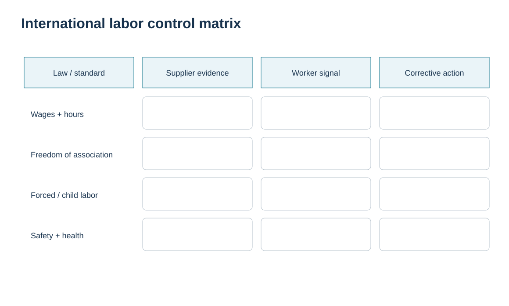
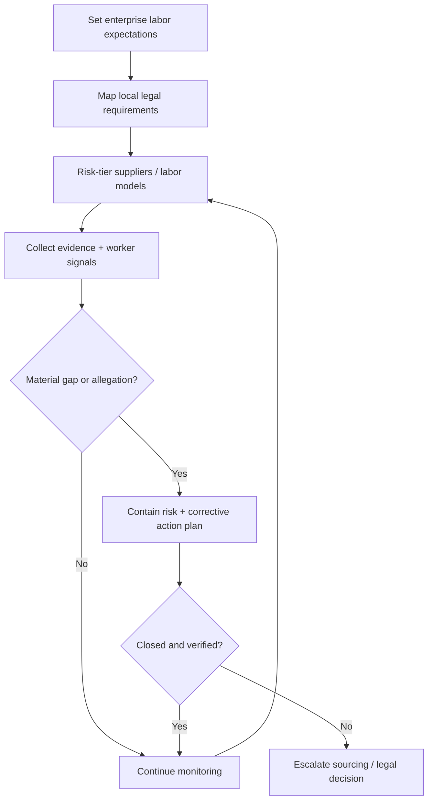

# 4. International Labor and Responsible-Sourcing Controls

## Learning objectives

After this topic, you should be able to:

- explain why labor requirements vary by jurisdiction while core responsible-sourcing themes can be standardized;
- translate labor expectations into supplier evidence and corrective-action controls;
- use worker-safety and grievance signals as supply-chain risk information;
- avoid using a one-time supplier audit as permanent proof of compliance.

## Concept in plain English

Global supply chains operate across different wage laws, working-time rules, collective-bargaining frameworks, health-and-safety systems, parental-leave provisions, discrimination protections, and termination/layoff procedures. A global policy therefore needs two levels: **non-negotiable enterprise expectations** and **jurisdiction-specific legal requirements**.

The International Labour Organization’s fundamental principles provide a useful high-level frame: freedom of association and collective bargaining; elimination of forced labor; abolition of child labor; elimination of discrimination; and a safe and healthy working environment. They do not replace local law. They help an organization ask consistent questions while local legal specialists determine the exact obligations.

Responsible sourcing is strongest when it goes beyond documents. Payroll and time records, training evidence, injury data, grievance mechanisms, worker interviews, turnover patterns, use of labor agents, and corrective-action closure can reveal whether the control actually operates.

## Why it matters

Labor failure can stop supply through enforcement actions, worker disruption, loss of capacity, reputational damage, or forced supplier transitions. It can also be hidden deep in the tier structure. Treating labor as a procurement checkbox misses the supply-continuity dimension: poor working conditions and weak grievance systems can be leading indicators of operational instability.

## Decision model and workflow

The visual turns the topic into a decision structure that can be audited and repeated instead of relying on shipment-by-shipment memory.

### Evidence retained through the workflow

Retain the country and site labor-law sources used, worker population and employment facts, wage/benefit and health-and-safety evidence, audit findings, remediation owner, closure proof, and scheduled reassessment date.

## Practical process flow

## Realistic example — HarborPeak Equipment Systems

HarborPeak is onboarding a contract manufacturer in a new country. The sourcing team initially compares wage rates and concludes that the location is attractive. The responsible-sourcing review widens the decision: overtime controls, safety incidents, use of labor agencies, grievance access, worker turnover, and local collective-representation requirements are added to the supplier risk profile.

The result is not a moral scorecard detached from operations. It identifies whether the supplier’s labor model is stable enough to support the promised capacity and whether corrective actions must be closed before volume increases.

## Applied decision artifact

| Control area | Example evidence | Escalation signal |
|---|---|---|
| Wages / hours | payroll, time records, legal threshold mapping | unexplained deductions, excessive hours |
| Forced / child labor | age verification, recruitment-fee policy, labor-agent controls | withheld documents, recruitment debt |
| Association / voice | worker representation and grievance process | retaliation allegation, ineffective grievance channel |
| Safety / health | training, incident logs, risk assessments | serious incident, repeated near-miss pattern |
| Equality | hiring/pay/promotion data and complaint process | unexplained subgroup disparity |
| Corrective action | owner, due date, verification evidence | overdue high-risk issue |

## Decision logic

- Define a global floor but map exact legal obligations by jurisdiction.
- Risk-tier suppliers based on labor model, geography, product criticality, and prior signals.
- Use multiple evidence types rather than certificates alone.
- Require containment for severe allegations while facts are investigated.
- Verify corrective-action effectiveness, not just document closure.

## Trade-offs

Deep supplier due diligence consumes time and may slow onboarding, but weak screening can create severe continuity and reputational risk. Overly rigid global rules can conflict with local legal structures; purely local rules can create inconsistent enterprise standards. The operating model must handle both.

## Commonly confused with

**Responsible sourcing** is broader than a social-audit score. It includes governance, evidence, worker channels, corrective action, and sourcing decisions. **Local legal compliance** and **enterprise policy compliance** overlap but are not identical.

## Common mistakes

- Comparing labor cost without comparing labor conditions and legal obligations.
- Treating a certificate as permanent proof.
- Ignoring temporary labor, recruiters, subcontractors, or lower-tier suppliers.
- Closing a corrective action when a document is submitted without verifying the condition changed.

## Original knowledge check

**Question.** A supplier submits a recent social-audit certificate, but injury and turnover data have sharply worsened. What is the strongest response?

A. Accept the certificate and ignore operating data

B. Treat the new signals as risk evidence and investigate whether controls remain effective

C. Cancel every contract immediately without review

D. Change the Incoterm

Answer and rationale

### Correct answer

**B. Treat the new signals as risk evidence and investigate whether controls remain effective**

### Why it is correct

A point-in-time certificate does not eliminate the need to monitor new evidence. Worsening operating signals can justify investigation and corrective action.

### Why the other answers are wrong

A ignores current evidence; C may be disproportionate before facts are established; D is unrelated.

## Practitioner perspective

Supplier master data should hold risk tier, audit/certification dates, critical findings, corrective-action status, and sourcing blocks where required. Sensitive worker information should be governed carefully; the supply-chain team usually needs decision status and evidence references, not unnecessary personal data.

## Freshness checkpoint

Labor, wage, benefits, worker-representation, and health-and-safety obligations vary by location and can change. Validate local legal requirements and qualified guidance before operational use. See [Section C references](./REFERENCES.md).

## Related concepts

- [Section C overview](./README.md)
- [Section C references](./REFERENCES.md)
- [Section C review](./14-section-c-review.md)

---

[Previous: Import/Export Requirements and Border Readiness](./03-import-export-requirements-and-border-readiness.md) · [Section overview](./README.md) · [Next: Customs Strategy](./05-customs-strategy-roles-brokers-and-preclearance.md)