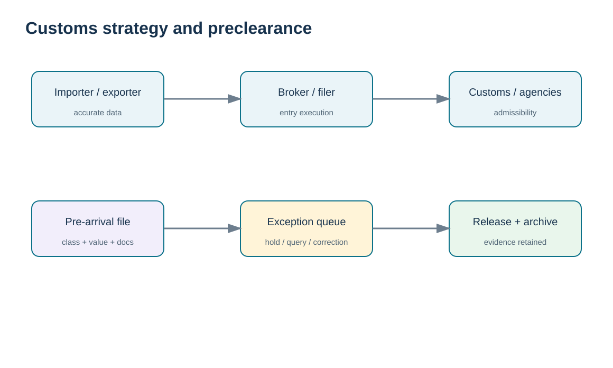
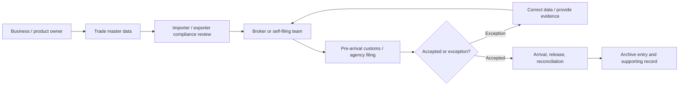

# 5. Customs Strategy: Roles, Brokers, and Preclearance

## Learning objectives

After this topic, you should be able to:

- distinguish importer/exporter accountability from broker execution;
- explain why customs specialists are valuable even when self-filing is legally possible;
- design pre-arrival data and exception workflows;
- retain evidence that supports classification, value, admissibility, and filing decisions.

## Concept in plain English

Customs strategy starts with role clarity. The **importer of record or equivalent responsible party** must understand what data and evidence support the declaration under the applicable jurisdiction. A **customs broker** can prepare and transact customs business on behalf of a client where licensed and authorized. That expertise is valuable, but outsourcing the filing does not make poor source data harmless.

In the United States, CBP explicitly states that there is no legal requirement to hire a broker to clear one’s own goods; an importer may self-file if it can meet the requirements. Many importers use licensed brokers because the process is specialized. This distinction matters because an exam question or operating procedure that says “a company must always use a broker” is too broad.

Preclearance or pre-arrival processing means moving the work upstream: provide classification, value, origin, party data, and documents early enough for the broker/filer and customs systems to identify exceptions before cargo physically arrives. The strategy succeeds when the importer provides controlled data, the broker executes against clear instructions, and both sides have an escalation path.

## Why it matters

The cost of a customs error is rarely limited to a filing fee. It can include storage, demurrage, missed production, rework, penalties, retroactive duty, and customer disruption. A strong broker relationship reduces avoidable mistakes, but the company still needs internal competence to validate instructions, challenge anomalies, and own master data.

## Decision model and workflow

The visual turns the topic into a decision structure that can be audited and repeated instead of relying on shipment-by-shipment memory.

### Evidence retained through the workflow

Retain importer/exporter-of-record decisions, broker or representative authority where applicable, classification and valuation inputs, pre-arrival filing evidence, duty/payment records, exception handling, and customs release status.

## Practical process flow

## Realistic example — HarborPeak Equipment Systems

HarborPeak’s `TC-005` gearbox import uses a self-file model with broker review. That is intentionally different from `TC-001`, where the company uses a licensed broker for the full customs entry. The operating model keeps the same internal evidence standard in both cases: approved classification, valuation support, product description, origin evidence, agency requirements, and an accountable owner.

The choice between broker-assisted and self-filing is therefore a capability decision, not a way to change the underlying obligation.

## Applied decision artifact

| Responsibility | Internal owner | Broker/filer | Evidence |
|---|---|---|---|
| Product description | accountable | may question | technical description/specification |
| Classification instruction | accountable for approved position | applies/validates per engagement | classification rationale |
| Customs value inputs | accountable | files declared value | invoice + valuation support |
| Entry transmission | oversight | executes if engaged | acceptance/entry reference |
| Exception response | decision owner | coordinates with customs | query + response + approval |
| Record retention | policy owner | supplies filing copy | controlled archive |

## Decision logic

- Choose self-filing or broker support based on volume, complexity, competence, systems, and risk.
- Send controlled instructions rather than asking the broker to infer from vague descriptions.
- Start filings early enough to resolve exceptions before arrival.
- Reconcile broker-returned data to company instructions and investigate differences.
- Retain the final filed record and the evidence used to support it.

## Trade-offs

A broker adds specialized expertise and scale but can become a black box if the importer does not govern instructions and reconciliation. Self-filing gives direct control but requires systems, trained staff, business continuity, and current regulatory knowledge.

## Commonly confused with

A **customs broker** conducts customs business under the applicable authorization. A **freight forwarder** arranges transportation and related logistics. The same enterprise group may offer both services, but the legal roles and accountability should still be explicit.

## Common mistakes

- Assuming a broker is legally mandatory in every transaction.
- Sending invoice data without approved classification or origin instructions.
- Allowing brokers to create recurring master-data assumptions without company approval.
- Failing to reconcile entry data and post-entry corrections back to master data.

## Original knowledge check

**Question.** A U.S. importer uses a licensed customs broker. Which statement is strongest?

A. The broker’s involvement eliminates the importer’s need to understand the entry data

B. The broker can execute customs business, while the importer still needs to provide and govern accurate information

C. The carrier becomes responsible for classification

D. The Incoterm determines the tariff code

Answer and rationale

### Correct answer

**B. The broker can execute customs business, while the importer still needs to provide and govern accurate information**

### Why it is correct

Broker expertise supports execution, but the company still has to control the data and evidence on which the filing depends.

### Why the other answers are wrong

A overstates outsourcing; C and D assign responsibility to unrelated constructs.

## Practitioner perspective

In a global-trade-management system, separate “broker transmitted” from “company approved.” Build broker interfaces with response messages, error queues, and reconciliation. A broker entry number without the source classification/version and approval history is weak master-data governance.

## Freshness checkpoint

Broker authority, filing processes, preclearance options, and importer responsibilities depend on the jurisdiction and transaction. Confirm the current customs process before delegating or filing. See [Section C references](./REFERENCES.md).

## Related concepts

- [Section C overview](./README.md)
- [Section C references](./REFERENCES.md)
- [Section C review](./14-section-c-review.md)

---

[Previous: International Labor and Responsible-Sourcing Controls](./04-international-labor-and-responsible-sourcing-controls.md) · [Section overview](./README.md) · [Next: Trade Rules and Market Access](./06-trade-rules-licensing-wto-and-market-access.md)