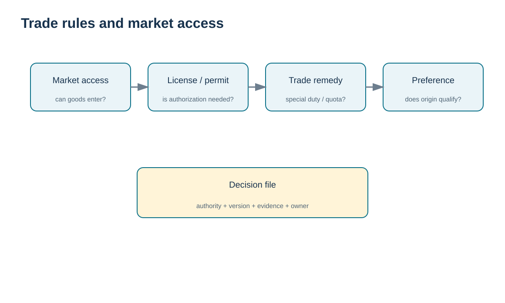
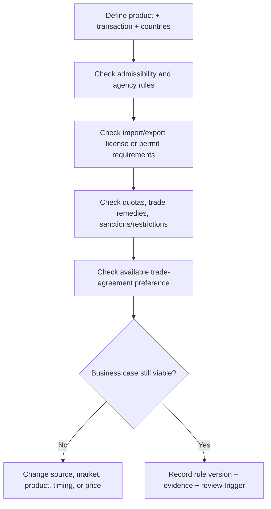

# 6. Trade Rules, Licensing, WTO Context, and Market Access

## Learning objectives

After this topic, you should be able to:

- separate product admissibility, licensing, trade remedies, quotas, and preferential treatment;
- explain the WTO role at a high level without treating it as a shipment-clearance agency;
- identify why local market access can remain difficult even when tariffs fall;
- build a rule-status record for changing trade requirements.

## Concept in plain English

International trade rules operate at several levels. **Domestic law** controls whether goods may enter or leave and what licenses, permits, markings, taxes, or agency reviews apply. **Trade remedies** can impose additional duties or restrictions in response to defined policy findings. **Quotas** can limit quantities or change treatment after a threshold. **Trade agreements** can reduce barriers for qualifying goods. Above these national systems, the **World Trade Organization (WTO)** provides a multilateral framework of trade rules and dispute mechanisms among members.

The WTO does not clear HarborPeak’s shipment and does not issue a blanket permit that overrides national law. Its agreements influence the rules member governments adopt and the way they treat trade, while customs and other domestic agencies administer actual border requirements.

Market access is therefore more than the headline tariff. Licensing, standards, infrastructure, documentation, local taxes, distribution requirements, bureaucracy, and purchasing power can all change the real commercial feasibility of a lane.

## Why it matters

A supply-chain network design can look attractive on freight and labor cost yet fail because the product cannot be imported as planned, a special duty destroys the margin, a quota creates uncertainty, or local certification takes longer than the demand window. Trade-rule scanning belongs in sourcing and network design, not only in shipment execution.

## Decision model and workflow

The visual turns the topic into a decision structure that can be audited and repeated instead of relying on shipment-by-shipment memory.

### Evidence retained through the workflow

Retain the product and market-access rule checked, responsible authority, license or permit need, restriction or quota status, exception basis, accountable owner, supporting evidence, and expiry or revalidation trigger.

## Practical process flow

## Realistic example — HarborPeak Equipment Systems

HarborPeak evaluates a new market for industrial control cabinets. The commercial team initially models normal duty and freight. The trade review adds a mandatory local product approval lead time and a possible additional measure on a key component family. The business case is revised before customer promises are made.

The lesson is not to memorize one country’s current rule. It is to keep **admissibility, license, remedy, quota, and preference** as separate questions that can each change.

## Applied decision artifact

| Rule dimension | Decision question | Evidence |
|---|---|---|
| Admissibility | May this product be imported/exported? | authority + rule reference |
| License / permit | Is prior authorization required? | license scope and validity |
| Quota | Does quantity/timing affect treatment? | quota status / allocation evidence |
| Trade remedy | Are special duties or measures applicable? | current official measure |
| Preference | Does an agreement reduce normal treatment? | origin qualification + claim support |
| Review trigger | What change invalidates the decision? | effective date / revision / product change |

## Decision logic

- Do not collapse market-access questions into a single “tariff rate” field.
- Check the official authority for the transaction date and product scope.
- Treat trade agreement preference as conditional on qualification, not on shipping between member countries alone.
- Model non-tariff lead time and evidence costs in the business case.
- Set review triggers for changes in product design, source, origin, jurisdiction, or trade measure.

## Trade-offs

More market-access analysis up front slows sourcing or market entry decisions, but it prevents false savings and infeasible launch plans. Broad use of specialists increases cost, yet the expense can be small compared with re-sourcing after a product fails a regulatory requirement.

## Commonly confused with

A **trade agreement** can create preferential treatment between members; it does not erase all domestic regulation. The **WTO** is a rules framework among governments, not a broker, freight forwarder, or customs clearance office.

## Common mistakes

- Assuming “free trade agreement” means every product is duty free.
- Ignoring rules of origin until goods arrive.
- Using a tariff rate copied from an old spreadsheet after the schedule changes.
- Treating market access as a procurement issue only after the sourcing decision is locked.

## Original knowledge check

**Question.** A good is shipped between two countries that are members of the same free-trade agreement. What must still be tested before claiming preferential treatment?

A. Only the carrier name

B. Whether the good satisfies the agreement’s applicable rules and claim requirements

C. Whether the shipment uses air rather than ocean

D. Whether the seller chose DDP

Answer and rationale

### Correct answer

**B. Whether the good satisfies the agreement’s applicable rules and claim requirements**

### Why it is correct

Membership alone does not make every good qualifying. The product must satisfy the agreement’s rules and the claim must be supported as required.

### Why the other answers are wrong

A, C, and D do not establish originating status.

## Practitioner perspective

Keep trade-measure and agreement determination logic outside static purchase-order text where possible. Reference a controlled rule or master-data version so the company can identify which open orders or shipments need reevaluation when a measure changes.

## Freshness checkpoint

Licensing, quotas, sanctions, market-access measures, and trade remedies can change quickly. Verify the current rule with the responsible government authority rather than relying on an older market-access assumption. See [Section C references](./REFERENCES.md).

## Related concepts

- [Section C overview](./README.md)
- [Section C references](./REFERENCES.md)
- [Section C review](./14-section-c-review.md)

---

[Previous: Customs Strategy](./05-customs-strategy-roles-brokers-and-preclearance.md) · [Section overview](./README.md) · [Next: Incoterms® 2020 Fundamentals](./07-incoterms-2020-fundamentals.md)