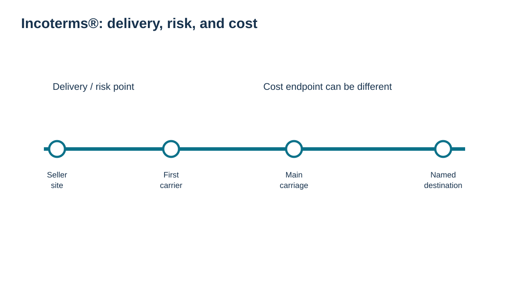
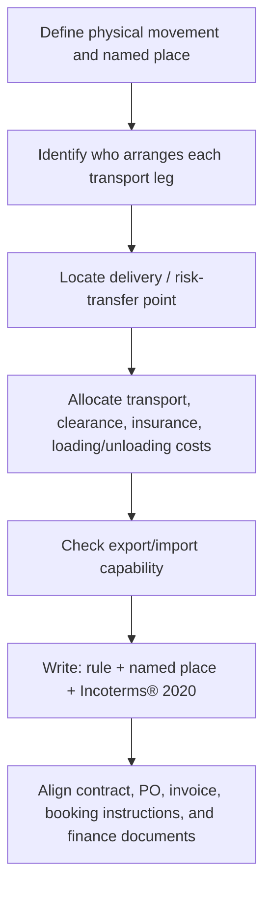

# 7. Incoterms® 2020 Fundamentals: Delivery, Risk, Cost, and Named Place

## Learning objectives

After this topic, you should be able to:

- explain what Incoterms® rules allocate between seller and buyer;
- distinguish delivery/risk transfer from the endpoint of paid carriage;
- state why the named place and edition year are part of the rule;
- recognize important matters Incoterms® rules do not resolve by themselves.

## Concept in plain English

Incoterms® are standardized International Chamber of Commerce rules used in contracts for the sale of goods. Incoterms® 2020 contains **11 rules**. They clarify three practical dimensions between seller and buyer: **obligations** (who does what), **risk** (where delivery occurs and risk transfers), and **costs** (who pays defined transport, clearance, insurance, loading/unloading, or related charges).

The most important discipline is to write the rule with a **precise named place or port and the edition**, for example `FCA [named place], Incoterms® 2020`. A three-letter acronym by itself is incomplete because the named place anchors key responsibilities.

Risk and cost do not always move at the same point. Under “C” rules such as CPT/CIP/CFR/CIF, the seller can pay carriage to a later destination even though delivery/risk transfer occurs earlier. That difference is a common source of misunderstanding.

Incoterms® rules also do **not** solve every contract issue. The sales contract still needs to address matters outside their scope, such as price/payment mechanics, transfer of ownership/title, product specifications, remedies, governing law, and other commercial terms.

## Why it matters

When sales, logistics, finance, and procurement interpret the same three-letter rule differently, costs leak and claims become difficult. A buyer may think “seller pays freight” means “seller has risk until destination,” or a seller may quote DDP without having the legal ability to complete import formalities in the destination. The rule must match the operating capability.

## Decision model and workflow

The visual turns the topic into a decision structure that can be audited and repeated instead of relying on shipment-by-shipment memory.

### Evidence retained through the workflow

Retain the agreed Incoterms® rule and edition, precise named place or port, transport mode, delivery/risk point, cost and clearance responsibilities, insurance obligation if any, and evidence that contract, carriage, and invoice data agree.

## Practical process flow

## Realistic example — HarborPeak Equipment Systems

HarborPeak sells a controller under a “seller-paid freight” concept. The salesperson assumes risk stays with HarborPeak until the customer’s dock. The trade team instead asks which rule is intended. If the commercial choice is a C-rule, seller-paid carriage can coexist with an earlier risk transfer. If the buyer requires seller risk through destination, a D-rule may better describe the intended delivery structure.

The decision insight is to **map the desired operating responsibilities first, then choose the acronym**—not the other way around.

## Applied decision artifact

| Contract-control field | What to capture |
|---|---|
| Rule | exact three-letter rule |
| Edition | Incoterms® 2020 unless parties deliberately agree otherwise |
| Named place / port | precise facility, terminal, port, or location |
| Delivery/risk point | operational interpretation for the chosen rule |
| Main carriage | arranging party and cost owner |
| Insurance | required party/coverage if rule imposes it; otherwise contract decision |
| Export/import clearance | responsible party and legal capability |
| Out-of-scope terms | payment, title, quality, remedies, law |

## Decision logic

- Start with the desired physical handoff, risk point, and control of carriage.
- Specify the named place precisely; do not use a country or city when the rule requires a more actionable point.
- State the Incoterms® edition in the contract.
- Separate risk transfer from freight payment.
- Check legal and operational ability to perform export/import obligations before selecting the rule.

## Trade-offs

Buyer-controlled carriage can provide rate visibility and consolidation control but increases the buyer’s operational burden. Seller-controlled carriage can simplify the customer experience but exposes the seller to transport management and potentially foreign compliance complexity. The “best” rule depends on capability and commercial strategy, not a universal ranking.

## Commonly confused with

Incoterms® **delivery** is the contractual handoff point defined by the rule. It is not automatically the same as physical arrival, payment date, or transfer of title. Incoterms® also do not determine tariff classification or rules of origin.

## Common mistakes

- Writing only “FOB” or “DDP” without a named place and edition.
- Assuming who pays freight also owns risk for the same distance.
- Using a sea-only rule for an unsuitable multimodal/containerized movement.
- Selecting DDP without confirming that the seller can legally and operationally complete import obligations.

## Original knowledge check

**Question.** Why can “seller pays the main freight” be an unsafe shortcut for identifying the risk-transfer point?

A. Freight is never paid by sellers

B. Some Incoterms® rules require seller-paid carriage even though delivery/risk transfers earlier

C. Risk is always transferred at invoice date

D. Incoterms® do not address transport

Answer and rationale

### Correct answer

**B. Some Incoterms® rules require seller-paid carriage even though delivery/risk transfers earlier**

### Why it is correct

The C-rules are a classic example: seller-paid carriage and the risk-transfer point are not the same endpoint.

### Why the other answers are wrong

A and C are false; D ignores a central purpose of Incoterms®.

## Practitioner perspective

Store Incoterm, location, and edition as separate controlled fields. Avoid embedding everything in a free-text PO note. The outbound delivery and freight instruction should derive from the same commercial master data so a mismatch can be detected before tendering.

## Freshness checkpoint

Confirm that the parties are using the intended Incoterms® edition and exact named place; do not infer title transfer, payment terms, or jurisdictional compliance from the trade rule itself. See [Section C references](./REFERENCES.md).

## Related concepts

- [Section C overview](./README.md)
- [Section C references](./REFERENCES.md)
- [Section C review](./14-section-c-review.md)

---

[Previous: Trade Rules and Market Access](./06-trade-rules-licensing-wto-and-market-access.md) · [Section overview](./README.md) · [Next: Incoterms® 2020 Selection](./08-incoterms-2020-selection.md)