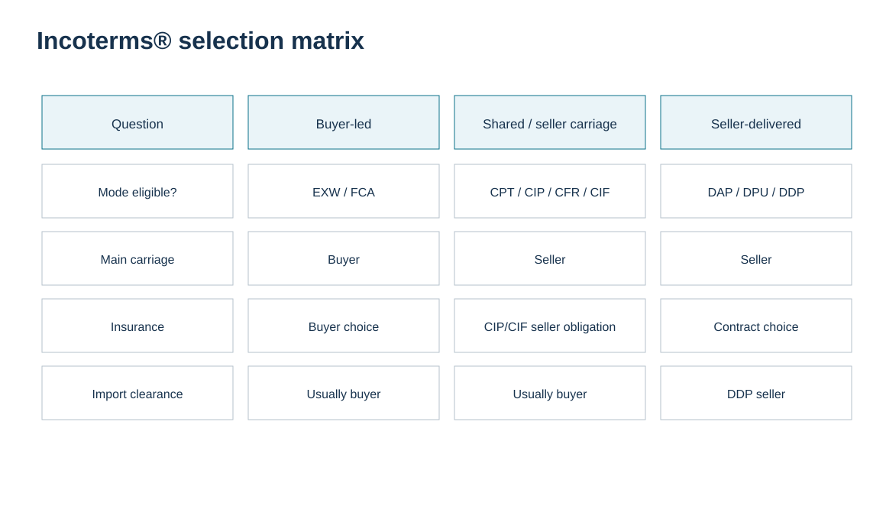
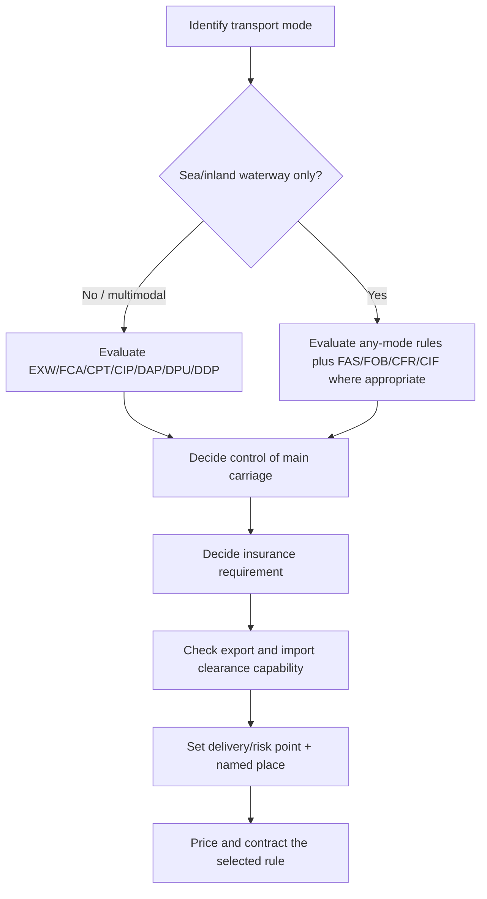

# 8. Incoterms® 2020 Selection by Mode and Commercial Strategy

## Learning objectives

After this topic, you should be able to:

- separate rules for any mode from sea/inland-waterway-only rules;
- select among buyer-led, seller-carriage, and seller-delivered structures;
- explain why FCA is often a stronger containerized/multimodal starting point than FOB;
- test insurance and import-clearance capability before finalizing the rule.

## Concept in plain English

Incoterms® 2020 divides the eleven rules into two groups. **Any mode or modes of transport:** EXW, FCA, CPT, CIP, DAP, DPU, DDP. **Sea and inland waterway transport:** FAS, FOB, CFR, CIF. The transport mode is therefore the first selection gate, but not the last.

A useful commercial spectrum is: **buyer-led origin control** (often EXW/FCA), **seller-arranged carriage with earlier risk transfer** (CPT/CIP and, for sea-only movements, CFR/CIF), and **seller-delivered destination responsibility** (DAP/DPU/DDP). The correct rule depends on who can control each leg, who can perform export/import clearance, whether seller-provided insurance is required, where the parties want risk to transfer, and whether unloading at destination is included.

For containerized or multimodal cargo, FCA is often a better fit than FOB because the delivery logic can match handoff to the carrier before ocean loading. FOB/FAS/CFR/CIF are designed for sea and inland-waterway movements where delivery is tied to the vessel/port context.

## Why it matters

A rule chosen because “we always use it” can create hidden work. The company may end up arranging transport it did not price, paying destination charges it did not expect, or taking on import obligations in a country where it lacks registration or representation. Mode and capability should constrain the choice before negotiation turns the term into a habit.

## Decision model and workflow

The visual turns the topic into a decision structure that can be audited and repeated instead of relying on shipment-by-shipment memory.

### Evidence retained through the workflow

Retain the alternatives considered, mode and named-place facts, buyer and seller operating capabilities, import/export clearance responsibilities, insurance requirement, selected rule and edition, and approval evidence for the choice.

## Practical process flow

## Realistic example — HarborPeak Equipment Systems

The locked [`incoterms-decision-cases.csv`](../../assets/data/module-5/incoterms-decision-cases.csv) gives seven fictional HarborPeak cases. **IC-01** is containerized and multimodal; the training recommendation is FCA HarborPeak’s Dallas dock because the buyer wants main-carriage control while HarborPeak can clear export. **IC-05** is an oversize breakbulk maritime movement where FAS at a named berth fits the intended handoff alongside the vessel.

These are training decisions, not universal prescriptions. If the parties’ capabilities or risk objectives change, the correct rule can change.

## Applied decision artifact

| Selection question | Why it matters |
|---|---|
| What mode(s) will move the goods? | determines whether sea-only rules are eligible |
| Who controls the main carriage? | affects rate/control and rule family |
| Where should risk transfer? | must match the negotiated commercial intent |
| Who must insure? | CIP and CIF impose seller insurance obligations; other rules differ |
| Who can clear export/import? | avoids assigning a duty to a party that cannot legally perform it |
| Who unloads at destination? | differentiates DAP from DPU in a key way |
| What exact named place? | anchors operational responsibility |

## Decision logic

- Eliminate mode-inappropriate rules first.
- Map the commercial intent for carriage, risk, insurance, and clearance.
- Check entity capability in the relevant countries before choosing DDP or another clearance-intensive structure.
- Price the operational burden; an Incoterm is not a free service choice.
- Publish the selected rule consistently to sales, purchasing, logistics, finance, and brokers.

## Trade-offs

More seller service can differentiate the offer and simplify buying, but it requires logistics capability and can expose the seller to destination complexity. More buyer control can lower costs and improve consolidation, but may be unattractive to customers without logistics expertise.

## Commonly confused with

**CIP** and **CIF** both involve seller-provided insurance, but they are not interchangeable: CIP is an any-mode rule and CIF is a sea/inland-waterway rule, and the default insurance expectations differ under Incoterms® 2020.

## Common mistakes

- Using FOB automatically for every ocean container.
- Selecting based only on which side “pays freight.”
- Ignoring destination unloading responsibilities.
- Quoting DDP before checking taxes, registrations, importer-of-record capability, and local restrictions.

## Original knowledge check

**Question.** A containerized shipment moves by truck from the seller to a container terminal and then by ocean. The buyer will control main carriage. Which rule family is the strongest starting place to evaluate?

A. Any-mode rules such as FCA

B. Sea-only rules must always be used because an ocean vessel is involved

C. DDP only

D. No Incoterm can be used for multimodal transport

Answer and rationale

### Correct answer

**A. Any-mode rules such as FCA**

### Why it is correct

Containerized multimodal shipments can fit the any-mode rules, and FCA is specifically useful when handoff to the carrier occurs before vessel loading.

### Why the other answers are wrong

B overgeneralizes; C imposes very different responsibilities; D is false.

## Practitioner perspective

Create an Incoterm decision table in sales and procurement governance, not just a list of codes. System validation can flag a sea-only rule against an air shipment or require a named place whenever the code is entered.

## Freshness checkpoint

Recheck the current ICC rules and the parties’ actual ability to perform export, import, carriage, unloading, and insurance obligations before placing the selected term into a live contract. See [Section C references](./REFERENCES.md).

## Related concepts

- [Section C overview](./README.md)
- [Section C references](./REFERENCES.md)
- [Section C review](./14-section-c-review.md)

---

[Previous: Incoterms® 2020 Fundamentals](./07-incoterms-2020-fundamentals.md) · [Section overview](./README.md) · [Next: Export-Import Intermediaries](./09-export-import-intermediaries.md)