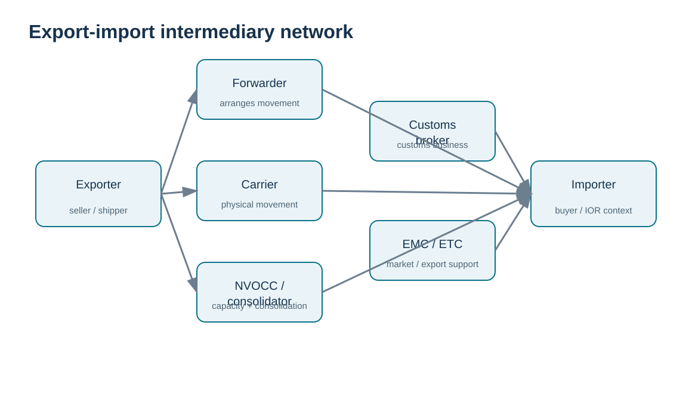
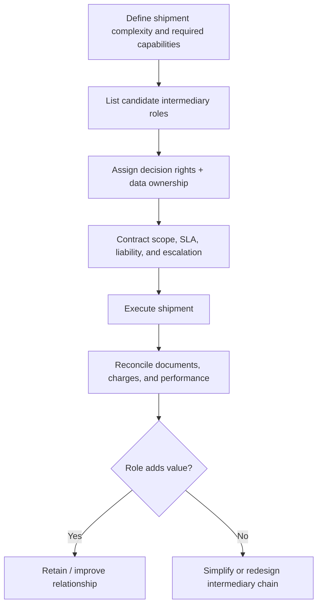

# 9. Export-Import Intermediaries and Responsibility Boundaries

## Learning objectives

After this topic, you should be able to:

- differentiate key trade intermediaries by role;
- explain how a freight forwarder differs from an NVOCC and customs broker;
- compare EMC and ETC commercial models at a high level;
- build a RACI that prevents responsibility gaps when several intermediaries touch one shipment.

## Concept in plain English

International shipments can involve many specialized participants. The **exporter** sells/ships the goods; the **importer** receives/buys and may carry customs responsibilities. **Domestic and overseas carriers** physically move cargo. A **freight forwarder** arranges transportation and can coordinate bookings, documents, insurance, tracing, and inland movement. A **non-vessel-operating common carrier (NVOCC)** can buy or contract for transportation capacity and resell space/services rather than operating the vessel itself. A **consolidator** combines shipments to use capacity efficiently.

A **customs broker** specializes in customs transactions under the applicable licensing framework. An **export management company (EMC)** can act like an external export department or long-term market/operating partner. An **export trading company (ETC)** is more oriented toward identifying goods it can purchase and resell in foreign markets. **Ship brokers/agents** and specialized export packers can support ocean transport and packaging needs.

The important management principle is not to memorize an org chart. It is to know **which party owns which decision, what data it receives, what authority it has, and what evidence returns to HarborPeak**.

## Why it matters

Every handoff creates both capability and risk. A specialist can make a complex lane feasible, but responsibility can disappear between organizations if everyone assumes another party owns the task. Duplicate intermediaries can also increase cost without adding control. The network should be intentionally designed for the shipment profile.

## Decision model and workflow

The visual turns the topic into a decision structure that can be audited and repeated instead of relying on shipment-by-shipment memory.

### Evidence retained through the workflow

Retain each intermediary’s assigned scope, required authority or qualification, contract and rate basis, booking/document responsibilities, handoff points, escalation owner, performance evidence, and conditions for replacing the provider.

## Practical process flow

## Realistic example — HarborPeak Equipment Systems

HarborPeak uses a forwarder for a European export because it needs booking, export documentation coordination, and inland transport. It separately uses a customs broker for the customer’s import entry where the customer has appointed that broker. The forwarder’s shipment status feed does not become the authoritative customs record; each role returns the evidence defined in its scope.

For a new small-market expansion, HarborPeak might evaluate an EMC if it needs continuing export-market support rather than only shipment execution. That is a commercial-channel choice, not merely freight procurement.

## Applied decision artifact

| Role | Core value | Key governance question |
|---|---|---|
| Freight forwarder | arranges transportation and related services | what decisions may it make without approval? |
| NVOCC | capacity/service without operating the vessel | what transport liability and document role applies? |
| Consolidator | combines shipments | how are cargo, cutoffs, and deconsolidation controlled? |
| Customs broker | customs-business expertise/execution | who approves classification/value/origin instructions? |
| EMC | outsourced export-management capability | is it an agent/consultant or taking another commercial role? |
| ETC | buys/resells into foreign markets | who owns customer, inventory, and market risk? |
| Ship agent/broker | vessel/port coordination | whose interests does the party represent? |

## Decision logic

- Start from needed capability, not from traditional use of a particular intermediary.
- Write a RACI for classification, value, origin, documents, booking, insurance, customs filing, and exception decisions.
- Give each intermediary controlled master data and instructions.
- Reconcile service provider outputs rather than assuming successful movement proves correctness.
- Periodically test whether the chain can be simplified without losing expertise or resilience.

## Trade-offs

More intermediaries can provide specialized expertise, local presence, and consolidation scale; they also create fees, data handoffs, and coordination risk. Direct contracting can improve control but requires internal staff and volume.

## Commonly confused with

A **forwarder** arranges transport; an **NVOCC** can operate as a carrier-like service provider without owning the vessel; a **customs broker** handles customs business. Commercial offerings may bundle these services, but the underlying roles remain different.

## Common mistakes

- Using “forwarder,” “broker,” and “carrier” as synonyms.
- Giving an intermediary authority that is not reflected in the contract or power of attorney.
- Failing to specify which party produces the final document set.
- Paying for overlapping intermediary functions without measuring value.

## Original knowledge check

**Question.** Which intermediary is most directly associated with conducting customs business on behalf of an importer under the applicable license/authorization?

A. Customs broker

B. Export packing company

C. Ship agent

D. Consolidator

Answer and rationale

### Correct answer

**A. Customs broker**

### Why it is correct

The customs broker role is specifically tied to customs-business expertise and authorized representation.

### Why the other answers are wrong

The other roles can support trade execution but do not inherently perform the customs-broker function.

## Practitioner perspective

Service-provider master data should distinguish role, legal entity, lane scope, licenses/permits where relevant, power-of-attorney status, bank/payment data, EDI/API endpoints, and SLA. Bundled providers should still have separate service scopes in governance and KPIs.

## Freshness checkpoint

Licensing and authority requirements for brokers, forwarders, carriers, and other intermediaries differ by country and service. Verify the provider’s current authority for the exact role being assigned. See [Section C references](./REFERENCES.md).

## Related concepts

- [Section C overview](./README.md)
- [Section C references](./REFERENCES.md)
- [Section C review](./14-section-c-review.md)

---

[Previous: Incoterms® 2020 Selection](./08-incoterms-2020-selection.md) · [Section overview](./README.md) · [Next: Export Documentation](./10-export-documentation-and-document-control.md)