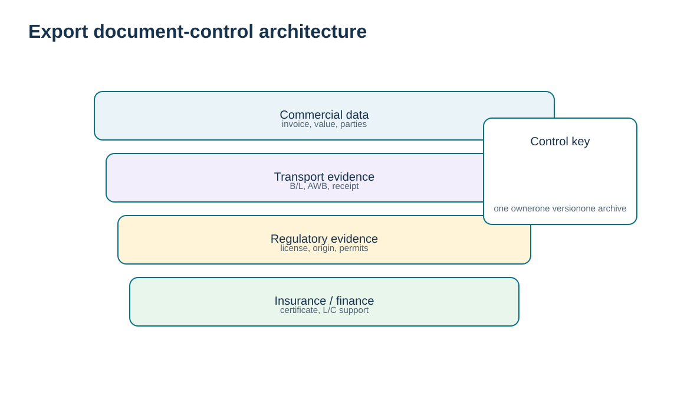
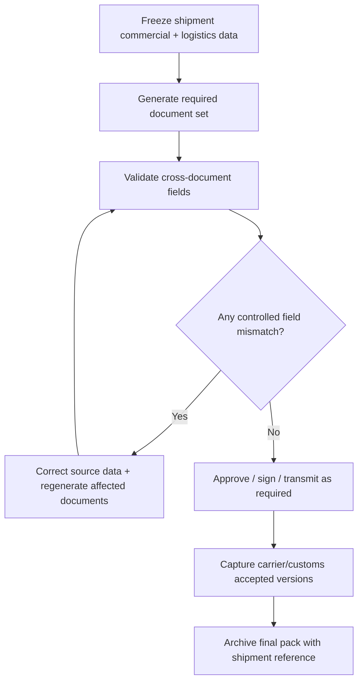

# 10. Export Documentation and Document-Control Architecture

## Learning objectives

After this topic, you should be able to:

- identify major categories of export and transport documents;
- explain the business purpose of commercial invoice, bill of lading, air waybill, origin, license, insurance, and carnet-type documents;
- design ownership and version control for the shipment document pack;
- recognize why one incorrect field can propagate across many documents.

## Concept in plain English

Trade documentation is a data architecture expressed as documents. The same core facts—seller, buyer, ship-to, goods description, quantity, value, currency, origin, classification, weights, transport route, and commercial terms—are reused across commercial invoices, transport documents, customs filings, certificates, licenses, insurance evidence, and financing documents.

Common documents include a **commercial invoice**; export declaration or filing; licenses when required; certificates of origin or other origin data; **bills of lading** for ocean and other carriage contexts; **air waybills** for air cargo; dock/terminal receipts; insurance certificates; and specialized transit/carnet documents such as ATA, TIR, or CMR instruments where applicable.

Because documents reuse the same data, the strongest control is not “proofread every PDF at the end.” It is to control the source data and define a document owner, generation point, approval rule, and final archive. The final document set must match what was actually shipped and filed.

## Why it matters

Document inconsistency is a classic cause of delay. A quantity changes after packing but not on the invoice; a consignee name differs between the airway bill and permit; a country-of-origin field uses a supplier address instead of an origin determination. Document control turns these from clerical surprises into governed change events.

## Decision model and workflow

The visual turns the topic into a decision structure that can be audited and repeated instead of relying on shipment-by-shipment memory.

### Evidence retained through the workflow

Retain the required-document checklist, document owner and source data, revision or issue date, cross-document consistency review, filing or presentation timestamps, acceptance status, discrepancies, and evidence of final closure.

## Practical process flow

## Realistic example — HarborPeak Equipment Systems

HarborPeak’s **TC-003** export has a pending export filing even though the physical cargo and invoice draft are ready. The section’s release rule prevents the warehouse from treating “paperwork will catch up” as a normal state. Once the filing is accepted, the accepted reference becomes part of the final document pack.

If a last-minute quantity change occurs, the document-control workflow identifies which documents and filings depend on quantity and requires regeneration/reconciliation rather than letting inconsistent versions circulate.

## Applied decision artifact

| Document / record | Primary purpose | Control focus |
|---|---|---|
| Commercial invoice | commercial value and transaction data | description, quantity, value, currency, terms |
| Transport document | evidence/instructions for carriage | shipper/consignee, packages, route, receipt status |
| Export filing/declaration | government export reporting/control | accepted filing data and reference |
| License/permit | authorization | scope, expiry, value/quantity/product limits |
| Origin evidence | supports origin statement or preference | qualification method and retention |
| Insurance certificate | evidence of required coverage | insured party, voyage, amount/terms |
| Carnet/transit document | temporary admission or controlled transit where applicable | jurisdiction, validity, seals/vehicle/goods data |

## Decision logic

- Define required documents by lane, product, mode, customer, and financing model.
- Generate documents from controlled data wherever possible.
- Cross-check the fields that repeat across documents.
- Treat changes after approval as version-controlled events.
- Archive the accepted/final version, not only the first draft.

## Trade-offs

Central document generation improves consistency but can become a bottleneck if every exception requires manual intervention. Local teams can respond faster but may create inconsistent templates and data rules. A hybrid model works when source data and minimum controls are global while local legal forms remain local.

## Commonly confused with

A **commercial invoice** supports the transaction and customs value but is not the same as a **bill of lading/air waybill**, which is a transport document. A **certificate of origin** is not automatically proof that a product qualifies for preferential treatment under every agreement.

## Common mistakes

- Manually retyping classification, origin, or value across documents.
- Failing to version a document after quantity or consignee changes.
- Assuming a carrier-generated document is correct because it was accepted for transport.
- Archiving drafts but not the final accepted filing/transport record.

## Original knowledge check

**Question.** A shipment quantity changes after the commercial invoice and transport instructions were generated. What is the strongest control?

A. Change only the warehouse pick quantity

B. Identify all dependent documents/filings, update the controlled source data, regenerate or correct them, and retain final versions

C. Ask the driver to explain the difference at the border

D. Ignore the difference if value is small

Answer and rationale

### Correct answer

**B. Identify all dependent documents/filings, update the controlled source data, regenerate or correct them, and retain final versions**

### Why it is correct

The problem is cross-document data consistency. The controlled response updates the source and every affected official record.

### Why the other answers are wrong

A leaves inconsistent records; C is too late; D makes materiality assumptions without a rule.

## Practitioner perspective

Document management should link the final file to shipment/delivery, customer order, material, and customs-entry/export-filing references. Electronic signatures, version hashes, and interface timestamps can improve evidence quality when legally appropriate.

## Freshness checkpoint

Document names, data elements, electronic-filing methods, retention rules, and certificate requirements vary by route and can change. Confirm the live shipment’s requirements with the competent authorities and counterparties. See [Section C references](./REFERENCES.md).

## Related concepts

- [Section C overview](./README.md)
- [Section C references](./REFERENCES.md)
- [Section C review](./14-section-c-review.md)

---

[Previous: Export-Import Intermediaries](./09-export-import-intermediaries.md) · [Section overview](./README.md) · [Next: Classification, Valuation, Duties, and Drawback](./11-classification-valuation-duties-and-drawback.md)