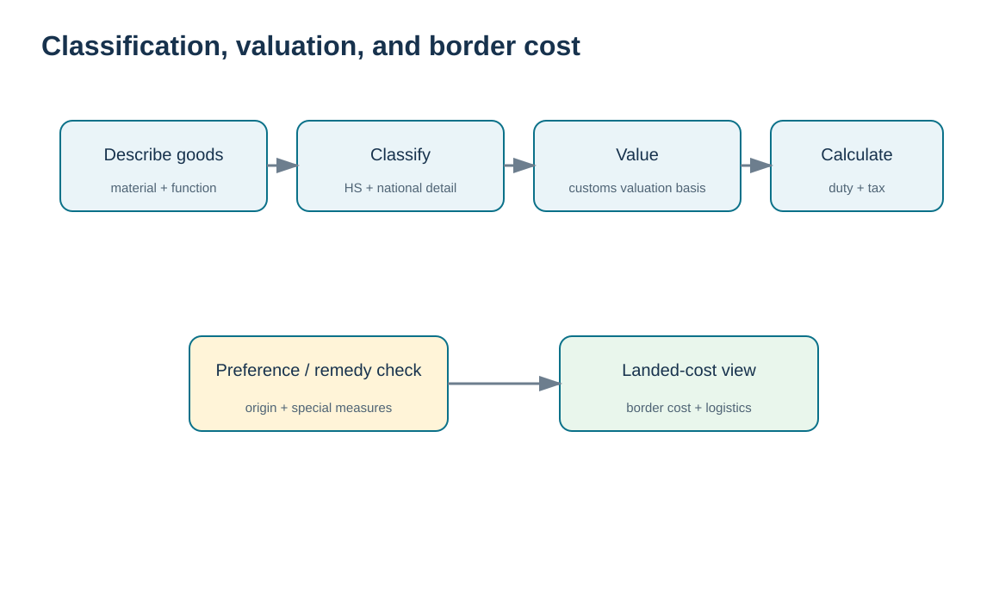
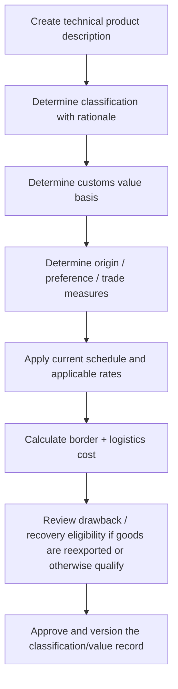

# 11. HS/HTS Classification, Valuation, Duties, Taxes, and Drawback

## Learning objectives

After this topic, you should be able to:

- explain the relationship between the international HS and national tariff schedules;
- separate tariff classification from customs valuation and origin;
- calculate a simplified training duty and landed-cost example;
- explain duty drawback as a recovery concept without treating it as automatic.

## Concept in plain English

Customs duty depends on more than the purchase price. Three core determinations are separate: **classification** identifies what the goods are under the tariff nomenclature; **customs value** determines the value basis under the jurisdiction’s valuation rules; **origin** determines where the goods legally originate for purposes such as marking, preference, or trade measures. Mixing the three creates weak decisions.

The **Harmonized System (HS)** provides the international six-digit foundation used by many customs administrations. Countries then extend that structure in national tariff/statistical schedules. In the United States, the **Harmonized Tariff Schedule of the United States (HTSUS)** is used for imports; U.S. export reporting uses Schedule B codes. Tariff schedules are revised during the year, so a classification record should include the schedule/version consulted and the effective transaction date.

A simplified training calculation can be expressed as:

```text
training duty = training customs value × training duty rate
training landed cost = customs value + duty + import tax + international freight + border/broker fees
```

Real customs valuation, tax bases, fees, trade remedies, and preferential rates can differ by jurisdiction and transaction. The dataset therefore uses **synthetic classifications and illustrative rates only**.

## Why it matters

Classification drives more than the duty rate. It can affect licenses, quotas, trade remedies, statistical reporting, and eligibility for a preferential agreement. Valuation affects the tax base. Origin can change both admissibility and treatment. A procurement team that compares suppliers only on invoice price can miss these border effects.

## Decision model and workflow



The visual turns the topic into a decision structure that can be audited and repeated instead of relying on shipment-by-shipment memory.

### Evidence retained through the workflow

Retain the classification rationale and tariff-schedule version, valuation method and additions, origin facts, duty/tax assumptions, drawback eligibility evidence, reviewer approval, calculation record, and the change that would force recalculation.

## Practical process flow



## Realistic example — HarborPeak Equipment Systems

The locked [`border-cost-classification-cases.csv`](../../assets/data/module-5/border-cost-classification-cases.csv) intentionally uses synthetic codes such as `SIM-85-01-10`. For **BC-01**, the training customs value is $82,000 and the training duty rate is 3.5%:

```text
training duty = 82,000 × 0.035 = $2,870
training landed cost = 82,000 + 2,870 + 0 + 4,100 + 1,280 = $90,250
```

The arithmetic is useful; the code and rate are not filing guidance. A real transaction must use the tariff schedule, measures, value rules, origin rules, and taxes effective for that transaction.

## Applied decision artifact

| Determination | Required evidence |
|---|---|
| Classification | technical description, composition/function, rationale, ruling/reference if used |
| Schedule/version | authority, revision/effective date |
| Customs value | invoice plus valuation adjustments/support |
| Origin | manufacturing facts and applicable origin rule |
| Duty/tax | applicable rate source and calculation |
| Trade remedy | special measure applicability check |
| Preference | agreement qualification and claim evidence |
| Drawback/recovery | eligibility, export/use evidence, matching records |

## Decision logic

- Describe the product technically before choosing a code.
- Version the classification against the tariff schedule used.
- Keep valuation and origin analyses separate from classification.
- Calculate normal treatment before applying a preference so the savings are visible.
- Treat drawback as an eligibility process requiring records, not a guaranteed refund.

## Trade-offs

Central classification governance improves consistency and auditability but can slow new-product setup. Decentralized classification is faster locally but can create conflicting codes for the same item. Binding rulings or specialist advice can reduce uncertainty but take time and may narrow future flexibility.

## Commonly confused with

**HS/HTS classification** says what the product is for tariff purposes; **origin** says where it originates under the applicable rule; **customs value** sets the value basis. A code alone does not prove origin or value.

## Common mistakes

- Copying a supplier’s code without independent review.
- Using an old tariff-rate spreadsheet without an effective date.
- Treating freight, assists, royalties, or other valuation elements as universally included/excluded without checking the jurisdiction’s rules.
- Assuming a preferential rate applies because the countries have an agreement.

## Original knowledge check

**Question.** Which statement best separates classification and origin?

A. Classification determines what the product is under the tariff nomenclature; origin is a separate determination under applicable origin rules

B. They are always the same field

C. Origin is determined only by the carrier route

D. Classification is set by the Incoterm

<details>
<summary>Answer and rationale</summary>

### Correct answer

**A. Classification determines what the product is under the tariff nomenclature; origin is a separate determination under applicable origin rules**

### Why it is correct

Classification and origin can interact with duty and preference, but they are distinct legal determinations supported by different evidence.

### Why the other answers are wrong

B, C, and D incorrectly collapse separate concepts.

</details>

## Practitioner perspective

Store classification at the right level of granularity—material, product variant, or jurisdiction-specific extension—with effective dates. Build change workflows when engineering changes material, function, composition, or source country, because those changes can invalidate a prior classification/origin decision.

## Freshness checkpoint

Classification numbers, tariff measures, duty rates, special programs, and valuation guidance change over time. Use the current importing-country tariff schedule and customs guidance for any real entry. See [Section C references](./REFERENCES.md).

## Related concepts

- [Section C overview](./README.md)
- [Section C references](./REFERENCES.md)
- [Section C review](./14-section-c-review.md)

---

[Previous: Export Documentation](./10-export-documentation-and-document-control.md) · [Section overview](./README.md) · [Next: Foreign-Trade Zones](./12-foreign-trade-zones.md)