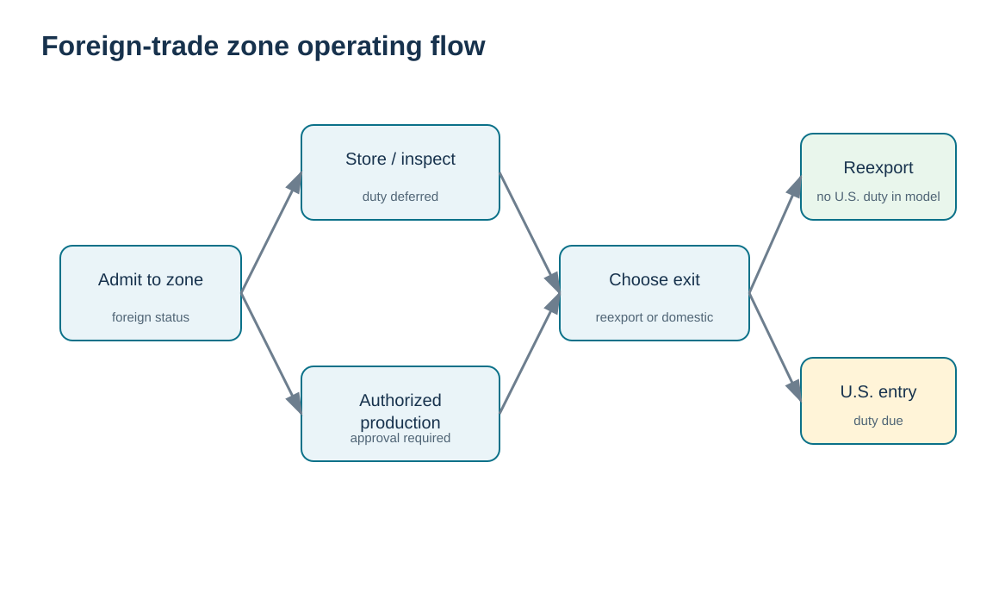
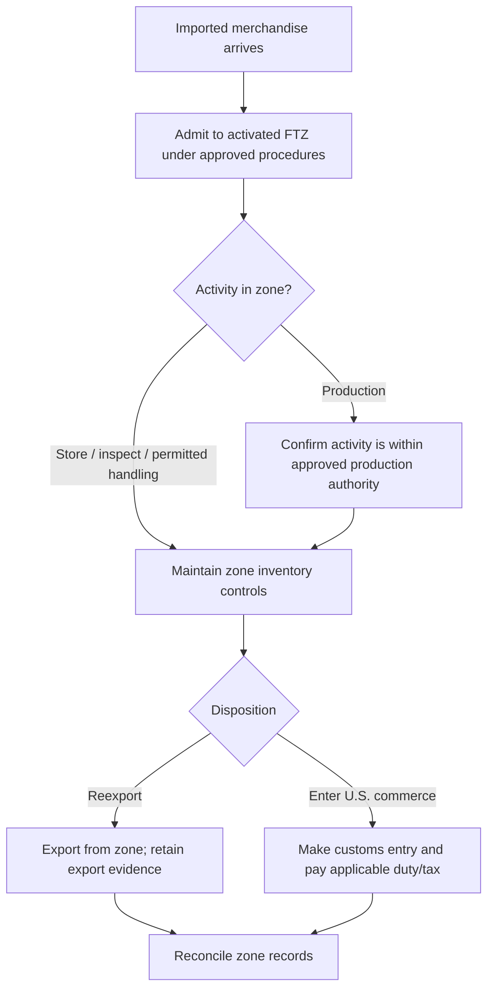

# 12. Foreign-Trade Zones: Duty Deferral, Production, and Compliance

## Learning objectives

After this topic, you should be able to:

- explain the operating purpose of a U.S. foreign-trade zone at a high level;
- distinguish duty deferral, reexport benefits, and authorized production from blanket exemption;
- identify why FTZ operations remain controlled and supervised;
- build a basic business-case screen for FTZ use.

## Concept in plain English

A U.S. **Foreign-Trade Zone (FTZ)** is a designated site where special customs procedures can be used under FTZ Board and CBP oversight. Foreign merchandise can be admitted before formal U.S. customs entry. If the goods are later reexported, U.S. customs duty generally is not paid on those reexports; if the goods enter U.S. commerce, duty payment is generally deferred until that entry.

This does **not** mean the zone is a law-free area, that every customs formality disappears, or that a company can freely manufacture anything without approval. FTZ activity remains subject to supervision, recordkeeping, security, and other U.S., state, and local laws. Production activity involving foreign-status merchandise requires advance authorization within the approved scope.

The supply-chain value comes from timing and structure: defer duty while inventory is held, avoid duty on qualifying reexports, potentially use approved production treatment, and gain certain procedural efficiencies. Those benefits must be compared with zone administration, inventory-control, security, system, and compliance costs.

## Why it matters

An FTZ can change working capital and network economics. A high-volume importer that holds inventory for months before U.S. consumption may value duty deferral. A distributor that reexports a meaningful share may avoid duties on those reexports. But a low-volume operation may not recover the cost of zone activation, inventory control, reporting, and governance.

## Decision model and workflow

The visual turns the topic into a decision structure that can be audited and repeated instead of relying on shipment-by-shipment memory.

### Evidence retained through the workflow

Retain zone admission and inventory identity records, status designation, authorized activity, duty treatment, manipulation/production approvals where required, transfer/withdrawal/reexport evidence, and reconciliation or audit records.

## Practical process flow

## Realistic example — HarborPeak Equipment Systems

HarborPeak evaluates an FTZ near a U.S. distribution center for imported drive components. Twenty-five percent of the components are expected to be reexported to Latin American service depots, and the remaining stock sits an average of 70 days before U.S. consumption. The team models the time value of deferred duty and avoided U.S. duty on reexports, then subtracts software, operator, broker, activation, audit, and control costs.

The decision is financial **and** operational. A projected duty saving does not justify a zone if the organization cannot maintain inventory identity, admission/disposition records, and authorized procedures.

## Applied decision artifact

| Business-case input | Question |
|---|---|
| Import volume/value | Is the duty base large enough to matter? |
| Reexport share | How much foreign merchandise leaves the U.S. without domestic entry? |
| Inventory dwell time | How long can duty payment be deferred? |
| Production | Is there an authorized production use case and approved scope? |
| MPF/procedural effects | Are streamlined procedures material to the operation? |
| Administration cost | systems, staffing, broker, security, audits, activation |
| Control maturity | can the site maintain zone inventory and compliance records? |

## Decision logic

- Confirm the site/operation is eligible and activated before assuming benefits.
- Separate storage/reexport benefits from production benefits that require authorization.
- Model cash-flow timing separately from permanent duty savings.
- Include administrative/control cost in the business case.
- Design zone inventory controls before moving volume into the program.

## Trade-offs

FTZs can improve cash flow and reduce duty on reexports, but the organization accepts more formal inventory-control and compliance obligations. Production can create additional value in some cases, yet it is not automatic and requires approved authority.

## Commonly confused with

An **FTZ** is a customs-program mechanism tied to a physical authorized site in the United States. A **free-trade agreement/trade bloc** is an agreement between governments that can change treatment for qualifying trade. They are not the same concept.

## Common mistakes

- Calling an FTZ “outside all U.S. law.”
- Assuming all manufacturing/assembly is automatically permitted.
- Counting duty deferral as permanent duty savings.
- Ignoring the cost of zone administration and inventory-control systems.
- Assuming a shipment with a compliance defect can simply be fixed in-zone without considering the actual rule and authorization.

## Original knowledge check

**Question.** Which statement best describes a U.S. FTZ benefit?

A. All laws and customs controls stop inside the zone

B. Duty can generally be deferred until goods enter U.S. commerce, and qualifying reexports can avoid U.S. duty

C. Every production activity is automatically approved

D. Retail trade is the primary purpose of the program

Answer and rationale

### Correct answer

**B. Duty can generally be deferred until goods enter U.S. commerce, and qualifying reexports can avoid U.S. duty**

### Why it is correct

Duty timing and reexport treatment are core FTZ benefits, while the zone remains supervised and controlled.

### Why the other answers are wrong

A and C overstate exemptions; D mischaracterizes the program.

## Practitioner perspective

FTZ inventory must reconcile physical and system status. ERP/WMS design should separate zone status, domestic status, privileged/nonprivileged status where applicable, admission references, and disposition. A zone business case without systems-control design is incomplete.

## Freshness checkpoint

Zone benefits do not remove customs control, and authorized activities differ by jurisdiction. Confirm current admission, production, duty, transfer, and reporting rules with the zone and customs authorities before implementation. See [Section C references](./REFERENCES.md).

## Related concepts

- [Section C overview](./README.md)
- [Section C references](./REFERENCES.md)
- [Section C review](./14-section-c-review.md)

---

[Previous: Classification, Valuation, Duties, and Drawback](./11-classification-valuation-duties-and-drawback.md) · [Section overview](./README.md) · [Next: Trade Blocs and Rules of Origin](./13-trade-blocs-rules-of-origin-and-agreement-status.md)