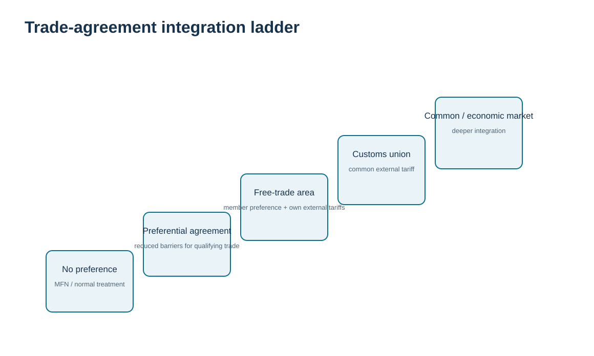

# 13. Trade Blocs, Preferential Agreements, Rules of Origin, and Agreement Status

## Learning objectives

After this topic, you should be able to:

- distinguish major forms of regional economic integration;
- explain why preference depends on rules of origin rather than shipping route alone;
- build an agreement-status freshness control;
- use USMCA as an example of why review dates and agreement status should be checked from current official sources.

## Concept in plain English

Countries can reduce trade barriers through different forms of regional integration. A **preferential trade agreement** grants defined preferences. A **free-trade area** removes or reduces barriers among members while members can retain their own external tariffs. A **customs union** adds a common external tariff. **Common markets** and **economic/monetary unions** represent progressively deeper integration of markets and policies.

For a company, the practical question is not “Are both countries in the bloc?” It is “Does this specific product meet the agreement’s applicable **rules of origin** and claim requirements for this transaction?” Origin rules can depend on tariff classification changes, regional value content, specific processing, wholly obtained status, or other product-specific criteria.

Agreement status also changes. Reviews, renegotiations, new measures, and implementation guidance can alter the business case. As of October 2026, USTR is preparing for the **2027 joint review of USMCA** and has opened a public consultation. That is exactly why a learning repository should teach a status-check process instead of freezing a review year into a permanent rule.

## Why it matters

Preferential duty can materially change sourcing economics, but unsupported preference claims create compliance exposure. Rules of origin also influence product design and supplier selection: a small change in a non-originating component can change qualification. The trade team therefore needs BOM/sourcing evidence, not only shipping documents.

## Decision model and workflow

The visual turns the topic into a decision structure that can be audited and repeated instead of relying on shipment-by-shipment memory.

### Evidence retained through the workflow

Retain the agreement and version in force, product classification, applicable rule of origin, BOM and sourcing facts, qualification calculation, certification/supporting records, approval owner, and every product or sourcing change that triggers requalification.

## Practical decision pattern

This topic is best understood as a **qualification-and-refresh loop** rather than a one-way shipment workflow: establish the agreement and product rule, qualify using current facts, support the claim, and requalify whenever the agreement, product, BOM, source, classification, or evidence changes.

## Realistic example — HarborPeak Equipment Systems

HarborPeak sources a control panel in Mexico and ships it to a U.S. plant. The company does not claim preference merely because the lane is Mexico-to-U.S. The trade team identifies the applicable product-specific origin rule, gathers component and production evidence, performs the required qualification, and retains the basis for the claim.

If a supplier changes a major component’s country of origin, the system triggers requalification. The preference is a **calculated and evidenced condition**, not a permanent material-master label.

## Applied decision artifact

| Agreement-control field | Purpose |
|---|---|
| Agreement | exact agreement and jurisdiction pair |
| Status / effective date | confirms the agreement and relevant provisions are in force |
| Product rule | applicable product-specific origin rule |
| BOM/source evidence | proves component origin and processing facts |
| Qualification method | tariff shift, value-content, specific process, etc. |
| Certification/claim data | required statement/data elements |
| Validity period | shipment/blanket-period control where permitted |
| Requalification trigger | supplier, BOM, classification, rule, cost, or agreement change |

## Decision logic

- Identify normal non-preferential treatment first.
- Confirm the agreement is in force and the transaction is within scope.
- Apply the product-specific rule of origin to current BOM/source facts.
- Retain the required certification/claim evidence.
- Requalify after material changes and periodically refresh agreement status.

## Trade-offs

Preference can reduce landed cost, but qualification and supplier-evidence maintenance cost money. Designing a product to qualify can improve duty economics but may reduce sourcing flexibility. A company should compare the value of preference with the resilience and commercial value of alternative sources.

## Commonly confused with

**Country of shipment** is not automatically **country of origin**. **Preferential origin** under a trade agreement can also differ from non-preferential origin concepts used for other purposes. A trade bloc can reduce barriers without eliminating all border procedures.

## Common mistakes

- Claiming preference solely because origin and destination countries are agreement members.
- Failing to requalify after a BOM or supplier change.
- Using an old origin certificate after its supporting facts change.
- Hard-coding a trade-agreement review timeline without checking current official status.

## Original knowledge check

**Question.** HarborPeak changes a major component supplier after a product was previously qualified for preferential treatment. What is the strongest response?

A. Keep claiming preference because the finished-good material number did not change

B. Reevaluate qualification using the new sourcing/BOM facts before relying on the prior result

C. Ask the carrier to decide origin

D. Change the Incoterm to preserve preference

Answer and rationale

### Correct answer

**B. Reevaluate qualification using the new sourcing/BOM facts before relying on the prior result**

### Why it is correct

Rules of origin depend on the facts used in the qualification. A sourcing change can change those facts and trigger requalification.

### Why the other answers are wrong

A ignores a material change; C and D do not determine preferential origin.

## Practitioner perspective

Origin qualification belongs close to BOM and procurement-source master data. Create requalification triggers for supplier changes, component origin changes, engineering changes, classification changes, and agreement-rule updates. A preference flag without an evidence date and rule version is weak governance.

## Freshness checkpoint

Trade-agreement status and rules of origin can be amended or reviewed. Confirm the agreement currently in force and the product-specific qualification rule before making a preference claim. See [Section C references](./REFERENCES.md).

## Related concepts

- [Section C overview](./README.md)
- [Section C references](./REFERENCES.md)
- [Section C review](./14-section-c-review.md)

---

[Previous: Foreign-Trade Zones](./12-foreign-trade-zones.md) · [Section overview](./README.md) · [Next: Section C Review](./14-section-c-review.md)