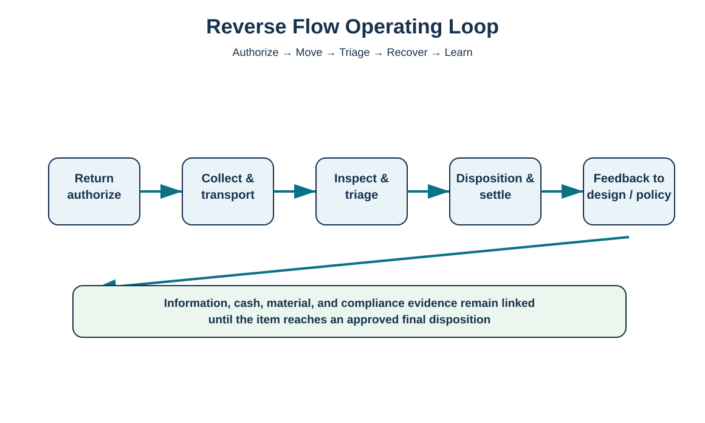
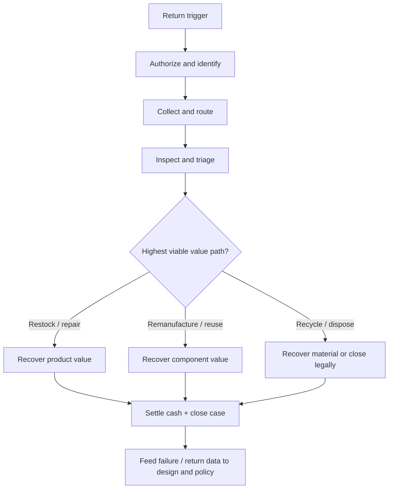

# 1. Reverse Logistics Operating Model

## Learning objectives

- define reverse logistics as an end-to-end operating system rather than a returns desk;
- distinguish reverse product, information, and cash flows;
- identify major disposition paths for returned products and materials;
- explain why the reverse chain may use different nodes than the forward chain.

## Concept in plain English

Reverse logistics begins when a product, component, package, or material needs to move backward from its current user or downstream node for a reason such as return, repair, recall, refurbishment, remanufacture, reuse, recycling, or controlled disposal. The movement is only one part of the job. A complete reverse system must also decide whether the return is authorized, preserve identity and condition information, settle credits or fees, route the item to the right capability, select a final disposition, and feed what was learned back into product and process decisions.

A useful mental model is **authorize → collect → triage → recover → learn**. Authorization prevents uncontrolled returns. Collection creates an efficient route. Triage determines condition and ownership. Recovery chooses the highest-value feasible outcome. Learning converts return reasons and failure data into design, supplier, service, packaging, or policy improvements. The path is not necessarily a mirror image of the forward network: a company may ship from many distribution centers but concentrate repair and remanufacturing in one specialist center.

## Why it matters

Without deliberate design, returned material tends to become slow-moving inventory with unclear ownership. Customer service may promise refunds before the warehouse confirms receipt, finance may not know the expected recovery value, and operations may mix saleable, repairable, and regulated material. The result is excess handling, long cycle time, write-offs, and poor customer experience. A controlled reverse chain makes the state of every return visible from initiation to closure.

## Decision model and workflow

The visual separates the five control stages and shows that the material movement is supported by linked information, cash, and compliance evidence.

### Evidence retained through the workflow

Retain return case ID, item/serial or lot identity when relevant, return reason, warranty/ownership status, authorization decision, physical condition, each custody/location change, accumulated cost or recovered value, final disposition, and closure date.

## Practical process flow

## Realistic example — HarborPeak Equipment Systems

In the locked [`reverse-flow-cases.csv`](../../assets/data/module-5/reverse-flow-cases.csv), case RF-05 covers 1,560 returned MX-12 drive assemblies out of 26,000 shipped units. That is a **6.0% observed return rate** for the training period. Some units may be repairable, some may support component recovery, and some may be candidates for material recycling. Sending every unit directly back to the manufacturing line would create congestion and mix different disposition needs. HarborPeak therefore uses a separate reverse-flow case, triage status, and approved routing decision before a unit enters repair, resale, or recovery inventory.

## Applied decision artifact

| Stage | Minimum control question |
|---|---|
| Authorize | Is the return permitted and who owns the decision? |
| Collect | Where should the item be routed and how should it be packaged? |
| Triage | What is the actual identity, condition, and risk status? |
| Recover | What is the highest viable value path? |
| Learn | What should change in design, supplier, service, packaging, or policy? |

## Decision logic

- Create a reverse case before material starts moving.
- Separate eligibility from physical disposition: an authorized return may still be scrap, and an unauthorized return may require customer support rather than movement.
- Use condition and economic gates to decide among restock, repair, refurbishment, remanufacture, component reuse, recycling, energy recovery, or disposal.
- Close both the material state and the financial state before the case is considered complete.
- Aggregate return reasons by product family so recurring failures become improvement inputs.

## Trade-offs

More return convenience can improve customer loyalty but increase return volume. Centralized processing can improve specialization and recovery yield but add transportation and time. Aggressive value recovery can be profitable, but testing every low-value return can cost more than the value recovered. The right design optimizes the stream, not the handling of one individual item.

## Commonly confused with

**Reverse logistics** is the operating system that manages backward flows and related decisions. **Returns management** is one important subset. A return can be resolved locally without a long reverse movement, while a reverse network may also handle recall stock, reusable packaging, end-of-life take-back, components, or process by-products.

## Common mistakes

- Treating the returns dock as the entire reverse supply chain.
- Issuing credit without linking it to receipt and disposition status.
- Sending every return to the original shipping node regardless of capability.
- Measuring only return quantity and not reason, cycle time, recovery value, or final disposition.
- Closing the customer case while the physical item remains unclassified.

## Original knowledge check

**Question.** A HarborPeak unit has been returned, the customer credit is complete, but the unit is still sitting in an unidentified quarantine location. Is the reverse case complete?

A. Yes, because customer settlement is the only objective

B. Yes, if the transportation provider shows delivery

C. No, because the physical status and final disposition are unresolved

D. No, unless the item is automatically sent back to the original factory

Answer and rationale

### Correct answer

**C. No, because the physical status and final disposition are unresolved**

### Why it is correct

Reverse logistics links customer settlement to the physical and information flows. An unresolved unit still carries inventory, compliance, and value-recovery risk.

### Why the other answers are wrong

A ignores the physical return, B proves only a transport event, and D assumes the original factory is always the correct reverse node.

## Practitioner perspective

In ERP/WMS/service environments, use a return/RMA object that can carry reason code, warranty status, inspection result, stock type, credit status, and disposition. Avoid using a generic goods receipt as the only reverse record; it rarely contains enough information to control the case end to end.

## Related concepts

- [Reverse Logistics Requirements, Strategy, and Implementation](./02-reverse-logistics-requirements-strategy-and-implementation.md)
- [Return Disposition and Value Recovery](./09-return-disposition-and-value-recovery.md)
- [Section D review](./14-section-d-review.md)

---

[Section overview](./README.md) · [Next: Reverse Logistics Requirements, Strategy, and Implementation](./02-reverse-logistics-requirements-strategy-and-implementation.md)