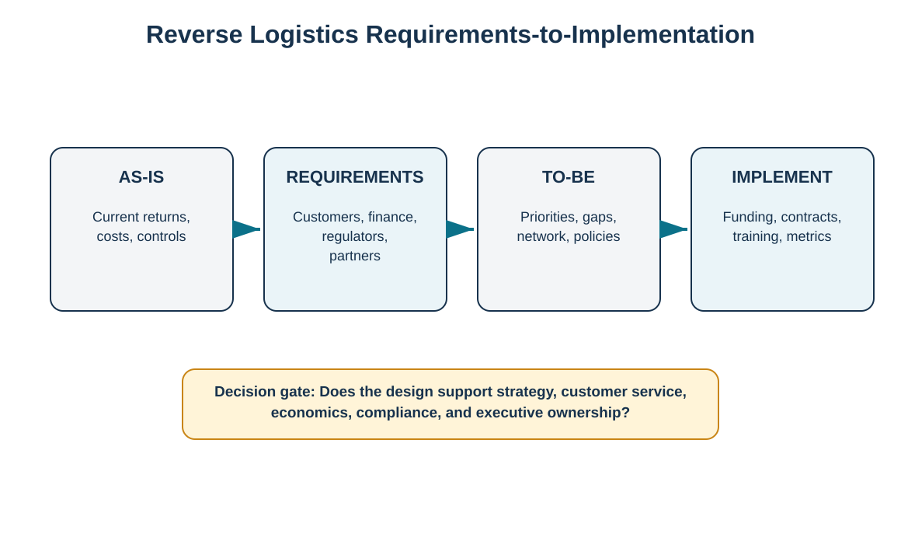
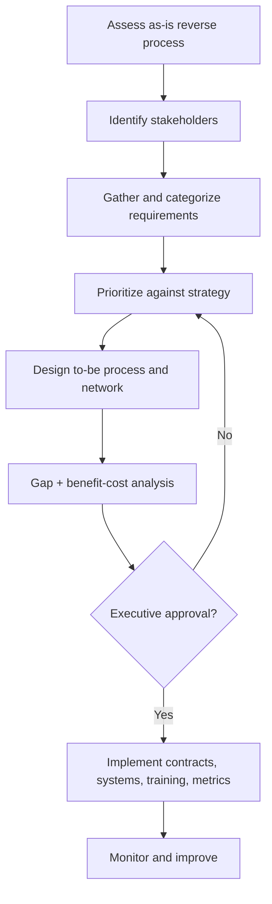

# 2. Reverse Logistics Requirements, Strategy, and Implementation

## Learning objectives

- structure a reverse-logistics improvement as requirements, design, and implementation work;
- identify the stakeholder groups that shape reverse-flow requirements;
- use gap and benefit-cost analysis to support strategic choices;
- translate the chosen design into projects, contracts, training, metrics, and governance.

## Concept in plain English

A reverse network should be designed the same way a forward operating model is designed: start from requirements rather than equipment or software. The first step is to understand the current process and the stakeholders affected by it. Customers may care about speed and simplicity. Finance cares about credits, reserves, write-offs, and recovered value. Operations cares about space, labor, safety, and capacity. Environmental and safety functions may impose controls on materials and final disposition. Service teams care about repair parts and turnaround time. External logistics or recovery partners care about packaging, pickup, acceptance specifications, and data.

Once requirements are collected, the team defines the desired future state, identifies gaps, and performs both quantitative and qualitative benefit-cost analysis. Implementation then requires funding, network or system changes, contracts, training, operating metrics, and continuous improvement. Reverse logistics is therefore not a one-time warehouse project; it is a governed capability that may change as the product moves through its life cycle.

## Why it matters

Organizations often discover reverse requirements only after returns surge, a new regulation becomes applicable, or a product is recalled. At that point the company is forced into expensive emergency handling. A requirements-first design brings those decisions earlier, when network capacity, product design, supplier terms, return policies, and information systems can still be shaped intentionally.

## Decision model and workflow

The four-stage model converts a vague “improve returns” objective into an auditable transformation path.

### Evidence retained through the workflow

Retain the current-state assessment, stakeholder list, requirement register, priority rationale, to-be process/network design, gap list, economic analysis, decision log, approved funding, implementation owners, training evidence, and operating KPIs.

## Practical process flow

## Realistic example — HarborPeak Equipment Systems

HarborPeak reviews RF-02, the PX-9 sensor kit, after returns rise to 1,440 units against 12,000 shipped in the training period (**12.0%**). Customer service wants immediate labels and credits, engineering wants failure data, finance wants tighter warranty controls, and the returns center lacks enough test capacity. A narrow project that buys more storage racks would not resolve the core requirements. The to-be design instead combines earlier troubleshooting, a defined RMA gate, expanded test capacity, serial-level failure capture, and a decision on whether overflow testing should be outsourced.

## Applied decision artifact

| Requirement category | Example evidence |
|---|---|
| Customer | promised turnaround, refund/repair rules, communication needs |
| Financial | credit policy, warranty reserve, recovery-value target |
| Operational | volume, condition mix, capacity, skills, handling requirements |
| Compliance | material/waste status, records, approved partners |
| Strategic | customer experience, sustainability, service-contract objectives |

## Decision logic

- Start with the as-is state and measurable pain points.
- Identify stakeholders for each product family rather than assuming one universal reverse process.
- Prioritize requirements using enterprise strategy and customer impact.
- Design policy, network, information, and disposition logic together.
- Use benefit-cost analysis to compare alternatives, including make-versus-buy choices.
- Implement with named owners, training, metrics, and feedback—not only a system configuration.

## Trade-offs

A highly customized reverse process can fit every product but become expensive and difficult to govern. A standardized process improves scale but may not fit products with different value, hazard, or service needs. Outsourcing can add expertise and variable capacity, but it can reduce direct control and require stronger partner governance and data integration.

## Commonly confused with

A **requirement** states what the reverse system must achieve or control. A **solution** is one possible way to meet it. “Return credit within 48 hours” is a requirement; “use a 3PL returns portal” is a proposed solution. Mixing these too early prevents fair comparison of alternatives.

## Common mistakes

- Starting by choosing a technology vendor before requirements are clear.
- Letting only logistics define the reverse process.
- Ignoring low-frequency but high-consequence regulatory or recall scenarios.
- Treating strategy as static across introduction, maturity, decline, and continuing support.
- Launching new procedures without change-management and KPI ownership.

## Original knowledge check

**Question.** A team proposes outsourcing all returns before documenting customer, repair, financial, and compliance requirements. What is the strongest next step?

A. Sign the 3PL contract because outsourcing is inherently lower cost

B. Document and prioritize requirements before choosing the operating model

C. Route every return to the nearest warehouse

D. Eliminate the RMA process to reduce administration

Answer and rationale

### Correct answer

**B. Document and prioritize requirements before choosing the operating model**

### Why it is correct

Make/buy and network decisions should follow requirements and benefit-cost analysis. Otherwise the organization may outsource the wrong scope or buy capacity that does not solve the actual problem.

### Why the other answers are wrong

A assumes the answer before analysis, C optimizes distance only, and D removes a control rather than designing one.

## Practitioner perspective

For transformation programs, map requirements to system capabilities and process controls. In SAP or another ERP landscape, distinguish what belongs in customer service, delivery/returns, quality inspection, repair/service, inventory, finance/credit, EHS, and partner systems. One transaction rarely owns the entire reverse flow.

## Related concepts

- [Reverse Logistics Operating Model](./01-reverse-logistics-operating-model.md)
- [Reverse Network Design and Make-or-Buy](./07-reverse-network-design-and-make-or-buy.md)
- [Reverse Information, Cash, and Product Flows](./03-reverse-information-cash-and-product-flows.md)

---

[Previous: Reverse Logistics Operating Model](./01-reverse-logistics-operating-model.md) · [Section overview](./README.md) · [Next: Reverse Information, Cash, and Product Flows](./03-reverse-information-cash-and-product-flows.md)