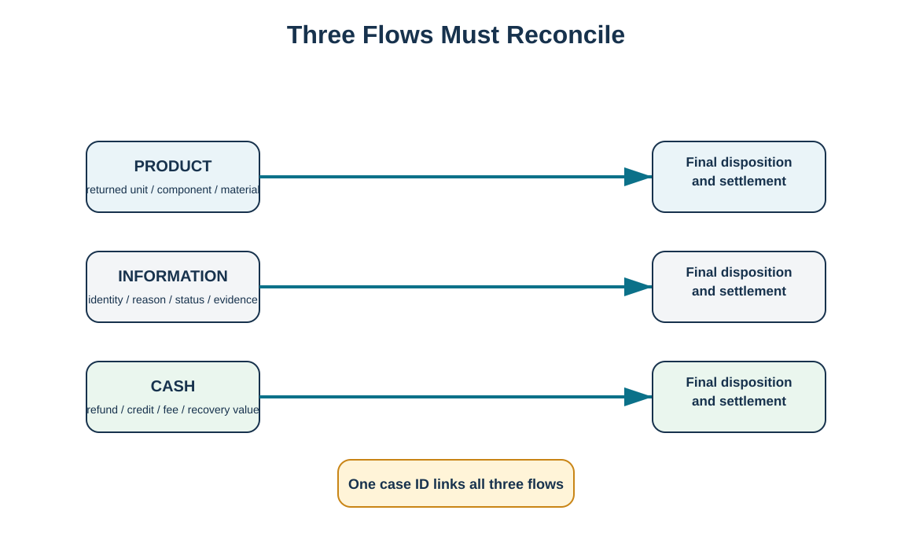
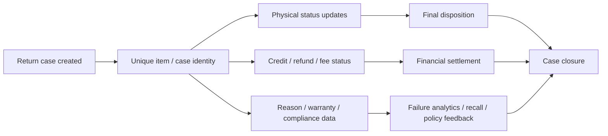

# 3. Reverse Information, Cash, and Product Flows

## Learning objectives

- explain how product, information, and cash move together in reverse logistics;
- define the minimum data needed to track a return from initiation to disposition;
- connect return data to recall, failure analysis, and product improvement;
- design controls that prevent credits and physical inventory from drifting apart.

## Concept in plain English

Reverse logistics contains three interdependent flows. The **product flow** is the physical unit or material moving backward. The **information flow** explains what the item is, why it returned, where it is, what condition it is in, and what decisions have been made. The **cash flow** includes refund, credit, warranty cost, repair fee, restocking fee, liquidation proceeds, recycling value, or disposal cost.

A return case should bind those flows together. If the physical item has a serial number or other unique identifier, the return record should carry it. Where subcomponents require traceability for recall, warranty, or material recovery, the information model may need component-level identity as well. The case should record each status change until the item reaches its final disposition and the financial settlement is complete. Return reasons should be coded consistently enough to support analysis; free-text notes alone make it difficult to identify systemic problems.

## Why it matters

When the three flows are disconnected, organizations pay twice: financially and operationally. A customer may be credited for a unit that never arrives, a returned unit may be physically repaired but still sit in blocked inventory, or a quality problem may generate repeated returns because engineering never receives structured failure data. Good reverse visibility protects cash, inventory accuracy, customer experience, and improvement.

## Decision model and workflow

The visual shows product, information, and cash moving in parallel toward a common case closure.

### Evidence retained through the workflow

Retain case ID, customer/partner, product and unique identifier when required, return reason, warranty/contract status, authorization date, carrier/tracking reference, receipt date, inspection result, location/status history, financial events, repair/recovery actions, compliance documents, and final disposition.

## Practical process flow

## Realistic example — HarborPeak Equipment Systems

RF-01 represents HX-400 controller returns. HarborPeak uses one return case identifier from customer authorization through receiving, inspection, credit, and final disposition. If a unit is restocked, the disposition record includes the accepted condition and new stock status. If it is refurbished, repair cost and resale value remain attached to the case. If the unit is scrapped, the final material route and any compliance evidence are recorded before closure. The same dataset can therefore support customer service, finance, operations, and engineering without maintaining separate unlinked spreadsheets.

## Applied decision artifact

| Flow | Typical status fields |
|---|---|
| Product | authorized, in transit, received, quarantined, tested, repaired, recovered, disposed |
| Information | reason, identity, warranty, condition, approvals, evidence |
| Cash | refund, credit, reserve, fee, repair cost, resale value, recycling value |
| Improvement | failure mode, supplier issue, packaging issue, design action |

## Decision logic

- Create the return case before or at authorization.
- Use controlled reason codes with optional free text.
- Capture financial events against the same case or a reliably linked object.
- Require inspection before changing stock from quarantine to a saleable or recoverable state.
- Feed aggregated failure/return information to quality, design, sourcing, and service.
- Close only after both material and financial states are reconciled.

## Trade-offs

More granular traceability improves analysis but adds data-capture effort. Serial-level history is valuable for high-value equipment and regulated components but may be unnecessary for low-value homogeneous material. Real-time integration improves visibility, yet the organization must first standardize statuses and reason codes or the integration will merely move inconsistent data faster.

## Commonly confused with

A **return reason** describes why the return started. A **disposition** describes what ultimately happened to the returned item. “Customer ordered wrong model” may be the reason; “inspected and restocked” may be the disposition. Combining them into one field destroys analytical value.

## Common mistakes

- Crediting customers before a return case exists.
- Using one status such as “returned” for every stage after receipt.
- Failing to capture warranty/contract ownership before repair costs are incurred.
- Losing serial or lot identity when units are consolidated.
- Closing the RMA when customer service finishes even though finance or inventory remains open.

## Original knowledge check

**Question.** Which design best supports reliable reverse logistics analytics?

A. One free-text comment per return

B. Separate unlinked spreadsheets for credit and warehouse status

C. A common return case linking identity, reason, status, financial events, and disposition

D. A return reason field that is overwritten with final disposition

Answer and rationale

### Correct answer

**C. A common return case linking identity, reason, status, financial events, and disposition**

### Why it is correct

A linked case preserves the relationship among the three flows and supports both transaction control and later analysis.

### Why the other answers are wrong

A is difficult to aggregate, B creates reconciliation risk, and D destroys the distinction between cause and outcome.

## Practitioner perspective

In integrated systems, define authoritative ownership for each status. For example, customer service may own return authorization, the WMS may own physical receipt, quality may own inspection, service may own repair completion, and finance may own credit. The end-to-end case should expose these statuses without making every function edit the same field.

## Related concepts

- [Reverse Logistics Operating Model](./01-reverse-logistics-operating-model.md)
- [Warranty Strategy and Hidden Liabilities](./05-warranty-strategy-and-hidden-liabilities.md)
- [Hazardous Waste Controls and Chain of Custody](./12-hazardous-waste-controls-and-chain-of-custody.md)

---

[Previous: Reverse Logistics Requirements, Strategy, and Implementation](./02-reverse-logistics-requirements-strategy-and-implementation.md) · [Section overview](./README.md) · [Next: Reverse Logistics Economics and Total-Cost Analysis](./04-reverse-logistics-economics-and-total-cost-analysis.md)