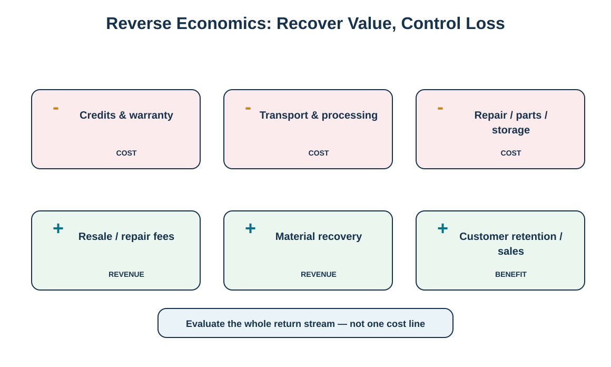
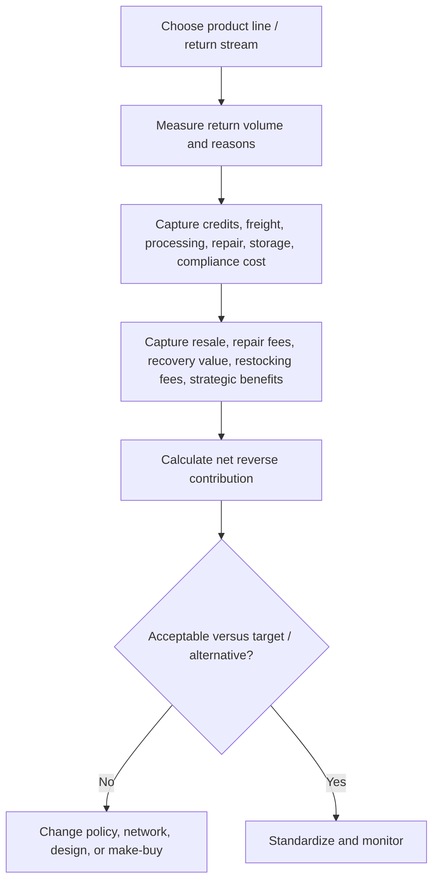

# 4. Reverse Logistics Economics and Total-Cost Analysis

## Learning objectives

- identify the major cost and value components of a reverse stream;
- calculate return rate and a simple net reverse contribution;
- explain why a low processing cost can still be a poor decision if recovery value is lost;
- use economic evidence in make-versus-buy and policy decisions.

## Concept in plain English

Reverse logistics economics should be evaluated at the level of a product family or return stream rather than one isolated activity. The cost side can include credits, warranty write-offs, reverse transportation, receiving, inspection, testing, repackaging, repair parts and labor, special storage, inventory write-down, compliance handling, and final disposal. The value side can include resale or liquidation proceeds, repair/service fees, restocking fees, recovered-material value, incentives, avoided purchase/disposal cost, and—where the organization has defensible evidence—commercial value associated with service contracts or warranty programs.

Two simple training measures are useful. **Return rate = units returned ÷ units shipped.** A simple **net reverse contribution = recovered revenue/benefits − reverse costs**. The second measure is not an accounting standard; it is a decision model. The organization must decide which benefits are sufficiently measurable to include and must keep hard cash recovery separate from softer strategic benefits.

## Why it matters

A warehouse can look efficient because its cost per return is low while it destroys value by sending repairable units to scrap. A liberal return policy can look expensive in reverse cost but support much higher customer retention and sales. Conversely, a complex refurbishment program can recover revenue yet cost more than liquidation. Total-cost logic prevents local optimization.

## Decision model and workflow

The diagram separates major loss drivers from potential recovery and strategic value sources.

### Evidence retained through the workflow

Retain units shipped/returned, return reasons, credits, transportation, processing, repair/parts, storage, write-down/disposal/compliance cost, recovered cash by type, modeled strategic benefits, assumption owner, and period.

## Practical process flow

## Realistic example — HarborPeak Equipment Systems

In [`reverse-cost-cases.csv`](../../assets/data/module-5/reverse-cost-cases.csv), RC-01 has $200,000 of modeled reverse costs: $120,000 credits + $22,000 transport + $18,000 processing + $28,000 repair/parts + $9,000 warehousing + $3,000 disposal/compliance. The modeled value side totals $223,000: $78,000 resale + $19,000 repair fees + $6,000 recycling + $8,000 restocking fees + $2,000 incentives + $110,000 estimated warranty-related sales uplift. The training **net reverse contribution is +$23,000**.

That does not prove the warranty program is profitable. The $110,000 commercial uplift is an estimate and should be sensitivity-tested separately from hard recovered cash. The example demonstrates why assumptions and evidence quality must remain visible.

## Applied decision artifact

| Measure | Training formula |
|---|---|
| Return rate | returned units ÷ shipped units |
| Direct recovery value | resale + fees + recycling/material value + incentives |
| Reverse cost | credits + transport + processing + repair/parts + storage + disposal/compliance |
| Net reverse contribution | selected recovery/benefits − selected reverse cost |

## Decision logic

- Calculate return rate by product family and reason; the same total rate can hide very different problems.
- Separate direct cash recovery from modeled strategic benefit.
- Include extra nodes and handling legs created only by reverse flow.
- Use sensitivity ranges for uncertain warranty, recovery yield, or secondary-market values.
- Compare internal and outsourced alternatives on the same scope and service assumptions.

## Trade-offs

Maximizing recovery percentage can increase processing cost and cycle time. Eliminating all returns through strict policy can reduce reverse cost but damage sales and loyalty. Central repair can improve labor utilization while increasing freight and time. Economic analysis should therefore be paired with service, quality, compliance, and strategic measures.

## Commonly confused with

**Gross recovery value** is not profit. A refurbished unit sold for $500 may have required a $300 credit, $40 transportation, $60 testing, and $80 repair. Measure the whole stream before claiming that the resale created $500 of value.

## Common mistakes

- Counting refunded sales as the only return cost.
- Treating estimated customer-loyalty value as cash without sensitivity analysis.
- Comparing a 3PL quote with internal cost while excluding internal overhead or retained activities.
- Ignoring write-downs and compliance/disposal costs.
- Optimizing cost per return while return volume is rising due to a product defect.

## Original knowledge check

**Question.** Which statement best reflects total-cost thinking in reverse logistics?

A. Choose the provider with the lowest transport rate

B. Always refurbish because resale creates revenue

C. Compare credits, transport, processing, repair, storage, compliance, and recovery value for the whole stream

D. Ignore customer-service benefits because they are never relevant

Answer and rationale

### Correct answer

**C. Compare credits, transport, processing, repair, storage, compliance, and recovery value for the whole stream**

### Why it is correct

The economic decision should consider the complete reverse stream and distinguish measurable recovery from uncertain strategic benefit.

### Why the other answers are wrong

A optimizes one line item, B assumes recovery is always economic, and D excludes a potentially strategic effect that should instead be estimated transparently.

## Practitioner perspective

Create a profitability or cost-to-serve view by product family, channel, and return reason. In ERP analytics, avoid a single “returns cost center” that prevents traceability to the products and policies creating the work. Even a simple monthly bridge from returned units to credits, processing cost, recovery value, and final write-off can materially improve decisions.

## Related concepts

- [Warranty Strategy and Hidden Liabilities](./05-warranty-strategy-and-hidden-liabilities.md)
- [Returns Authorization and Customer Experience](./06-returns-authorization-and-customer-experience.md)
- [Reverse Network Design and Make-or-Buy](./07-reverse-network-design-and-make-or-buy.md)

---

[Previous: Reverse Information, Cash, and Product Flows](./03-reverse-information-cash-and-product-flows.md) · [Section overview](./README.md) · [Next: Warranty Strategy and Hidden Liabilities](./05-warranty-strategy-and-hidden-liabilities.md)