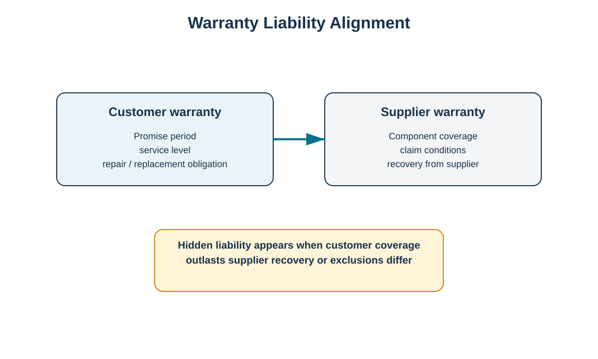
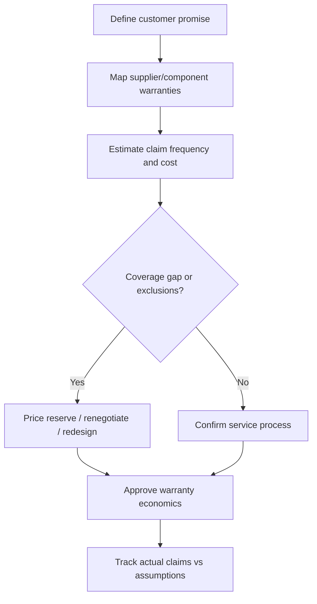

# 5. Warranty Strategy and Hidden Liabilities

## Learning objectives

- treat warranties as both a commercial promise and a reverse-logistics cost driver;
- identify coverage gaps between customer and supplier warranties;
- estimate expected warranty cost using transparent assumptions;
- connect warranty claims to parts, repair capacity, failure analysis, and reserves.

## Concept in plain English

A warranty can increase buyer confidence and support sales, but it also creates a service obligation that must be designed into the reverse supply chain. The organization needs a path to diagnose failures, decide repair versus replacement, source spare parts, move products, settle customer claims, and recover value from failed components.

One hidden exposure occurs when the warranty sold to the customer is broader or longer than the warranty received from a component supplier. HarborPeak may promise a three-year product warranty while a purchased power module is covered by the supplier for only one year. A failure in year two may still require free service to the customer even though HarborPeak cannot recover the component cost from the supplier. Similar gaps arise from exclusions, labor coverage, shipping responsibility, or different proof requirements.

A training planning estimate can use **expected warranty cost = units sold × expected claim rate × average covered claim cost**. Real accounting treatment, reserves, and recognition rules require finance guidance; the formula here is for operational capacity and risk planning.

## Why it matters

Warranty terms influence return volume, parts demand, service-center capacity, supplier negotiations, and product profitability. If the reverse network is designed after the commercial warranty is launched, the company may discover that it has promised turnaround time or geographic coverage it cannot economically support.

## Decision model and workflow

The visual highlights the exposure created when customer promises and supplier recovery do not align.

### Evidence retained through the workflow

Retain customer warranty terms/version, supplier/component warranty terms, claim eligibility reason, failure code, claim date, labor/parts/freight cost, supplier-recovery amount, reserve/planning assumption, and unresolved coverage exceptions.

## Practical process flow

## Realistic example — HarborPeak Equipment Systems

For RF-04, HarborPeak receives 504 LB-22 battery service modules. Assume, only for training, that 60% are within the customer warranty and the average covered logistics-plus-service cost is $118 per claim. The expected covered cost for those observed claims is `504 × 0.60 × $118 = $35,683.20`. If the supplier warranty covers only half of those component failures, HarborPeak must separately evaluate the unrecoverable gap. The point is not the specific amount; it is to make the coverage boundary visible before pricing and launching the promise.

## Applied decision artifact

| Warranty design question | Why it matters |
|---|---|
| What is promised? | sets customer expectation and liability boundary |
| For how long? | drives exposure duration and continuing support |
| Who pays freight/labor/parts? | determines reverse cost allocation |
| What do suppliers cover? | identifies recoverable versus retained cost |
| What proof is required? | affects authorization and customer effort |
| What service level is promised? | drives parts and repair capacity |

## Decision logic

- Map the customer warranty against supplier/component coverage before launch.
- Model claim volume and capacity across the warranty period.
- Separate covered defects from misuse, damage, commercial returns, and goodwill exceptions.
- Capture failure data for engineering and supplier quality.
- Reconcile supplier recovery to customer claim cost so leakage is visible.

## Trade-offs

A stronger warranty can support differentiation and loyalty but raises cost and uncertainty. Narrow warranties reduce financial exposure but may weaken market appeal. Replacing a whole product can be faster for the customer than repair, yet it can increase inventory and recovery workload. Supplier recovery terms can reduce cost but may add claim administration.

## Commonly confused with

A **warranty** is a promise defining covered service conditions. A **return policy** defines when goods may be returned for commercial or service reasons. A customer may return a nondefective item under a return policy even though no warranty claim exists.

## Common mistakes

- Copying supplier warranty terms into customer promises without checking gaps.
- Using historical claim rate from a mature product for a new product without adjustment.
- Failing to plan spare parts and repair capacity for continuing support.
- Allowing “goodwill” exceptions without reason codes and approval.
- Tracking customer refunds but not supplier warranty recoveries.

## Original knowledge check

**Question.** HarborPeak gives a 36-month product warranty, but a critical purchased module is covered by its supplier for 12 months. What risk should be quantified?

A. Only the customer selling price

B. The period in which HarborPeak may owe service but cannot recover component cost from the supplier

C. Only outbound freight for new sales

D. No risk, because supplier and customer warranties do not interact

Answer and rationale

### Correct answer

**B. The period in which HarborPeak may owe service but cannot recover component cost from the supplier**

### Why it is correct

Misaligned warranty periods can create retained cost that is easy to miss unless the coverage map is built before the promise is priced.

### Why the other answers are wrong

A and C ignore the service obligation, while D overlooks a direct economic relationship.

## Practitioner perspective

Link warranty eligibility, quality notification, repair order, component consumption, customer credit/replacement, and supplier claim where possible. This makes it possible to see whether a warranty problem is a customer-service issue, a supplier-quality issue, a design issue, or all three.

## Related concepts

- [Returns Authorization and Customer Experience](./06-returns-authorization-and-customer-experience.md)
- [Reverse Logistics Economics and Total-Cost Analysis](./04-reverse-logistics-economics-and-total-cost-analysis.md)
- [Product Life-Cycle Design for Reverse Logistics](./08-product-life-cycle-design-for-reverse-logistics.md)

---

[Previous: Reverse Logistics Economics and Total-Cost Analysis](./04-reverse-logistics-economics-and-total-cost-analysis.md) · [Section overview](./README.md) · [Next: Returns Authorization and Customer Experience](./06-returns-authorization-and-customer-experience.md)