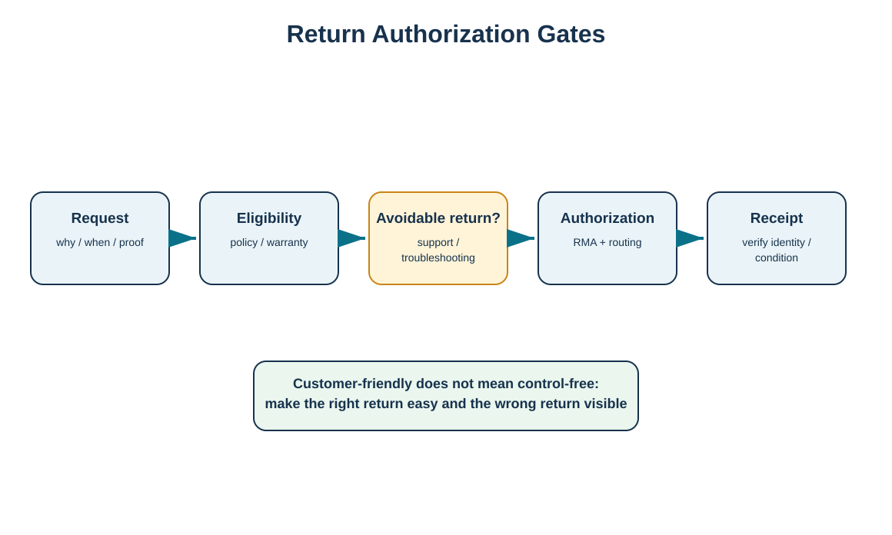
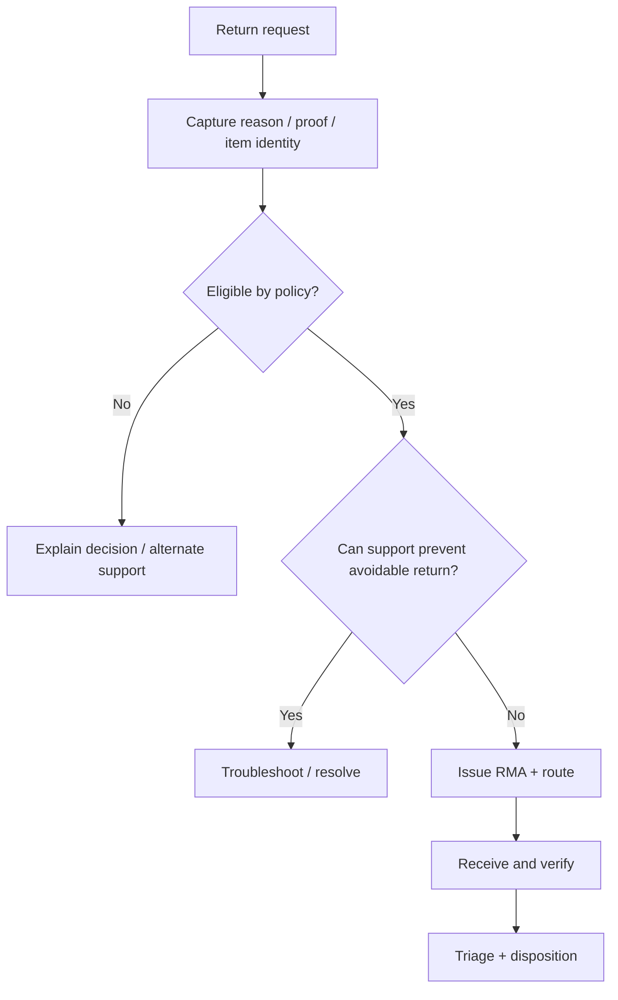

# 6. Returns Authorization and Customer Experience

## Learning objectives

- design a return authorization policy that supports strategy while controlling avoidable returns;
- distinguish eligibility, troubleshooting, authorization, and receipt verification;
- explain how liberal and restrictive policies create different service/cost trade-offs;
- use RMA controls without making the customer experience unnecessarily difficult.

## Concept in plain English

A return authorization policy answers who can return what, for what reasons, during what period, under what condition, with what evidence, and to which destination. A well-designed policy is explicit enough to control abuse and routing but simple enough that legitimate customers do not need to fight the process.

The RMA—or equivalent return authorization—is a control object, not a punishment. It captures identity, reason, eligibility, routing, expected quantity, and ownership before material arrives. Some returns can be prevented by troubleshooting, configuration support, a replacement accessory, or clearer instructions. Preventing an unnecessary physical return is usually higher value than processing it efficiently after it has shipped back.

Policies may differ by channel. A B2C return program may prioritize convenience and prepaid labels. A B2B agreement may specify consolidation, minimum return quantities, scheduled pickups, or advance inspection because the economics differ.

## Why it matters

Return policy affects both sales and reverse cost. Very restrictive rules can suppress legitimate returns but damage trust. Extremely liberal rules can increase customer confidence while also increasing volume, fraud exposure, processing cost, and inventory uncertainty. The organization needs data on both customer outcomes and reverse cost to know whether the policy is working.

## Decision model and workflow

The visual separates eligibility from avoidable-return prevention and from physical receipt verification.

### Evidence retained through the workflow

Retain policy/version, request date, customer/channel, item identity, stated reason, eligibility result, troubleshooting performed, authorization number, return-by date, routing instruction, expected quantity, receipt verification, exceptions, and customer outcome.

## Practical process flow

## Realistic example — HarborPeak Equipment Systems

HarborPeak sees RF-01 HX-400 controllers returned for “setup mismatch.” Before automatically issuing a shipping label, the RMA workflow asks whether the device is defective or whether configuration support can solve the problem. If remote support resolves the mismatch, the customer keeps the unit and the reverse move is avoided. If the unit truly needs to return, the RMA determines destination and expected serial number before receipt. This protects customer service while reducing avoidable transportation and handling.

## Applied decision artifact

| Gate | Decision |
|---|---|
| Request | Is identity and reason sufficiently clear? |
| Eligibility | Does contract/policy/warranty allow the return? |
| Avoidable return | Can support solve the issue without moving the item? |
| Authorization | What RMA, route, packaging, and timing apply? |
| Receipt | Did the expected item and condition actually arrive? |

## Decision logic

- Publish and version the return policy so sales, service, and customers receive the same answer.
- Use reason-specific troubleshooting where an avoidable return is plausible.
- Issue routing instructions as part of authorization, not after shipment.
- Verify identity and condition at receipt before final financial settlement when the policy requires it.
- Track policy exceptions and their commercial reasons.

## Trade-offs

A liberal policy may increase sales and loyalty but raises return volume. Troubleshooting reduces avoidable returns but can frustrate customers if it becomes a barrier. Requiring B2B consolidation improves freight economics but delays credit. Prepaid returns improve convenience but shift freight cost to the seller.

## Commonly confused with

An **RMA** authorizes and controls the return transaction. It does not automatically mean the item is accepted as defective, under warranty, or suitable for resale. Those decisions may occur after receipt and inspection.

## Common mistakes

- Treating the RMA number as proof of defect.
- Using policy complexity to discourage legitimate customers.
- Failing to route high-risk or regulated returns differently.
- Letting customers send returns to any warehouse.
- Ignoring “no fault found” returns as a source of product-documentation or training improvement.

## Original knowledge check

**Question.** What is the strongest response when a reported return reason can often be resolved through configuration support?

A. Require the customer to ship the item first in every case

B. Use a troubleshooting gate that can resolve the issue without blocking legitimate returns

C. Reject all returns with that reason code

D. Credit the customer immediately and do not track the physical item

Answer and rationale

### Correct answer

**B. Use a troubleshooting gate that can resolve the issue without blocking legitimate returns**

### Why it is correct

Preventing an avoidable physical return can reduce cost and improve speed, provided the process remains customer-friendly and preserves the right to return when appropriate.

### Why the other answers are wrong

A creates unnecessary movement, C is too rigid, and D creates reconciliation risk.

## Practitioner perspective

Configure return reasons, eligibility rules, and follow-on actions so the system can distinguish commercial returns, warranty claims, repairs, recalls, vendor returns, and end-of-life take-back. One generic return type usually produces weak routing and weak analytics.

## Related concepts

- [Warranty Strategy and Hidden Liabilities](./05-warranty-strategy-and-hidden-liabilities.md)
- [Return Disposition and Value Recovery](./09-return-disposition-and-value-recovery.md)
- [Reverse Information, Cash, and Product Flows](./03-reverse-information-cash-and-product-flows.md)

---

[Previous: Warranty Strategy and Hidden Liabilities](./05-warranty-strategy-and-hidden-liabilities.md) · [Section overview](./README.md) · [Next: Reverse Network Design and Make-or-Buy](./07-reverse-network-design-and-make-or-buy.md)